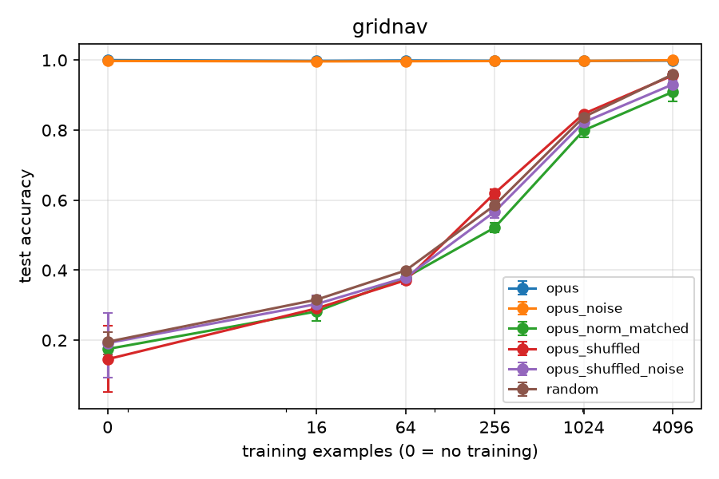
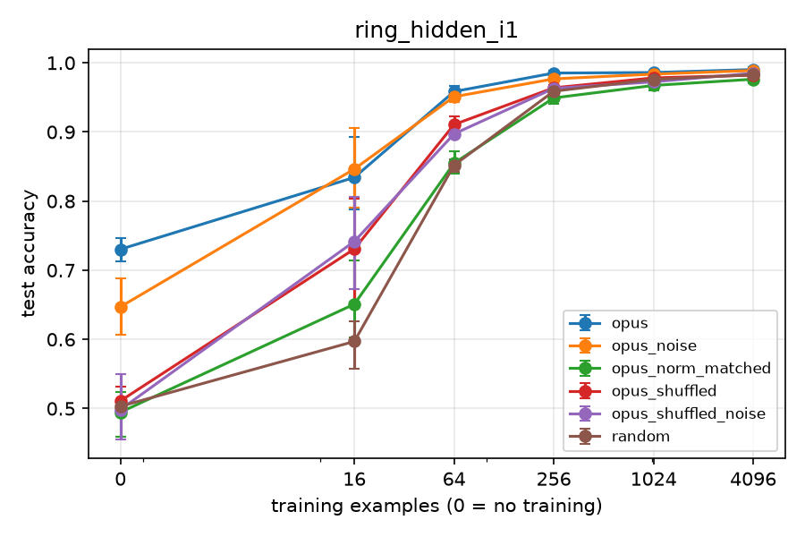
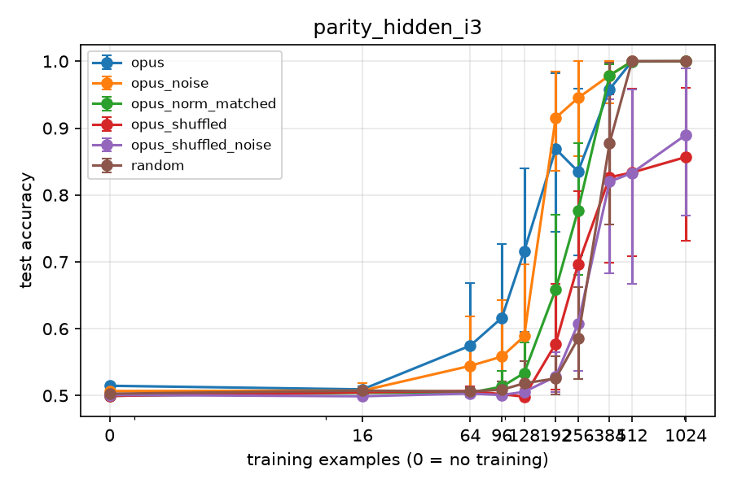

# How much training data is an AI-written network worth?

*By Garrett (Stanford EE). Draft, November 2026. Code, configs, audits and redacted agent transcripts: [github.com/garrettlii/written-init](https://github.com/garrettlii/written-init).*

In early November, MIT CSAIL researchers showed that a frontier model can write the weights of small neural networks directly, by reasoning about what each layer should compute ("Sparks of Weight-Space Programming", Takehi, Teoh, Zhang and Khattab). They mostly evaluated those networks as finished products. I wanted to ask a different question: if you use an agent-written network as the *starting point* for ordinary training, how many labeled examples is it worth?

So I had a coding agent write the weights of small networks from a task description alone, with no data and no ability to run code. Then I fine-tuned those networks on 16 to 4,096 examples and compared them with randomly initialized networks trained the same way.

The short answer depends on what the agent knows. When its knowledge covers the whole task, the written network is worth thousands of examples. When it knows the algorithm but not the specifics, it depends on what's left to learn: a ring's two radii were learned with 1.8-3.9x less data, but a grid's wall layout still took thousands of examples. When the hard part is a search for which inputs matter, knowledge makes early success possible in about half of training runs, but cuts the data needed for reliable success by only 1.05-1.23x. And when the hard part is perceptual (recognizing handwritten digits), the gain is small and gone by a few hundred examples.

## The setup

**The agent.** Claude Code (version 2.1.318, model Opus 5.5) ran headless in a fresh temporary folder for each sample. It could read and write files there and nothing else: no shell, no web, no subagents. It received a task description and a fixed architecture, and had to write a `build.py` that returns every weight as a numpy array. The rules forbade generating labeled examples, fitting, solving for weights, and randomness. Every script passed static checks, and every sample was audited by hand (with Claude Code's help) before use. I generated three samples per task (four for digits, one of which I excluded; see below).

**Training.** Small ReLU MLPs (1k to 15k parameters), plain numpy, AdamW with batch size 64 for up to 3,000 steps. Learning rate and weight decay came from a 10-setting grid, selected by accuracy on 256 held-out validation examples, with early stopping. The untrained network was always a candidate, so if training only hurt, validation could pick "don't train". Every arm got exactly the same grid, budget and validation set. For a given seed, every arm trained on the same examples.

**Arms.** Besides random initialization and the written weights, three controls separate *what* the written weights encode from *how large* they are:

| arm | what it tests |
|---|---|
| random | standard He initialization |
| written | the agent's weights, as written |
| written + noise | written weights plus small Gaussian noise |
| shuffled + noise | written values randomly permuted within each tensor, plus the same noise (structure control) |
| norm-matched | random directions rescaled to each written tensor's norm (scale control) |

The main metric is a **data multiplier**: if the written arm reaches some accuracy with *n* examples and random needs *m*, the multiplier is *m/n*. The analysis refuses to report a multiplier where it would be noise: near chance, when both arms are at 100%, or where random's learning curve is flat. Every interpolated value comes with the bracket it was interpolated in.

## Phase 1: tasks where the agent is told everything

Four tasks, each fully specified:

- **sparse parity:** 16 random bits, label = XOR of 4 named bits
- **ring:** is a 2D point inside a ring with radii 0.4 and 0.75?
- **gridnav:** 9x9 grid, a scripted expert's next move toward a goal, rule given exactly
- **digits:** scikit-learn's 8x8 handwritten digits, where the agent can only rely on what it knows about how digits look

| task | written, before training | random, at its largest budget | written init is worth |
|---|---|---|---|
| gridnav | 100% | 95.9% at 4,096 | more than 4,096 examples |
| ring | 99.9% | 98.5% at 4,096 | more than 4,096 examples |
| sparse parity | 100% | 100%, first reached between 256 and 1,024 | 256 to 1,024 examples |
| digits | 51% | 97.6% at 1,000 | 1.33x at 16 examples, nothing after ~256 |

On the first three tasks the agent simply solved the problem. Its networks were correct before any training, and training had nothing left to add. The multipliers are lower bounds, because random never caught up within the budgets I gave it.

*Figure 1. Phase 1 gridnav, where the agent was given the rule exactly (5 seeds). The written network ("opus") is right before any training and stays there. Random reaches 95.9% at 4,096 examples, and the norm-matched and shuffled controls train roughly like random. Points are means over seeds with 95% bootstrap CIs. In all figures, opus = written, opus_noise = written + noise, opus_shuffled_noise = shuffled + noise, opus_norm_matched = norm-matched, and opus_shuffled = shuffled without noise (a secondary control).*

Digits is the interesting control. The written networks start at 35.8-62.1% accuracy, give a 1.33x data advantage at 16 examples (95% CI 1.00-1.88), and lose it by 256. At 1,000 examples they are slightly *behind* random (0.80x, CI 0.62-1.00). The controls explain why. Norm-matched and shuffled versions of the written weights train worse than random (point estimates 0.58x to 0.84x from 64 examples on; 2 of their 9 CIs reach 1), so the scale of hand-written weights is itself a mild handicap for gradient descent. The written init's net effect is useful structure minus that cost, and once the structure stops helping, the cost shows.

Two smaller findings from Phase 1:

- **Structure, not scale.** On every task, written weights beat both the shuffled and the norm-matched controls. Adding noise to the written weights never helped, and on the ring it wrecked the zero-shot network (99.9% to 66.7%).
- **Confident networks survive fine-tuning.** The few written networks that lost a little accuracy during training (gridnav and ring, down to 99.0-99.9%) were the low-margin ones. Networks written with large logit margins came through untouched. That's 1-2 seeds per sample, so treat it as a hint.

### The agent remembered the dataset

One digits sample classified by comparing inputs against 23 hand-drawn prototype images, "based on how typical load_digits samples look," according to its notes. When I checked those prototypes against the real dataset, 9 of them were near-exact copies of dataset images 0 through 8, in order. Each was closer to one specific real image (distances 0.13-0.22) than any two real images are to each other (minimum 0.33), with up to 64 of 64 pixels matching after rounding. One of them was in my test set.

That's memorized data, not knowledge of what digits look like, so I rejected the sample. I then adopted a rule: any digits sample containing a near-copy of a real image is excluded. I wrote that rule *after* seeing this sample, and 1 of the 4 digits samples I generated was excluded under it. The check that caught it was nearest-image distance. Correlation with class averages, the obvious first test, would have missed it.

## Phase 2: the agent knows the algorithm, not the details

Phase 1 left a gap. Since the agent solved three of four tasks outright, it barely tested what written weights are worth *during* training. So for Phase 2, which I pre-registered before generating anything, the agent was told the algorithm but not its parameters:

| family | told | hidden |
|---|---|---|
| parity_hidden | the label is the parity of exactly 4 of 16 bits | which 4 |
| ring_hidden | a ring centered at the origin, with bounds on its radii | the radii |
| gridnav_hidden | a shortest-path expert on a grid with 8-12 walls | where the walls are |

The agent wrote one network per sample for the whole family, without knowing the instance. The agent was also told the fine-tuning procedure; that's part of the environment, and random init gets the same procedure. Each written network was then fine-tuned separately on three hidden instances. The pre-registered primary test was written minus random accuracy at 16 and 64 examples, required to hold in at least 2 of 3 instances.

**Gridnav: a big head start that never turns into faster learning.** All three agents wrote the wall-free rule exactly, which is already right 87-88% of the time on every instance. At 16 examples that puts them 51.9-55.9 points ahead of random. But fine-tuning barely moves the written network until about 1,000 examples. On one instance it goes from 88.3% at 0, 16 and 64 examples to 89.0% at 256, 91.2% at 1,024 and 96.3% at 3,144. Random climbs from 32% to 92% over the same range. The written network reaches 95% at about 2,400 examples, while random never gets there within its ~3,000-example pool. The whole advantage is what the agent already knew; learning the walls still took thousands of examples.

**Ring: the clearest win.** The written networks reach 95% accuracy with 46-58 examples, against 82-228 for random (1.8x to 3.9x). Only written networks reach 99% at all within 4,096 examples (645-3,682 needed). The agents' default guess at the radii happened to land near one instance, which scored 91.6% before training against 73-76% for the other two. But the advantage held on an instance they didn't luck into (+23.7 points at 16 examples, 95% CI +20.8 to +28.0).

*Figure 2. ring_hidden instance i1, one that the agents' default radii didn't luck into (6 seeds). The written network starts at 73.0% and reaches 95.8% at 64 examples, where random is at 85.2%. The shuffled controls fall between them and norm-matched is at random's level. By 1,024 examples every arm is within 2 points of the others.*

**Parity: nothing at 16 or 64 examples.** That was the pre-registered answer, and with so few examples nothing found the hidden bits. But at 256 examples, written networks were at or near 100% on 7 of 9 sample-instance pairs, while random sat at 57.8-66.2%. One sample solved one instance from just 64 examples, on both seeds. That looked like a real effect, but it came from the instances I would have tested it on, so it needed a confirmation.

## Parity: does knowing the algorithm help with a search?

Parity is the most interesting case. The hard part isn't computing parity, which the agent knows how to do. It's figuring out which 4 of the 16 bits matter. In principle that takes about 11 bits of information (there are 1,820 possible subsets), yet random init needs several hundred examples.

### The confirmation

I pre-registered a follow-up on three *new* instances, with the same three written networks, 12 seeds instead of 6, and a finer budget grid between 64 and 1,024. Primary test: written minus random at 256 examples, CI above zero in at least 2 of 3 new instances.

It held on all three: +0.250 (95% CI +0.137 to +0.369), +0.294 (+0.127 to +0.430), and +0.369 (+0.263 to +0.460), 12 seeds each.

### The effect is smaller than it looked

The finer grid also corrected the effect's size. In Phase 2, interpolating across a 4x gap between budgets suggested written networks needed about 4x less data to reach 95%. With measured budgets in between, the real figure is **1.05x to 1.23x** (303-370 examples vs 369-455). At 99% it is 1.05x, 1.21x and 0.48x, the last meaning slower than random. The bracket I'd reported in Phase 2 ("between about 1x and 16x") was honest. The interpolated point inside it was not a good estimate.

### Earlier success, not cheaper success

The reason a +0.3 accuracy gap at 256 examples comes with only a ~1.2x data saving is that individual runs look all-or-nothing. A run either finds the hidden bits (about 100%) or stays at chance (about 50%), so mean accuracy tracks the share of runs that succeeded:

| examples | random: runs solved | written: runs solved |
|---|---|---|
| 128 | about 1-4% | about 43-52% |
| 256 | about 10-24% | about 67-84% |
| 384 | about 76-99% | about 92-100% |

These shares are approximate. They assume runs are bimodal, which the per-sample averages suggest but which I haven't checked run by run.

Random almost never solves parity below 256 examples, then jumps between 256 and 384. Written networks open that window several times earlier, with roughly half of runs solving by 128, but close it only slightly sooner. And a few written runs still fail at budgets where random has converged. So the agent's knowledge doesn't remove the search. It makes early success possible without making success reliable much sooner.

*Figure 3. Follow-up parity instance i3 (12 seeds). The written network pulls ahead from 64 examples, but random catches up between 256 and 512. Between 50% and 100%, mean accuracy mostly reflects the share of runs that found the hidden bits, hence the wide CIs. Each budget is a separate set of training runs, so a curve can dip (written: 86.9% at 192, 83.5% at 256). The shuffled controls are still behind at 1,024.*

### Why: what the first gradient step says

To see where the advantage comes from, I computed the part of the first-layer gradient that depends on the labels, exactly, over all 65,536 inputs, before any training. (Cross-entropy's gradient is linear in the labels, so the gradient with the true labels minus the gradient with uniform labels is exactly that part.) The question is whether a written network's very first step already points at the hidden bits.

The answer needed a baseline, because **random initialization already points at the right bits**. On average its label-dependent gradient puts 53.6-62.4% of its squared norm on the 4 relevant inputs (25% would be an even spread). It usually ranks the true subset first among all 1,820 (median rank 1; the worst of 120 random inits ranked it 24th). That's how gradient descent eventually solves parity from scratch. What differs is how *strong* and how *complete* that signal is:

| init | share on the 4 bits | rank of true subset (of 1,820) | signal strength (‖D‖) vs random's mean on the same instance |
|---|---|---|---|
| random He | 53.6-62.4% | median 1 | 1x |
| written sample A | 88.6-91.1% | 1, for every possible subset | 14.4-19.7x |
| written sample B | 99.8% | 1, for every possible subset | 11.6-13.5x |
| written sample C | up to 100%, but on only 1-2 of the 4 bits | 15-455 | 2.4-6.4x |

Samples A and B reached 95% at 128 examples in 4 and 5 of 12 runs. Sample C did in 0 of 12, though it caught up by 192, fastest on the instance where its gradient was best aimed. Random: essentially none. So the pattern is that a strong signal aimed at *all* the relevant bits goes with early solves, and a signal aimed at only some of them goes with late ones. Sample B is a neat case: its label-dependent gradient has 98% of the norm of the whole first-layer gradient (random: about 3%). The likely reason is its output bias, which the agent set so the untrained network's average prediction is exactly balanced; that removes the part of the gradient that doesn't depend on the labels.

This part is exploratory: three written networks and six instances. It's consistent with the training results, not a proof of mechanism.

## Keeping the agent in its box

The rule that the agent sees only the task description turned out to be the hardest part of the project to enforce. I ran an isolation check before generating anything: a real agent session that tries forbidden things (reading files in the project, using the network, writing outside its folder) under the same restrictions as a real run. Every generated sample was also checked against the actual tool list and context the model received. Each problem below was invisible in a normal run:

| what got in | how it was found | fix |
|---|---|---|
| a plugin's startup hook added ~2.5 KB of instructions to the agent's context | the first sample's audit | a dedicated, empty Claude Code profile |
| `--allowedTools` only pre-approves tools; 20 were available instead of 3 | the isolation check's tool list | `--tools`, plus a run-time check of the tool list |
| 5 built-in plugins | the isolation check | allowed by exact name as part of the stock tool |
| 9 skills synced from my claude.ai account into the fresh profile | the profile check before a run | `syncClaudeAiSkills: false` |
| an "advisor" tool for consulting a second model, never used | the CLI's own session log | disabled; tools now checked at the API-request level |
| a placeholder tool for deferred loading | the request-level check | `ENABLE_TOOL_SEARCH=false` |

Midway through, a new built-in agent type also appeared without any change to the CLI version, presumably through a server-side feature flag. So I now rerun the isolation check before every batch, rather than once per version.

If you run experiments that depend on what an agent did or didn't see, don't trust the flags you passed. Check what the model actually received, per run.

## What this does and doesn't show

- **Narrow scope.** One model, one harness, one condition (no code execution), small networks, toy tasks. These results say nothing yet about large networks or about agents allowed to test their own weights.
- **Few samples.** Three written networks per task and 5-12 seeds per cell. The confidence intervals are bootstrap intervals over seeds, and rough.
- **Extra labeled data.** The 256-example validation set is labeled data the "budget" doesn't count. It's the same for every arm, but it means the absolute numbers understate total data use, especially at 16 examples.
- **Prior knowledge cuts both ways.** Sparse parity, ring and grid navigation have well-known constructions, and on digits the agent had memorized part of the dataset. "What the agent knows" includes things it may have seen during pretraining.
- **A post-hoc rule.** The digits exclusion rule was written after the sample that prompted it.
- **A degenerate control.** For one parity sample, the shuffled control has exactly zero label signal: shuffling its few large biases leaves the network linear everywhere. Parity's structure claims rest on the scale control instead.
- **Exploratory parts.** The gradient analysis and the runs-solved shares are exploratory. The pre-registered claims are the primary tests in each phase.

## What I'd try next

- **Agents that can run code.** Does checking its own construction help the agent write better starting points?
- **A second model family**, to see whether any of this is specific to one model.
- **Prompting for trainability.** Low-margin networks degraded under fine-tuning, so I'd compare prompts that ask for confident networks against prompts that ask for "trainable" ones.
- **Larger networks**, where the agent would need tools to inspect its own weights.

## Reproducing this

Everything is in the repo: task definitions, the isolation checks and their reports, every agent transcript (redacted), each sample's audit notes, the pre-registration documents with their commit hashes, and the sweep results. `docs/PHASE2_PLAN.md` and `docs/DECISIONS.md` record every design decision and when it was made, including the ones made after seeing data. The commit hashes they cite are from my private working repository. This public copy starts a fresh history, because the original history contains local file paths.
