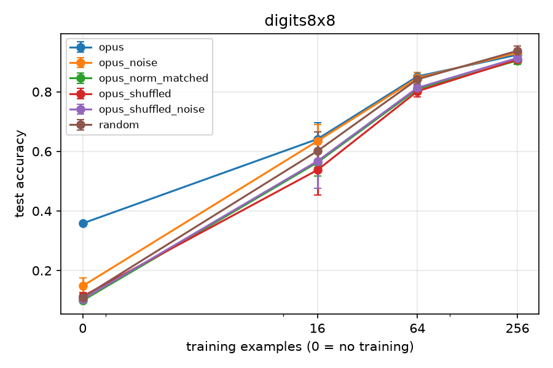
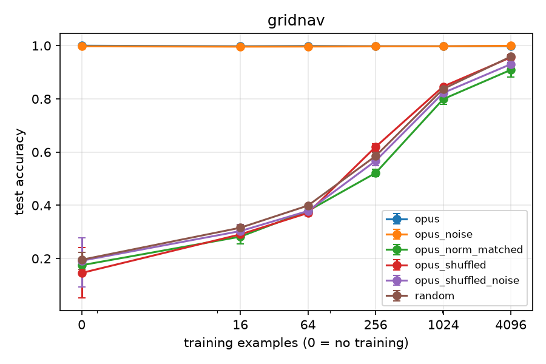
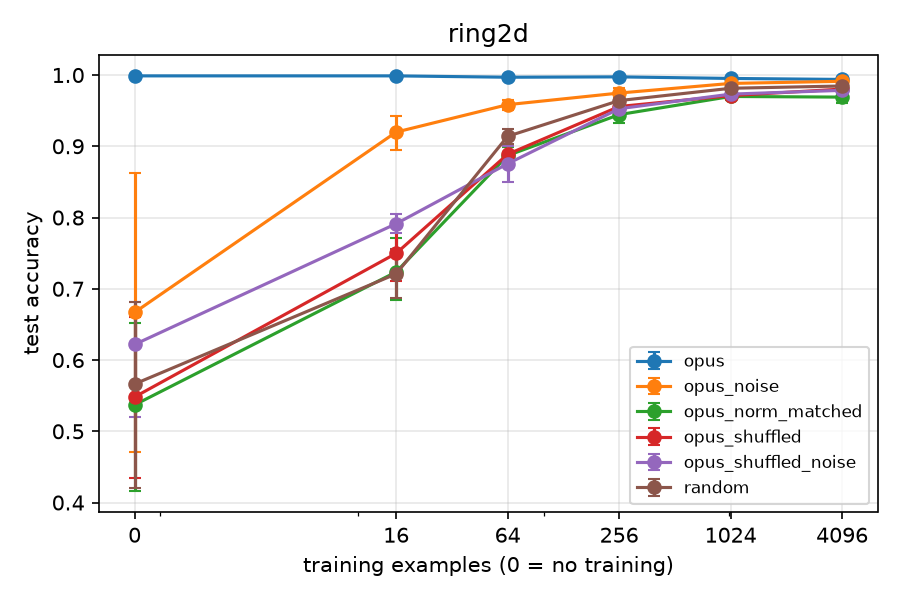
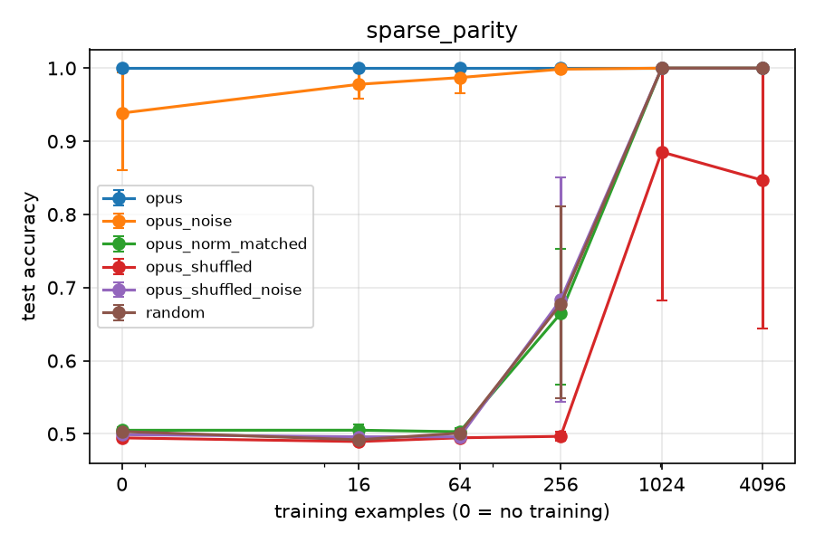

# Results: main_v1

Data multiplier = how many times more data the random-init arm needs to match this arm's mean test accuracy. Budget 0 rows give the init's worth in examples instead. Rules (margin 0.02): '≈ chance' = within the margin of a majority-class predictor, so no multiplier; 'both at ceiling' = this arm and random both have mean test accuracy >= 0.995 at this budget, so no multiplier; `>=` / `<=` = outside random's measured range; 'random flat here' = the random curve does not clearly rise between the bracketing budgets, so only the interval is known; otherwise a log-linear point estimate with its 95% bootstrap CI over seeds and the bracket it was interpolated in.

## digits8x8

Majority-class baseline: 0.112

| arm | budget | seeds | test acc (95% CI) | step-0 selected | data multiplier |
|---|---|---|---|---|---|
| opus | 0 | 5 | 0.358 (0.358-0.358) | 100% | <= 16 ex. |
| opus | 16 | 5 | 0.641 (0.562-0.696) | 0% | 1.26x (CI 1.00-1.86; bracket 1.00x-4.00x) |
| opus | 64 | 5 | 0.852 (0.839-0.865) | 0% | 1.15x (CI 0.96-1.48; bracket 1.00x-4.00x) |
| opus | 256 | 5 | 0.924 (0.912-0.941) | 0% | 0.82x (CI 0.64-1.00; bracket 0.25x-1.00x) |
| opus_noise | 0 | 5 | 0.148 (0.123-0.175) | 100% | <= 16 ex. |
| opus_noise | 16 | 5 | 0.635 (0.558-0.689) | 0% | 1.21x (CI 1.00-1.79; bracket 1.00x-4.00x) |
| opus_noise | 64 | 5 | 0.846 (0.826-0.864) | 0% | 1.07x (CI 0.90-1.45; bracket 1.00x-4.00x) |
| opus_noise | 256 | 5 | 0.932 (0.924-0.942) | 0% | 0.92x (CI 0.74-1.00; bracket 0.25x-1.00x) |
| opus_norm_matched | 0 | 5 | 0.099 (0.096-0.103) | 100% | ≈ chance (no multiplier) |
| opus_norm_matched | 16 | 5 | 0.563 (0.517-0.599) | 0% | <= 1.00x |
| opus_norm_matched | 64 | 5 | 0.809 (0.791-0.832) | 0% | 0.83x (CI 0.72-0.96; bracket 0.25x-1.00x) |
| opus_norm_matched | 256 | 5 | 0.905 (0.892-0.922) | 0% | 0.62x (CI 0.49-0.84; bracket 0.25x-1.00x) |
| opus_shuffled | 0 | 5 | 0.114 (0.103-0.125) | 100% | ≈ chance (no multiplier) |
| opus_shuffled | 16 | 5 | 0.537 (0.453-0.606) | 0% | <= 1.00x |
| opus_shuffled | 64 | 5 | 0.802 (0.783-0.821) | 0% | 0.79x (CI 0.68-0.92; bracket 0.25x-1.00x) |
| opus_shuffled | 256 | 5 | 0.908 (0.895-0.920) | 0% | 0.65x (CI 0.52-0.84; bracket 0.25x-1.00x) |
| opus_shuffled_noise | 0 | 5 | 0.104 (0.098-0.110) | 100% | ≈ chance (no multiplier) |
| opus_shuffled_noise | 16 | 5 | 0.567 (0.477-0.624) | 0% | <= 1.00x |
| opus_shuffled_noise | 64 | 5 | 0.813 (0.801-0.824) | 0% | 0.85x (CI 0.76-0.95; bracket 0.25x-1.00x) |
| opus_shuffled_noise | 256 | 5 | 0.914 (0.907-0.921) | 0% | 0.71x (CI 0.59-0.86; bracket 0.25x-1.00x) |
| random | 0 | 5 | 0.110 (0.103-0.116) | 100% | - |
| random | 16 | 5 | 0.601 (0.546-0.665) | 0% | - |
| random | 64 | 5 | 0.842 (0.825-0.853) | 0% | - |
| random | 256 | 5 | 0.938 (0.925-0.953) | 0% | - |

**Per sample** (written arms; mean test accuracy, then mean test loss, over each sample's seeds; n=0 = zero-shot. Loss shows margin differences that accuracy hides). Samples get different seeds, so fine-tuned differences between samples also include seed (training-set) variation:

| arm | sample | seeds | acc n=0 | acc n=16 | acc n=64 | acc n=256 | loss n=0 | loss n=16 | loss n=64 | loss n=256 |
|---|---|---|---|---|---|---|---|---|---|---|
| opus | sample_01 | 0 1 2 3 4 | 0.358 | 0.641 | 0.852 | 0.924 | 2.14 | 6.4 | 0.552 | 0.245 |

**Controls** (test-accuracy difference A - B, paired by seed, 95% bootstrap CI; with few seeds the CI is rough):

| test | A | B | budget | seeds | A - B (95% CI) |
|---|---|---|---|---|---|
| structure | opus_noise | opus_shuffled_noise | 0 | 5 | +0.045 (+0.021 to +0.069) |
| structure | opus_noise | opus_shuffled_noise | 16 | 5 | +0.067 (+0.055 to +0.081) |
| structure | opus_noise | opus_shuffled_noise | 64 | 5 | +0.033 (+0.014 to +0.052) |
| structure | opus_noise | opus_shuffled_noise | 256 | 5 | +0.018 (+0.011 to +0.027) |
| scale | opus | opus_norm_matched | 0 | 5 | +0.259 (+0.256 to +0.262) |
| scale | opus | opus_norm_matched | 16 | 5 | +0.078 (+0.045 to +0.105) |
| scale | opus | opus_norm_matched | 64 | 5 | +0.043 (+0.025 to +0.062) |
| scale | opus | opus_norm_matched | 256 | 5 | +0.019 (-0.001 to +0.044) |
| structure (secondary) | opus | opus_shuffled | 0 | 5 | +0.245 (+0.233 to +0.256) |
| structure (secondary) | opus | opus_shuffled | 16 | 5 | +0.104 (+0.076 to +0.137) |
| structure (secondary) | opus | opus_shuffled | 64 | 5 | +0.050 (+0.035 to +0.065) |
| structure (secondary) | opus | opus_shuffled | 256 | 5 | +0.016 (-0.003 to +0.036) |

## gridnav

Majority-class baseline: 0.285

| arm | budget | seeds | test acc (95% CI) | step-0 selected | data multiplier |
|---|---|---|---|---|---|
| opus | 0 | 5 | 1.000 (1.000-1.000) | 100% | >= 4096 ex. |
| opus | 16 | 5 | 0.998 (0.995-1.000) | 0% | >= 256.00x |
| opus | 64 | 5 | 0.999 (0.998-1.000) | 0% | >= 64.00x |
| opus | 256 | 5 | 0.998 (0.996-1.000) | 0% | >= 16.00x |
| opus | 1024 | 5 | 0.998 (0.995-1.000) | 0% | >= 4.00x |
| opus | 4096 | 5 | 0.998 (0.997-1.000) | 0% | >= 1.00x |
| opus_noise | 0 | 5 | 0.998 (0.994-1.000) | 100% | >= 4096 ex. |
| opus_noise | 16 | 5 | 0.996 (0.991-1.000) | 40% | >= 256.00x |
| opus_noise | 64 | 5 | 0.997 (0.994-0.999) | 0% | >= 64.00x |
| opus_noise | 256 | 5 | 0.997 (0.993-1.000) | 0% | >= 16.00x |
| opus_noise | 1024 | 5 | 0.998 (0.993-1.000) | 0% | >= 4.00x |
| opus_noise | 4096 | 5 | 1.000 (0.999-1.000) | 0% | >= 1.00x |
| opus_norm_matched | 0 | 5 | 0.175 (0.150-0.198) | 100% | ≈ chance (no multiplier) |
| opus_norm_matched | 16 | 5 | 0.282 (0.255-0.309) | 0% | ≈ chance (no multiplier) |
| opus_norm_matched | 64 | 5 | 0.379 (0.367-0.389) | 0% | 0.72x (CI 0.58-0.86; bracket 0.25x-1.00x) |
| opus_norm_matched | 256 | 5 | 0.522 (0.509-0.536) | 0% | 0.62x (CI 0.55-0.71; bracket 0.25x-1.00x) |
| opus_norm_matched | 1024 | 5 | 0.799 (0.781-0.817) | 0% | 0.81x (CI 0.73-0.90; bracket 0.25x-1.00x) |
| opus_norm_matched | 4096 | 5 | 0.909 (0.882-0.938) | 0% | 0.57x (CI 0.41-0.78; bracket 0.25x-1.00x) |
| opus_shuffled | 0 | 5 | 0.146 (0.051-0.241) | 100% | ≈ chance (no multiplier) |
| opus_shuffled | 16 | 5 | 0.291 (0.279-0.304) | 0% | ≈ chance (no multiplier) |
| opus_shuffled | 64 | 5 | 0.371 (0.363-0.383) | 0% | 0.63x (CI 0.53-0.76; bracket 0.25x-1.00x) |
| opus_shuffled | 256 | 5 | 0.620 (0.603-0.631) | 0% | 1.21x (CI 1.08-1.32; bracket 1.00x-4.00x) |
| opus_shuffled | 1024 | 5 | 0.847 (0.845-0.849) | 0% | 1.11x (CI 1.03-1.20; bracket 1.00x-4.00x) |
| opus_shuffled | 4096 | 5 | 0.956 (0.945-0.966) | 0% | 0.97x (CI 0.84-1.00; bracket 0.25x-1.00x) |
| opus_shuffled_noise | 0 | 5 | 0.192 (0.093-0.277) | 100% | ≈ chance (no multiplier) |
| opus_shuffled_noise | 16 | 5 | 0.303 (0.277-0.328) | 0% | ≈ chance (no multiplier) |
| opus_shuffled_noise | 64 | 5 | 0.379 (0.361-0.393) | 0% | 0.71x (CI 0.53-0.92; bracket 0.25x-1.00x) |
| opus_shuffled_noise | 256 | 5 | 0.567 (0.549-0.582) | 0% | 0.87x (CI 0.75-1.01; bracket 0.25x-1.00x) |
| opus_shuffled_noise | 1024 | 5 | 0.823 (0.812-0.835) | 0% | 0.92x (CI 0.86-1.00; bracket 0.25x-1.00x) |
| opus_shuffled_noise | 4096 | 5 | 0.931 (0.921-0.943) | 0% | 0.72x (CI 0.64-0.83; bracket 0.25x-1.00x) |
| random | 0 | 5 | 0.196 (0.159-0.224) | 100% | - |
| random | 16 | 5 | 0.316 (0.305-0.326) | 0% | - |
| random | 64 | 5 | 0.399 (0.395-0.402) | 0% | - |
| random | 256 | 5 | 0.585 (0.571-0.599) | 0% | - |
| random | 1024 | 5 | 0.837 (0.831-0.844) | 0% | - |
| random | 4096 | 5 | 0.959 (0.955-0.962) | 0% | - |

**Per sample** (written arms; mean test accuracy, then mean test loss, over each sample's seeds; n=0 = zero-shot. Loss shows margin differences that accuracy hides). Samples get different seeds, so fine-tuned differences between samples also include seed (training-set) variation:

| arm | sample | seeds | acc n=0 | acc n=16 | acc n=64 | acc n=256 | acc n=1024 | acc n=4096 | loss n=0 | loss n=16 | loss n=64 | loss n=256 | loss n=1024 | loss n=4096 |
|---|---|---|---|---|---|---|---|---|---|---|---|---|---|---|
| opus | sample_01 | 0 3 | 1.000 | 1.000 | 1.000 | 1.000 | 1.000 | 1.000 | 0.00111 | 0.00064 | 0.000296 | 0.00031 | 0.000293 | 0.000228 |
| opus | sample_02 | 1 4 | 1.000 | 0.998 | 0.998 | 0.998 | 0.995 | 0.998 | 0.295 | 0.285 | 0.278 | 0.279 | 0.221 | 0.127 |
| opus | sample_03 | 2 | 1.000 | 0.993 | 0.999 | 0.994 | 0.999 | 0.995 | 0.897 | 0.275 | 0.305 | 0.152 | 0.119 | 0.0239 |

**Controls** (test-accuracy difference A - B, paired by seed, 95% bootstrap CI; with few seeds the CI is rough):

| test | A | B | budget | seeds | A - B (95% CI) |
|---|---|---|---|---|---|
| structure | opus_noise | opus_shuffled_noise | 0 | 5 | +0.806 (+0.719 to +0.906) |
| structure | opus_noise | opus_shuffled_noise | 16 | 5 | +0.693 (+0.665 to +0.722) |
| structure | opus_noise | opus_shuffled_noise | 64 | 5 | +0.618 (+0.601 to +0.635) |
| structure | opus_noise | opus_shuffled_noise | 256 | 5 | +0.430 (+0.413 to +0.451) |
| structure | opus_noise | opus_shuffled_noise | 1024 | 5 | +0.175 (+0.163 to +0.186) |
| structure | opus_noise | opus_shuffled_noise | 4096 | 5 | +0.069 (+0.056 to +0.079) |
| scale | opus | opus_norm_matched | 0 | 5 | +0.825 (+0.802 to +0.850) |
| scale | opus | opus_norm_matched | 16 | 5 | +0.716 (+0.687 to +0.744) |
| scale | opus | opus_norm_matched | 64 | 5 | +0.620 (+0.609 to +0.633) |
| scale | opus | opus_norm_matched | 256 | 5 | +0.476 (+0.463 to +0.491) |
| scale | opus | opus_norm_matched | 1024 | 5 | +0.198 (+0.180 to +0.220) |
| scale | opus | opus_norm_matched | 4096 | 5 | +0.089 (+0.060 to +0.116) |
| structure (secondary) | opus | opus_shuffled | 0 | 5 | +0.854 (+0.759 to +0.949) |
| structure (secondary) | opus | opus_shuffled | 16 | 5 | +0.707 (+0.694 to +0.719) |
| structure (secondary) | opus | opus_shuffled | 64 | 5 | +0.628 (+0.618 to +0.636) |
| structure (secondary) | opus | opus_shuffled | 256 | 5 | +0.378 (+0.366 to +0.396) |
| structure (secondary) | opus | opus_shuffled | 1024 | 5 | +0.151 (+0.147 to +0.155) |
| structure (secondary) | opus | opus_shuffled | 4096 | 5 | +0.042 (+0.031 to +0.054) |

## ring2d

Majority-class baseline: 0.682

| arm | budget | seeds | test acc (95% CI) | step-0 selected | data multiplier |
|---|---|---|---|---|---|
| opus | 0 | 5 | 0.999 (0.998-1.000) | 100% | >= 4096 ex. |
| opus | 16 | 5 | 0.999 (0.998-1.000) | 100% | >= 256.00x |
| opus | 64 | 5 | 0.997 (0.994-1.000) | 60% | >= 64.00x |
| opus | 256 | 5 | 0.997 (0.995-1.000) | 60% | >= 16.00x |
| opus | 1024 | 5 | 0.995 (0.993-0.998) | 20% | >= 4.00x |
| opus | 4096 | 5 | 0.994 (0.989-0.997) | 0% | >= 1.00x |
| opus_noise | 0 | 5 | 0.667 (0.471-0.862) | 100% | ≈ chance (no multiplier) |
| opus_noise | 16 | 5 | 0.920 (0.895-0.942) | 20% | 4.71x (CI 3.46-8.77; bracket 4.00x-16.00x) |
| opus_noise | 64 | 5 | 0.958 (0.951-0.965) | 0% | 3.42x (CI 2.71-4.80; bracket 1.00x-4.00x) |
| opus_noise | 256 | 5 | 0.975 (0.968-0.982) | 0% | 1.00-4.00x (random flat here) |
| opus_noise | 1024 | 5 | 0.988 (0.985-0.991) | 0% | >= 4.00x |
| opus_noise | 4096 | 5 | 0.991 (0.988-0.995) | 0% | >= 1.00x |
| opus_norm_matched | 0 | 5 | 0.537 (0.416-0.651) | 100% | ≈ chance (no multiplier) |
| opus_norm_matched | 16 | 5 | 0.724 (0.684-0.771) | 0% | ≈ chance (no multiplier) |
| opus_norm_matched | 64 | 5 | 0.887 (0.876-0.898) | 0% | 0.82x (CI 0.73-0.92; bracket 0.25x-1.00x) |
| opus_norm_matched | 256 | 5 | 0.944 (0.932-0.956) | 0% | 0.58x (CI 0.38-0.82; bracket 0.25x-1.00x) |
| opus_norm_matched | 1024 | 5 | 0.970 (0.964-0.975) | 0% | 0.25-1.00x (random flat here) |
| opus_norm_matched | 4096 | 5 | 0.969 (0.961-0.976) | 0% | 0.06-0.25x (random flat here) |
| opus_shuffled | 0 | 5 | 0.548 (0.434-0.660) | 100% | ≈ chance (no multiplier) |
| opus_shuffled | 16 | 5 | 0.750 (0.711-0.786) | 0% | 1.23x (CI 1.00-1.70; bracket 1.00x-4.00x) |
| opus_shuffled | 64 | 5 | 0.889 (0.878-0.900) | 0% | 0.83x (CI 0.75-0.93; bracket 0.25x-1.00x) |
| opus_shuffled | 256 | 5 | 0.956 (0.951-0.960) | 0% | 0.79x (CI 0.66-0.96; bracket 0.25x-1.00x) |
| opus_shuffled | 1024 | 5 | 0.971 (0.967-0.975) | 0% | 0.25-1.00x (random flat here) |
| opus_shuffled | 4096 | 5 | 0.980 (0.973-0.987) | 0% | 0.06-0.25x (random flat here) |
| opus_shuffled_noise | 0 | 5 | 0.622 (0.520-0.682) | 100% | ≈ chance (no multiplier) |
| opus_shuffled_noise | 16 | 5 | 0.791 (0.778-0.805) | 0% | 1.66x (CI 1.33-1.96; bracket 1.00x-4.00x) |
| opus_shuffled_noise | 64 | 5 | 0.876 (0.850-0.900) | 0% | 0.76x (CI 0.62-0.92; bracket 0.25x-1.00x) |
| opus_shuffled_noise | 256 | 5 | 0.953 (0.947-0.957) | 0% | 0.73x (CI 0.60-0.87; bracket 0.25x-1.00x) |
| opus_shuffled_noise | 1024 | 5 | 0.973 (0.967-0.978) | 0% | 0.25-1.00x (random flat here) |
| opus_shuffled_noise | 4096 | 5 | 0.979 (0.974-0.983) | 0% | 0.06-0.25x (random flat here) |
| random | 0 | 5 | 0.566 (0.421-0.682) | 100% | - |
| random | 16 | 5 | 0.721 (0.686-0.756) | 0% | - |
| random | 64 | 5 | 0.914 (0.903-0.924) | 0% | - |
| random | 256 | 5 | 0.964 (0.959-0.969) | 0% | - |
| random | 1024 | 5 | 0.981 (0.976-0.986) | 0% | - |
| random | 4096 | 5 | 0.985 (0.982-0.987) | 0% | - |

**Per sample** (written arms; mean test accuracy, then mean test loss, over each sample's seeds; n=0 = zero-shot. Loss shows margin differences that accuracy hides). Samples get different seeds, so fine-tuned differences between samples also include seed (training-set) variation:

| arm | sample | seeds | acc n=0 | acc n=16 | acc n=64 | acc n=256 | acc n=1024 | acc n=4096 | loss n=0 | loss n=16 | loss n=64 | loss n=256 | loss n=1024 | loss n=4096 |
|---|---|---|---|---|---|---|---|---|---|---|---|---|---|---|
| opus | sample_00 | 0 3 | 0.998 | 0.998 | 0.993 | 0.998 | 0.995 | 0.990 | 0.475 | 0.475 | 0.076 | 0.271 | 0.0495 | 0.0706 |
| opus | sample_01 | 1 4 | 1.000 | 1.000 | 1.000 | 1.000 | 0.996 | 0.996 | 0.0245 | 0.0245 | 0.0245 | 0.0245 | 0.0268 | 0.0249 |
| opus | sample_02 | 2 | 0.998 | 0.998 | 0.998 | 0.992 | 0.993 | 0.997 | 0.475 | 0.475 | 0.475 | 0.211 | 0.223 | 0.225 |

**Controls** (test-accuracy difference A - B, paired by seed, 95% bootstrap CI; with few seeds the CI is rough):

| test | A | B | budget | seeds | A - B (95% CI) |
|---|---|---|---|---|---|
| structure | opus_noise | opus_shuffled_noise | 0 | 5 | +0.045 (-0.115 to +0.204) |
| structure | opus_noise | opus_shuffled_noise | 16 | 5 | +0.129 (+0.108 to +0.149) |
| structure | opus_noise | opus_shuffled_noise | 64 | 5 | +0.083 (+0.051 to +0.108) |
| structure | opus_noise | opus_shuffled_noise | 256 | 5 | +0.022 (+0.013 to +0.031) |
| structure | opus_noise | opus_shuffled_noise | 1024 | 5 | +0.015 (+0.008 to +0.022) |
| structure | opus_noise | opus_shuffled_noise | 4096 | 5 | +0.013 (+0.006 to +0.020) |
| scale | opus | opus_norm_matched | 0 | 5 | +0.462 (+0.347 to +0.584) |
| scale | opus | opus_norm_matched | 16 | 5 | +0.275 (+0.228 to +0.315) |
| scale | opus | opus_norm_matched | 64 | 5 | +0.110 (+0.100 to +0.122) |
| scale | opus | opus_norm_matched | 256 | 5 | +0.053 (+0.043 to +0.065) |
| scale | opus | opus_norm_matched | 1024 | 5 | +0.025 (+0.022 to +0.029) |
| scale | opus | opus_norm_matched | 4096 | 5 | +0.025 (+0.019 to +0.034) |
| structure (secondary) | opus | opus_shuffled | 0 | 5 | +0.451 (+0.338 to +0.565) |
| structure (secondary) | opus | opus_shuffled | 16 | 5 | +0.249 (+0.213 to +0.287) |
| structure (secondary) | opus | opus_shuffled | 64 | 5 | +0.108 (+0.098 to +0.118) |
| structure (secondary) | opus | opus_shuffled | 256 | 5 | +0.042 (+0.038 to +0.047) |
| structure (secondary) | opus | opus_shuffled | 1024 | 5 | +0.024 (+0.021 to +0.027) |
| structure (secondary) | opus | opus_shuffled | 4096 | 5 | +0.014 (+0.008 to +0.022) |

## sparse_parity

Majority-class baseline: 0.505

| arm | budget | seeds | test acc (95% CI) | step-0 selected | data multiplier |
|---|---|---|---|---|---|
| opus | 0 | 5 | 1.000 (1.000-1.000) | 100% | worth 1024 ex. (CI 1024-1024; bracket 256 ex.-1024 ex.) |
| opus | 16 | 5 | 1.000 (1.000-1.000) | 100% | 64.00x (CI 64.00-64.00; bracket 16.00x-64.00x) |
| opus | 64 | 5 | 1.000 (1.000-1.000) | 80% | 16.00x (CI 16.00-16.00; bracket 4.00x-16.00x) |
| opus | 256 | 5 | 1.000 (1.000-1.000) | 0% | 4.00x (CI 4.00-4.00; bracket 1.00x-4.00x) |
| opus | 1024 | 5 | 1.000 (1.000-1.000) | 0% | both at ceiling |
| opus | 4096 | 5 | 1.000 (1.000-1.000) | 0% | both at ceiling |
| opus_noise | 0 | 5 | 0.939 (0.860-0.994) | 100% | worth 786 ex. (CI 523-999; bracket 256 ex.-1024 ex.) |
| opus_noise | 16 | 5 | 0.978 (0.958-0.997) | 20% | 58.20x (CI 51.55-63.00; bracket 16.00x-64.00x) |
| opus_noise | 64 | 5 | 0.987 (0.965-0.999) | 20% | 15.14x (CI 13.53-15.96; bracket 4.00x-16.00x) |
| opus_noise | 256 | 5 | 0.999 (0.997-1.000) | 0% | 3.98x (CI 3.94-4.00; bracket 1.00x-4.00x) |
| opus_noise | 1024 | 5 | 1.000 (1.000-1.000) | 0% | both at ceiling |
| opus_noise | 4096 | 5 | 1.000 (1.000-1.000) | 0% | both at ceiling |
| opus_norm_matched | 0 | 5 | 0.505 (0.504-0.505) | 100% | ≈ chance (no multiplier) |
| opus_norm_matched | 16 | 5 | 0.505 (0.499-0.512) | 0% | ≈ chance (no multiplier) |
| opus_norm_matched | 64 | 5 | 0.503 (0.497-0.508) | 0% | ≈ chance (no multiplier) |
| opus_norm_matched | 256 | 5 | 0.665 (0.568-0.752) | 0% | 0.90x (CI 0.40-1.61; bracket 0.25x-1.00x) |
| opus_norm_matched | 1024 | 5 | 1.000 (1.000-1.000) | 0% | both at ceiling |
| opus_norm_matched | 4096 | 5 | 1.000 (1.000-1.000) | 0% | both at ceiling |
| opus_shuffled | 0 | 5 | 0.495 (0.495-0.495) | 100% | ≈ chance (no multiplier) |
| opus_shuffled | 16 | 5 | 0.489 (0.486-0.493) | 20% | ≈ chance (no multiplier) |
| opus_shuffled | 64 | 5 | 0.495 (0.492-0.497) | 20% | ≈ chance (no multiplier) |
| opus_shuffled | 256 | 5 | 0.497 (0.490-0.503) | 0% | ≈ chance (no multiplier) |
| opus_shuffled | 1024 | 5 | 0.885 (0.682-1.000) | 0% | 0.61x (CI 0.21-1.00; bracket 0.25x-1.00x) |
| opus_shuffled | 4096 | 5 | 0.847 (0.645-1.000) | 0% | 0.13x (CI 0.05-0.25; bracket 0.06x-0.25x) |
| opus_shuffled_noise | 0 | 5 | 0.499 (0.495-0.503) | 100% | ≈ chance (no multiplier) |
| opus_shuffled_noise | 16 | 5 | 0.496 (0.486-0.505) | 0% | ≈ chance (no multiplier) |
| opus_shuffled_noise | 64 | 5 | 0.496 (0.493-0.500) | 20% | ≈ chance (no multiplier) |
| opus_shuffled_noise | 256 | 5 | 0.683 (0.544-0.850) | 0% | 1.02x (CI 0.34-2.15; bracket 1.00x-4.00x) |
| opus_shuffled_noise | 1024 | 5 | 1.000 (1.000-1.000) | 0% | both at ceiling |
| opus_shuffled_noise | 4096 | 5 | 1.000 (1.000-1.000) | 0% | both at ceiling |
| random | 0 | 5 | 0.503 (0.497-0.510) | 100% | - |
| random | 16 | 5 | 0.492 (0.485-0.496) | 0% | - |
| random | 64 | 5 | 0.501 (0.496-0.506) | 20% | - |
| random | 256 | 5 | 0.677 (0.549-0.811) | 0% | - |
| random | 1024 | 5 | 1.000 (1.000-1.000) | 0% | - |
| random | 4096 | 5 | 1.000 (1.000-1.000) | 0% | - |

**Per sample** (written arms; mean test accuracy, then mean test loss, over each sample's seeds; n=0 = zero-shot. Loss shows margin differences that accuracy hides). Samples get different seeds, so fine-tuned differences between samples also include seed (training-set) variation:

| arm | sample | seeds | acc n=0 | acc n=16 | acc n=64 | acc n=256 | acc n=1024 | acc n=4096 | loss n=0 | loss n=16 | loss n=64 | loss n=256 | loss n=1024 | loss n=4096 |
|---|---|---|---|---|---|---|---|---|---|---|---|---|---|---|
| opus | sample_00 | 0 3 | 1.000 | 1.000 | 1.000 | 1.000 | 1.000 | 1.000 | 0.313 | 0.313 | 0.313 | 0.00366 | 0.000271 | 0.000266 |
| opus | sample_01 | 1 4 | 1.000 | 1.000 | 1.000 | 1.000 | 1.000 | 1.000 | 4.54e-05 | 4.54e-05 | 3.4e-05 | 2.58e-07 | 2.36e-07 | 2.46e-07 |
| opus | sample_02 | 2 | 1.000 | 1.000 | 1.000 | 1.000 | 1.000 | 1.000 | 0.474 | 0.474 | 0.474 | 0.000293 | 0.000275 | 0.000285 |

**Controls** (test-accuracy difference A - B, paired by seed, 95% bootstrap CI; with few seeds the CI is rough):

| test | A | B | budget | seeds | A - B (95% CI) |
|---|---|---|---|---|---|
| structure | opus_noise | opus_shuffled_noise | 0 | 5 | +0.440 (+0.364 to +0.497) |
| structure | opus_noise | opus_shuffled_noise | 16 | 5 | +0.482 (+0.462 to +0.500) |
| structure | opus_noise | opus_shuffled_noise | 64 | 5 | +0.491 (+0.469 to +0.506) |
| structure | opus_noise | opus_shuffled_noise | 256 | 5 | +0.316 (+0.146 to +0.454) |
| structure | opus_noise | opus_shuffled_noise | 1024 | 5 | +0.000 (+0.000 to +0.000) |
| structure | opus_noise | opus_shuffled_noise | 4096 | 5 | +0.000 (+0.000 to +0.000) |
| scale | opus | opus_norm_matched | 0 | 5 | +0.495 (+0.495 to +0.496) |
| scale | opus | opus_norm_matched | 16 | 5 | +0.495 (+0.487 to +0.501) |
| scale | opus | opus_norm_matched | 64 | 5 | +0.497 (+0.491 to +0.503) |
| scale | opus | opus_norm_matched | 256 | 5 | +0.335 (+0.247 to +0.432) |
| scale | opus | opus_norm_matched | 1024 | 5 | +0.000 (+0.000 to +0.000) |
| scale | opus | opus_norm_matched | 4096 | 5 | +0.000 (+0.000 to +0.000) |
| structure (secondary) | opus | opus_shuffled | 0 | 5 | +0.506 (+0.506 to +0.506) |
| structure (secondary) | opus | opus_shuffled | 16 | 5 | +0.510 (+0.507 to +0.514) |
| structure (secondary) | opus | opus_shuffled | 64 | 5 | +0.505 (+0.503 to +0.508) |
| structure (secondary) | opus | opus_shuffled | 256 | 5 | +0.503 (+0.497 to +0.510) |
| structure (secondary) | opus | opus_shuffled | 1024 | 5 | +0.115 (+0.000 to +0.318) |
| structure (secondary) | opus | opus_shuffled | 4096 | 5 | +0.153 (+0.000 to +0.356) |
