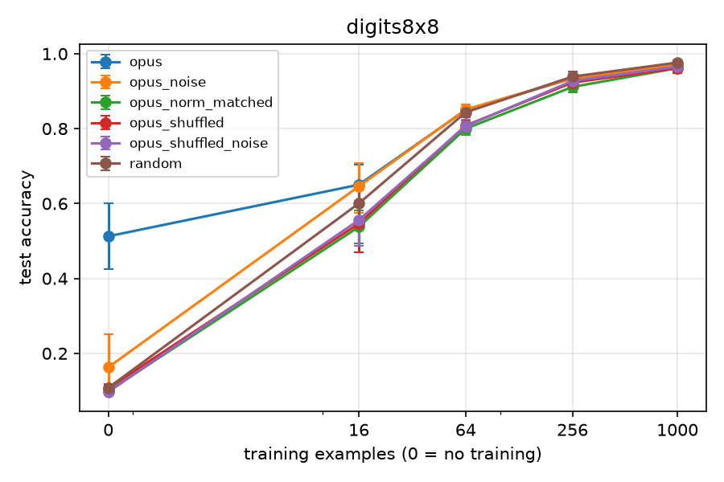

# Results: main_v1_digits

Data multiplier = how many times more data the random-init arm needs to match this arm's mean test accuracy. Budget 0 rows give the init's worth in examples instead. Rules (margin 0.02): '≈ chance' = within the margin of a majority-class predictor, so no multiplier; 'both at ceiling' = this arm and random both have mean test accuracy >= 0.995 at this budget, so no multiplier; `>=` / `<=` = outside random's measured range; 'random flat here' = the random curve does not clearly rise between the bracketing budgets, so only the interval is known; otherwise a log-linear point estimate with its 95% bootstrap CI over seeds and the bracket it was interpolated in.

## digits8x8

Majority-class baseline: 0.112

| arm | budget | seeds | test acc (95% CI) | step-0 selected | data multiplier |
|---|---|---|---|---|---|
| opus | 0 | 6 | 0.513 (0.425-0.600) | 100% | <= 16 ex. |
| opus | 16 | 6 | 0.650 (0.581-0.703) | 0% | 1.33x (CI 1.00-1.88; bracket 1.00x-4.00x) |
| opus | 64 | 6 | 0.850 (0.832-0.864) | 0% | 1.09x (CI 0.92-1.41; bracket 1.00x-4.00x) |
| opus | 256 | 6 | 0.934 (0.922-0.946) | 0% | 0.93x (CI 0.73-1.45; bracket 0.25x-1.00x) |
| opus | 1000 | 6 | 0.970 (0.966-0.974) | 0% | 0.80x (CI 0.62-1.00; bracket 0.26x-1.00x) |
| opus_noise | 0 | 6 | 0.163 (0.107-0.252) | 100% | ≈ chance (no multiplier) |
| opus_noise | 16 | 6 | 0.646 (0.575-0.708) | 0% | 1.30x (CI 1.00-1.91; bracket 1.00x-4.00x) |
| opus_noise | 64 | 6 | 0.851 (0.839-0.864) | 0% | 1.12x (CI 0.95-1.41; bracket 1.00x-4.00x) |
| opus_noise | 256 | 6 | 0.934 (0.927-0.944) | 0% | 0.94x (CI 0.77-1.37; bracket 0.25x-1.00x) |
| opus_noise | 1000 | 6 | 0.971 (0.967-0.974) | 0% | 0.82x (CI 0.64-1.00; bracket 0.26x-1.00x) |
| opus_norm_matched | 0 | 6 | 0.099 (0.097-0.102) | 100% | ≈ chance (no multiplier) |
| opus_norm_matched | 16 | 6 | 0.538 (0.494-0.580) | 0% | <= 1.00x |
| opus_norm_matched | 64 | 6 | 0.800 (0.783-0.822) | 0% | 0.78x (CI 0.68-0.91; bracket 0.25x-1.00x) |
| opus_norm_matched | 256 | 6 | 0.911 (0.898-0.926) | 0% | 0.67x (CI 0.52-0.90; bracket 0.25x-1.00x) |
| opus_norm_matched | 1000 | 6 | 0.961 (0.958-0.966) | 0% | 0.58x (CI 0.42-0.75; bracket 0.26x-1.00x) |
| opus_shuffled | 0 | 6 | 0.107 (0.099-0.117) | 100% | ≈ chance (no multiplier) |
| opus_shuffled | 16 | 6 | 0.546 (0.471-0.602) | 0% | <= 1.00x |
| opus_shuffled | 64 | 6 | 0.808 (0.802-0.816) | 0% | 0.82x (CI 0.75-0.89; bracket 0.25x-1.00x) |
| opus_shuffled | 256 | 6 | 0.923 (0.905-0.937) | 0% | 0.79x (CI 0.61-1.09; bracket 0.25x-1.00x) |
| opus_shuffled | 1000 | 6 | 0.961 (0.948-0.974) | 0% | 0.58x (CI 0.32-0.95; bracket 0.26x-1.00x) |
| opus_shuffled_noise | 0 | 6 | 0.097 (0.089-0.105) | 100% | ≈ chance (no multiplier) |
| opus_shuffled_noise | 16 | 6 | 0.556 (0.487-0.608) | 0% | <= 1.00x |
| opus_shuffled_noise | 64 | 6 | 0.807 (0.786-0.824) | 0% | 0.81x (CI 0.70-0.92; bracket 0.25x-1.00x) |
| opus_shuffled_noise | 256 | 6 | 0.927 (0.918-0.939) | 0% | 0.84x (CI 0.69-1.19; bracket 0.25x-1.00x) |
| opus_shuffled_noise | 1000 | 6 | 0.966 (0.959-0.973) | 0% | 0.68x (CI 0.46-0.98; bracket 0.26x-1.00x) |
| random | 0 | 6 | 0.108 (0.101-0.114) | 100% | - |
| random | 16 | 6 | 0.600 (0.549-0.648) | 0% | - |
| random | 64 | 6 | 0.843 (0.830-0.853) | 0% | - |
| random | 256 | 6 | 0.939 (0.927-0.952) | 0% | - |
| random | 1000 | 6 | 0.976 (0.970-0.982) | 0% | - |

**Per sample** (written arms; mean test accuracy, then mean test loss, over each sample's seeds; n=0 = zero-shot. Loss shows margin differences that accuracy hides). Samples get different seeds, so fine-tuned differences between samples also include seed (training-set) variation:

| arm | sample | seeds | acc n=0 | acc n=16 | acc n=64 | acc n=256 | acc n=1000 | loss n=0 | loss n=16 | loss n=64 | loss n=256 | loss n=1000 |
|---|---|---|---|---|---|---|---|---|---|---|---|---|
| opus | sample_01 | 0 3 | 0.358 | 0.596 | 0.868 | 0.915 | 0.976 | 2.14 | 4.55 | 0.439 | 0.265 | 0.1 |
| opus | sample_02 | 1 4 | 0.621 | 0.694 | 0.837 | 0.943 | 0.969 | 1.18 | 1.44 | 0.701 | 0.209 | 0.101 |
| opus | sample_03 | 2 5 | 0.558 | 0.660 | 0.844 | 0.943 | 0.966 | 1.29 | 3.03 | 0.621 | 0.197 | 0.115 |

**Controls** (test-accuracy difference A - B, paired by seed, 95% bootstrap CI; with few seeds the CI is rough):

| test | A | B | budget | seeds | A - B (95% CI) |
|---|---|---|---|---|---|
| structure | opus_noise | opus_shuffled_noise | 0 | 6 | +0.066 (+0.010 to +0.157) |
| structure | opus_noise | opus_shuffled_noise | 16 | 6 | +0.090 (+0.055 to +0.119) |
| structure | opus_noise | opus_shuffled_noise | 64 | 6 | +0.044 (+0.031 to +0.058) |
| structure | opus_noise | opus_shuffled_noise | 256 | 6 | +0.007 (+0.004 to +0.011) |
| structure | opus_noise | opus_shuffled_noise | 1000 | 6 | +0.005 (-0.001 to +0.012) |
| scale | opus | opus_norm_matched | 0 | 6 | +0.413 (+0.327 to +0.498) |
| scale | opus | opus_norm_matched | 16 | 6 | +0.113 (+0.054 to +0.179) |
| scale | opus | opus_norm_matched | 64 | 6 | +0.050 (+0.023 to +0.074) |
| scale | opus | opus_norm_matched | 256 | 6 | +0.023 (+0.005 to +0.037) |
| scale | opus | opus_norm_matched | 1000 | 6 | +0.009 (+0.005 to +0.012) |
| structure (secondary) | opus | opus_shuffled | 0 | 6 | +0.405 (+0.314 to +0.496) |
| structure (secondary) | opus | opus_shuffled | 16 | 6 | +0.104 (+0.067 to +0.136) |
| structure (secondary) | opus | opus_shuffled | 64 | 6 | +0.041 (+0.024 to +0.059) |
| structure (secondary) | opus | opus_shuffled | 256 | 6 | +0.011 (-0.005 to +0.029) |
| structure (secondary) | opus | opus_shuffled | 1000 | 6 | +0.009 (-0.003 to +0.022) |
