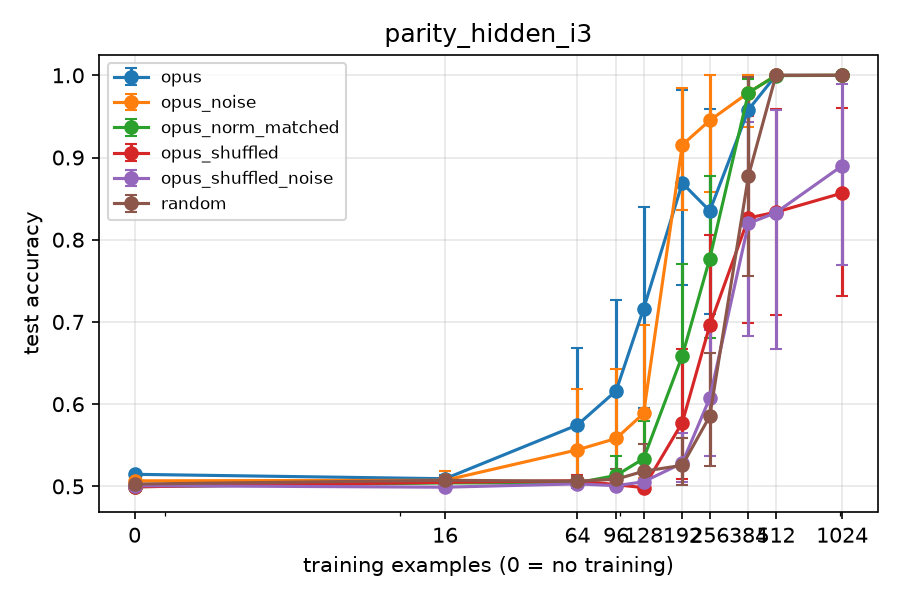
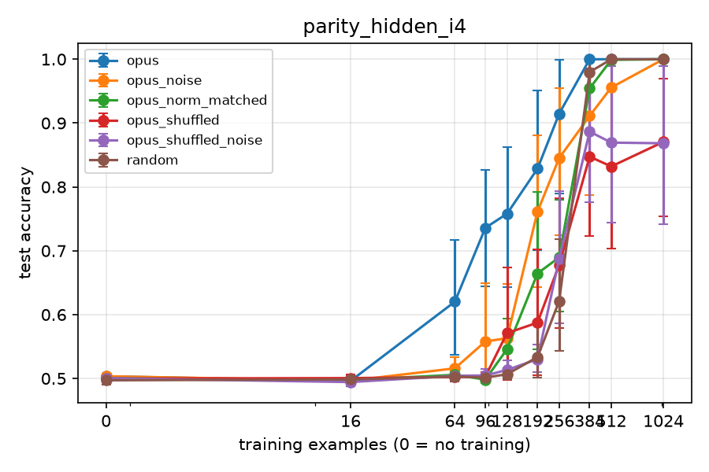
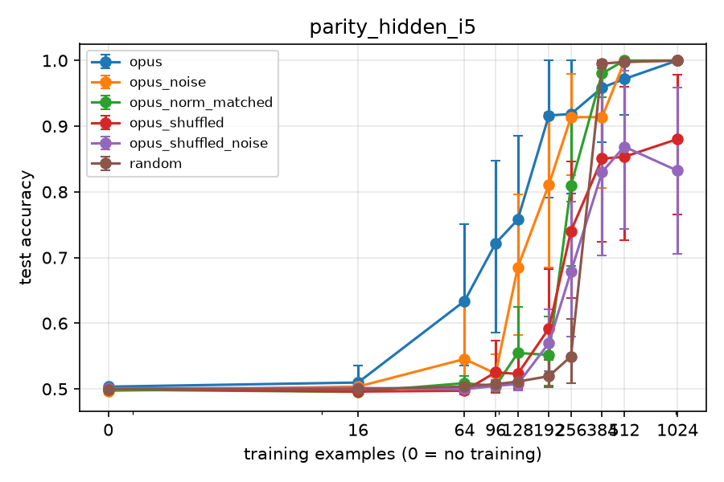

# Results: phase2_parity_f1

Data multiplier = how many times more data the random-init arm needs to match this arm's mean test accuracy. Budget 0 rows give the init's worth in examples instead. Rules (margin 0.02): '≈ chance' = within the margin of a majority-class predictor, so no multiplier; 'both at ceiling' = this arm and random both have mean test accuracy >= 0.995 at this budget, so no multiplier; `>=` / `<=` = outside random's measured range; 'random flat here' = the random curve does not clearly rise between the bracketing budgets, so only the interval is known; otherwise a log-linear point estimate with its 95% bootstrap CI over seeds and the bracket it was interpolated in.

## Family: parity_hidden

**H9 canary (parity_hidden_i3):** written zero-shot opus mean 0.515, sample_00 0.515, sample_01 0.519, sample_02 0.510. within 0.5 ± 0.04 (mean and every sample).
**H9 canary (parity_hidden_i4):** written zero-shot opus mean 0.503, sample_00 0.497, sample_01 0.508, sample_02 0.505. within 0.5 ± 0.04 (mean and every sample).
**H9 canary (parity_hidden_i5):** written zero-shot opus mean 0.503, sample_00 0.500, sample_01 0.500, sample_02 0.509. within 0.5 ± 0.04 (mean and every sample).

**Primary:** written − random test accuracy at budgets 256, paired by seed, 95% bootstrap CI over seeds.

| instance | arm | budget | seeds | written − random (95% CI) |
|---|---|---|---|---|
| parity_hidden_i3 | opus | 256 | 12 | +0.250 (+0.137 to +0.369) |
| parity_hidden_i4 | opus | 256 | 12 | +0.294 (+0.127 to +0.430) |
| parity_hidden_i5 | opus | 256 | 12 | +0.369 (+0.263 to +0.460) |

Instances with CI lower bound > 0 (opus): 256: 3 of 3.

**Samples to target (B.8):** budget at which the arm's mean test accuracy reaches the target (log-linear on its own running-max curve; 0 = met zero-shot; `<= 16` = first met between 0 and 16; `>` = not met by the largest budget).

| instance | target | arm | random n | arm n | random / arm |
|---|---|---|---|---|---|
| parity_hidden_i3 | 0.95 | opus | 455 | 370 | 1.23x |
| parity_hidden_i3 | 0.99 | opus | 500 | 478 | 1.05x |
| parity_hidden_i4 | 0.95 | opus | 371 | 303 | 1.23x |
| parity_hidden_i4 | 0.99 | opus | 444 | 366 | 1.21x |
| parity_hidden_i5 | 0.95 | opus | 369 | 352 | 1.05x |
| parity_hidden_i5 | 0.99 | opus | 382 | 801 | 0.48x |

**Zero-shot test accuracy per sample and instance:**

| arm | sample | parity_hidden_i3 | parity_hidden_i4 | parity_hidden_i5 |
|---|---|---|---|---|
| opus | sample_00 | 0.515 | 0.497 | 0.500 |
| opus | sample_01 | 0.519 | 0.508 | 0.500 |
| opus | sample_02 | 0.510 | 0.505 | 0.509 |
| opus | mean | 0.515 | 0.503 | 0.503 |

**Exploratory (F1c):** per sample, the (instance, seed) cells whose training run at budget 128 reaches test accuracy >= 0.95 (that one run, not the best of smaller budgets).

| arm | sample | cells reaching | share |
|---|---|---|---|
| opus | sample_00 | 4 of 12 | 0.33 |
| opus | sample_01 | 5 of 12 | 0.42 |
| opus | sample_02 | 0 of 12 | 0.00 |

**Controls pooled over instances (B.8 secondary 4):** A − B paired by seed; 95% CI from a bootstrap stratified by instance (seeds resampled within each instance, instances weighted equally). Only budgets measured in every instance are pooled.

| test | A | B | budget | instances | pairs | A − B (95% CI) |
|---|---|---|---|---|---|---|
| structure | opus_noise | opus_shuffled_noise | 0 | 3 | 36 | +0.002 (-0.002 to +0.006) |
| structure | opus_noise | opus_shuffled_noise | 16 | 3 | 36 | +0.004 (+0.000 to +0.008) |
| structure | opus_noise | opus_shuffled_noise | 64 | 3 | 36 | +0.033 (+0.004 to +0.075) |
| structure | opus_noise | opus_shuffled_noise | 96 | 3 | 36 | +0.043 (+0.010 to +0.086) |
| structure | opus_noise | opus_shuffled_noise | 128 | 3 | 36 | +0.103 (+0.050 to +0.162) |
| structure | opus_noise | opus_shuffled_noise | 192 | 3 | 36 | +0.287 (+0.223 to +0.348) |
| structure | opus_noise | opus_shuffled_noise | 256 | 3 | 36 | +0.244 (+0.177 to +0.304) |
| structure | opus_noise | opus_shuffled_noise | 384 | 3 | 36 | +0.089 (+0.023 to +0.162) |
| structure | opus_noise | opus_shuffled_noise | 512 | 3 | 36 | +0.127 (+0.059 to +0.199) |
| structure | opus_noise | opus_shuffled_noise | 1024 | 3 | 36 | +0.136 (+0.068 to +0.214) |
| scale | opus | opus_norm_matched | 0 | 3 | 36 | +0.008 (+0.005 to +0.010) |
| scale | opus | opus_norm_matched | 16 | 3 | 36 | +0.006 (-0.001 to +0.015) |
| scale | opus | opus_norm_matched | 64 | 3 | 36 | +0.103 (+0.049 to +0.161) |
| scale | opus | opus_norm_matched | 96 | 3 | 36 | +0.186 (+0.125 to +0.254) |
| scale | opus | opus_norm_matched | 128 | 3 | 36 | +0.199 (+0.125 to +0.273) |
| scale | opus | opus_norm_matched | 192 | 3 | 36 | +0.246 (+0.152 to +0.336) |
| scale | opus | opus_norm_matched | 256 | 3 | 36 | +0.131 (+0.049 to +0.209) |
| scale | opus | opus_norm_matched | 384 | 3 | 36 | +0.001 (-0.042 to +0.036) |
| scale | opus | opus_norm_matched | 512 | 3 | 36 | -0.009 (-0.027 to +0.001) |
| scale | opus | opus_norm_matched | 1024 | 3 | 36 | +0.000 (+0.000 to +0.000) |

H10 check (claude-opus-5-5__claudecode-noexec__finetune_family, structure CI lower bound > 0 at 16, 64 and 256): 16: yes, 64: yes, 256: yes.

## parity_hidden_i3

**H9 canary (parity_hidden_i3):** written zero-shot opus mean 0.515, sample_00 0.515, sample_01 0.519, sample_02 0.510. within 0.5 ± 0.04 (mean and every sample).

Majority-class baseline: 0.501

| arm | budget | seeds | test acc (95% CI) | step-0 selected | data multiplier |
|---|---|---|---|---|---|
| opus | 0 | 12 | 0.515 (0.512-0.517) | 100% | ≈ chance (no multiplier) |
| opus | 16 | 12 | 0.509 (0.505-0.514) | 33% | ≈ chance (no multiplier) |
| opus | 64 | 12 | 0.575 (0.504-0.668) | 0% | ≈ chance (no multiplier) |
| opus | 96 | 12 | 0.616 (0.522-0.727) | 17% | 2.78x (CI 1.31-3.33; bracket 2.67x-4.00x) |
| opus | 128 | 12 | 0.716 (0.596-0.840) | 0% | 2.40x (CI 1.88-3.06; bracket 2.00x-3.00x) |
| opus | 192 | 12 | 0.869 (0.745-0.982) | 0% | 1.98x (CI 1.61-2.59; bracket 1.33x-2.00x) |
| opus | 256 | 12 | 0.835 (0.709-0.959) | 0% | 1.41x (CI 1.15-1.81; bracket 1.00x-1.50x) |
| opus | 384 | 12 | 0.958 (0.875-1.000) | 0% | 1.21x (CI 0.94-1.33; bracket 1.00x-1.33x) |
| opus | 512 | 12 | 1.000 (1.000-1.000) | 0% | both at ceiling |
| opus | 1024 | 12 | 1.000 (1.000-1.000) | 0% | both at ceiling |
| opus_noise | 0 | 12 | 0.507 (0.501-0.513) | 100% | ≈ chance (no multiplier) |
| opus_noise | 16 | 12 | 0.507 (0.499-0.519) | 17% | ≈ chance (no multiplier) |
| opus_noise | 64 | 12 | 0.544 (0.502-0.618) | 33% | ≈ chance (no multiplier) |
| opus_noise | 96 | 12 | 0.558 (0.504-0.643) | 17% | ≈ chance (no multiplier) |
| opus_noise | 128 | 12 | 0.589 (0.510-0.696) | 17% | ≈ chance (no multiplier) |
| opus_noise | 192 | 12 | 0.915 (0.836-0.985) | 0% | 2.18x (CI 1.81-2.57; bracket 2.00x-2.67x) |
| opus_noise | 256 | 12 | 0.945 (0.858-1.000) | 0% | 1.76x (CI 1.39-2.00; bracket 1.50x-2.00x) |
| opus_noise | 384 | 12 | 0.979 (0.937-1.000) | 0% | 1.27x (CI 0.98-1.33; bracket 1.00x-1.33x) |
| opus_noise | 512 | 12 | 1.000 (0.999-1.000) | 0% | both at ceiling |
| opus_noise | 1024 | 12 | 1.000 (1.000-1.000) | 0% | both at ceiling |
| opus_norm_matched | 0 | 12 | 0.500 (0.498-0.501) | 100% | ≈ chance (no multiplier) |
| opus_norm_matched | 16 | 12 | 0.504 (0.500-0.509) | 0% | ≈ chance (no multiplier) |
| opus_norm_matched | 64 | 12 | 0.504 (0.499-0.511) | 0% | ≈ chance (no multiplier) |
| opus_norm_matched | 96 | 12 | 0.513 (0.498-0.537) | 0% | ≈ chance (no multiplier) |
| opus_norm_matched | 128 | 12 | 0.534 (0.505-0.580) | 0% | ≈ chance (no multiplier) |
| opus_norm_matched | 192 | 12 | 0.659 (0.559-0.771) | 0% | 1.48x (CI 1.12-1.80; bracket 1.33x-2.00x) |
| opus_norm_matched | 256 | 12 | 0.777 (0.680-0.878) | 0% | 1.30x (CI 1.10-1.62; bracket 1.00x-1.50x) |
| opus_norm_matched | 384 | 12 | 0.979 (0.959-0.995) | 0% | 1.27x (CI 0.99-1.32; bracket 1.00x-1.33x) |
| opus_norm_matched | 512 | 12 | 1.000 (0.999-1.000) | 0% | both at ceiling |
| opus_norm_matched | 1024 | 12 | 1.000 (1.000-1.000) | 0% | both at ceiling |
| opus_shuffled | 0 | 12 | 0.499 (0.498-0.500) | 100% | ≈ chance (no multiplier) |
| opus_shuffled | 16 | 12 | 0.505 (0.499-0.512) | 8% | ≈ chance (no multiplier) |
| opus_shuffled | 64 | 12 | 0.507 (0.500-0.514) | 8% | ≈ chance (no multiplier) |
| opus_shuffled | 96 | 12 | 0.502 (0.499-0.505) | 0% | ≈ chance (no multiplier) |
| opus_shuffled | 128 | 12 | 0.498 (0.494-0.503) | 0% | ≈ chance (no multiplier) |
| opus_shuffled | 192 | 12 | 0.578 (0.509-0.667) | 8% | ≈ chance (no multiplier) |
| opus_shuffled | 256 | 12 | 0.696 (0.588-0.805) | 0% | 1.17x (CI 0.94-1.44; bracket 1.00x-1.50x) |
| opus_shuffled | 384 | 12 | 0.826 (0.699-0.951) | 0% | 0.93x (CI 0.76-1.20; bracket 0.67x-1.00x) |
| opus_shuffled | 512 | 12 | 0.834 (0.709-0.958) | 0% | 0.71x (CI 0.57-0.93; bracket 0.50x-0.75x) |
| opus_shuffled | 1024 | 12 | 0.857 (0.732-0.961) | 0% | 0.36x (CI 0.30-0.46; bracket 0.25x-0.38x) |
| opus_shuffled_noise | 0 | 12 | 0.501 (0.499-0.504) | 100% | ≈ chance (no multiplier) |
| opus_shuffled_noise | 16 | 12 | 0.499 (0.495-0.503) | 17% | ≈ chance (no multiplier) |
| opus_shuffled_noise | 64 | 12 | 0.503 (0.498-0.508) | 25% | ≈ chance (no multiplier) |
| opus_shuffled_noise | 96 | 12 | 0.501 (0.498-0.505) | 17% | ≈ chance (no multiplier) |
| opus_shuffled_noise | 128 | 12 | 0.506 (0.499-0.516) | 25% | ≈ chance (no multiplier) |
| opus_shuffled_noise | 192 | 12 | 0.528 (0.506-0.565) | 17% | ≈ chance (no multiplier) |
| opus_shuffled_noise | 256 | 12 | 0.607 (0.537-0.691) | 8% | 1.03x (CI 0.76-1.19; bracket 1.00x-1.50x) |
| opus_shuffled_noise | 384 | 12 | 0.820 (0.683-0.943) | 8% | 0.92x (CI 0.75-1.20; bracket 0.67x-1.00x) |
| opus_shuffled_noise | 512 | 12 | 0.833 (0.667-0.958) | 0% | 0.70x (CI 0.57-0.91; bracket 0.50x-0.75x) |
| opus_shuffled_noise | 1024 | 12 | 0.890 (0.770-0.989) | 0% | 0.39x (CI 0.31-0.49; bracket 0.38x-0.50x) |
| random | 0 | 12 | 0.503 (0.500-0.506) | 100% | - |
| random | 16 | 12 | 0.507 (0.502-0.512) | 17% | - |
| random | 64 | 12 | 0.506 (0.500-0.513) | 50% | - |
| random | 96 | 12 | 0.509 (0.499-0.521) | 42% | - |
| random | 128 | 12 | 0.518 (0.499-0.551) | 42% | - |
| random | 192 | 12 | 0.526 (0.502-0.559) | 42% | - |
| random | 256 | 12 | 0.585 (0.525-0.662) | 33% | - |
| random | 384 | 12 | 0.878 (0.756-0.998) | 8% | - |
| random | 512 | 12 | 1.000 (1.000-1.000) | 0% | - |
| random | 1024 | 12 | 1.000 (1.000-1.000) | 0% | - |

**Per sample** (written arms; mean test accuracy, then mean test loss, over each sample's seeds; n=0 = zero-shot. Loss shows margin differences that accuracy hides). Samples get different seeds, so fine-tuned differences between samples also include seed (training-set) variation:

| arm | sample | seeds | acc n=0 | acc n=16 | acc n=64 | acc n=96 | acc n=128 | acc n=192 | acc n=256 | acc n=384 | acc n=512 | acc n=1024 | loss n=0 | loss n=16 | loss n=64 | loss n=96 | loss n=128 | loss n=192 | loss n=256 | loss n=384 | loss n=512 | loss n=1024 |
|---|---|---|---|---|---|---|---|---|---|---|---|---|---|---|---|---|---|---|---|---|---|---|
| opus | sample_00 | 0 3 6 9 | 0.515 | 0.516 | 0.595 | 0.547 | 0.905 | 0.994 | 1.000 | 1.000 | 1.000 | 1.000 | 0.815 | 0.828 | 1.57 | 1.14 | 0.276 | 0.0212 | 0.00582 | 0.00124 | 0.000391 | 3.02e-05 |
| opus | sample_01 | 1 4 7 10 | 0.519 | 0.506 | 0.626 | 0.755 | 0.750 | 0.750 | 0.874 | 1.000 | 1.000 | 1.000 | 0.693 | 1.27 | 2.65 | 0.46 | 0.354 | 0.375 | 0.191 | 0.00058 | 0.00057 | 0.00122 |
| opus | sample_02 | 2 5 8 11 | 0.510 | 0.506 | 0.503 | 0.546 | 0.492 | 0.863 | 0.631 | 0.875 | 1.000 | 1.000 | 0.74 | 1.05 | 2.03 | 1.12 | 0.872 | 0.273 | 0.773 | 0.213 | 0.00176 | 0.000222 |

**Controls** (test-accuracy difference A - B, paired by seed, 95% bootstrap CI; with few seeds the CI is rough):

| test | A | B | budget | seeds | A - B (95% CI) |
|---|---|---|---|---|---|
| structure | opus_noise | opus_shuffled_noise | 0 | 12 | +0.006 (-0.000 to +0.012) |
| structure | opus_noise | opus_shuffled_noise | 16 | 12 | +0.008 (+0.001 to +0.018) |
| structure | opus_noise | opus_shuffled_noise | 64 | 12 | +0.041 (-0.001 to +0.116) |
| structure | opus_noise | opus_shuffled_noise | 96 | 12 | +0.057 (+0.001 to +0.146) |
| structure | opus_noise | opus_shuffled_noise | 128 | 12 | +0.083 (+0.001 to +0.196) |
| structure | opus_noise | opus_shuffled_noise | 192 | 12 | +0.387 (+0.303 to +0.463) |
| structure | opus_noise | opus_shuffled_noise | 256 | 12 | +0.338 (+0.208 to +0.445) |
| structure | opus_noise | opus_shuffled_noise | 384 | 12 | +0.159 (+0.044 to +0.283) |
| structure | opus_noise | opus_shuffled_noise | 512 | 12 | +0.167 (+0.042 to +0.292) |
| structure | opus_noise | opus_shuffled_noise | 1024 | 12 | +0.110 (+0.016 to +0.229) |
| scale | opus | opus_norm_matched | 0 | 12 | +0.015 (+0.013 to +0.017) |
| scale | opus | opus_norm_matched | 16 | 12 | +0.005 (-0.003 to +0.012) |
| scale | opus | opus_norm_matched | 64 | 12 | +0.070 (-0.001 to +0.165) |
| scale | opus | opus_norm_matched | 96 | 12 | +0.103 (+0.002 to +0.225) |
| scale | opus | opus_norm_matched | 128 | 12 | +0.182 (+0.046 to +0.318) |
| scale | opus | opus_norm_matched | 192 | 12 | +0.210 (+0.043 to +0.368) |
| scale | opus | opus_norm_matched | 256 | 12 | +0.058 (-0.077 to +0.182) |
| scale | opus | opus_norm_matched | 384 | 12 | -0.021 (-0.089 to +0.020) |
| scale | opus | opus_norm_matched | 512 | 12 | +0.000 (+0.000 to +0.001) |
| scale | opus | opus_norm_matched | 1024 | 12 | +0.000 (+0.000 to +0.000) |
| structure (secondary) | opus | opus_shuffled | 0 | 12 | +0.015 (+0.013 to +0.017) |
| structure (secondary) | opus | opus_shuffled | 16 | 12 | +0.004 (-0.002 to +0.011) |
| structure (secondary) | opus | opus_shuffled | 64 | 12 | +0.068 (-0.004 to +0.163) |
| structure (secondary) | opus | opus_shuffled | 96 | 12 | +0.114 (+0.019 to +0.227) |
| structure (secondary) | opus | opus_shuffled | 128 | 12 | +0.217 (+0.101 to +0.334) |
| structure (secondary) | opus | opus_shuffled | 192 | 12 | +0.291 (+0.175 to +0.403) |
| structure (secondary) | opus | opus_shuffled | 256 | 12 | +0.139 (-0.003 to +0.280) |
| structure (secondary) | opus | opus_shuffled | 384 | 12 | +0.132 (-0.032 to +0.293) |
| structure (secondary) | opus | opus_shuffled | 512 | 12 | +0.166 (+0.042 to +0.291) |
| structure (secondary) | opus | opus_shuffled | 1024 | 12 | +0.143 (+0.039 to +0.268) |

## parity_hidden_i4

**H9 canary (parity_hidden_i4):** written zero-shot opus mean 0.503, sample_00 0.497, sample_01 0.508, sample_02 0.505. within 0.5 ± 0.04 (mean and every sample).

Majority-class baseline: 0.508

| arm | budget | seeds | test acc (95% CI) | step-0 selected | data multiplier |
|---|---|---|---|---|---|
| opus | 0 | 12 | 0.503 (0.501-0.506) | 100% | ≈ chance (no multiplier) |
| opus | 16 | 12 | 0.496 (0.487-0.505) | 0% | ≈ chance (no multiplier) |
| opus | 64 | 12 | 0.620 (0.537-0.717) | 0% | 3.99x (CI 2.62-4.54; bracket 3.00x-4.00x) |
| opus | 96 | 12 | 0.736 (0.645-0.827) | 0% | 3.04x (CI 2.62-3.39; bracket 2.67x-4.00x) |
| opus | 128 | 12 | 0.758 (0.643-0.863) | 0% | 2.33x (CI 1.96-2.65; bracket 2.00x-3.00x) |
| opus | 192 | 12 | 0.829 (0.701-0.951) | 0% | 1.69x (CI 1.41-1.95; bracket 1.33x-2.00x) |
| opus | 256 | 12 | 0.915 (0.789-0.999) | 0% | 1.39x (CI 1.21-1.98; bracket 1.00x-1.50x) |
| opus | 384 | 12 | 1.000 (1.000-1.000) | 0% | 1.00-1.33x (random flat here) |
| opus | 512 | 12 | 1.000 (1.000-1.000) | 0% | both at ceiling |
| opus | 1024 | 12 | 1.000 (1.000-1.000) | 0% | both at ceiling |
| opus_noise | 0 | 12 | 0.503 (0.499-0.508) | 100% | ≈ chance (no multiplier) |
| opus_noise | 16 | 12 | 0.497 (0.489-0.504) | 0% | ≈ chance (no multiplier) |
| opus_noise | 64 | 12 | 0.516 (0.503-0.533) | 0% | ≈ chance (no multiplier) |
| opus_noise | 96 | 12 | 0.558 (0.502-0.649) | 0% | ≈ chance (no multiplier) |
| opus_noise | 128 | 12 | 0.563 (0.506-0.648) | 0% | ≈ chance (no multiplier) |
| opus_noise | 192 | 12 | 0.761 (0.643-0.881) | 0% | 1.56x (CI 1.31-1.79; bracket 1.33x-2.00x) |
| opus_noise | 256 | 12 | 0.845 (0.725-0.955) | 0% | 1.29x (CI 1.11-1.47; bracket 1.00x-1.50x) |
| opus_noise | 384 | 12 | 0.911 (0.787-0.997) | 0% | 0.93x (CI 0.80-1.28; bracket 0.67x-1.00x) |
| opus_noise | 512 | 12 | 0.956 (0.869-1.000) | 0% | 0.73x (CI 0.65-1.00; bracket 0.50x-0.75x) |
| opus_noise | 1024 | 12 | 1.000 (1.000-1.000) | 0% | both at ceiling |
| opus_norm_matched | 0 | 12 | 0.500 (0.496-0.505) | 100% | ≈ chance (no multiplier) |
| opus_norm_matched | 16 | 12 | 0.497 (0.490-0.504) | 0% | ≈ chance (no multiplier) |
| opus_norm_matched | 64 | 12 | 0.506 (0.498-0.514) | 8% | ≈ chance (no multiplier) |
| opus_norm_matched | 96 | 12 | 0.498 (0.493-0.504) | 0% | ≈ chance (no multiplier) |
| opus_norm_matched | 128 | 12 | 0.546 (0.510-0.593) | 0% | ≈ chance (no multiplier) |
| opus_norm_matched | 192 | 12 | 0.664 (0.546-0.792) | 0% | 1.40x (CI 1.00-1.64; bracket 1.33x-2.00x) |
| opus_norm_matched | 256 | 12 | 0.690 (0.605-0.779) | 0% | 1.08x (CI 0.89-1.20; bracket 1.00x-1.50x) |
| opus_norm_matched | 384 | 12 | 0.954 (0.886-1.000) | 0% | 0.97x (CI 0.89-1.33; bracket 0.67x-1.00x) |
| opus_norm_matched | 512 | 12 | 0.999 (0.997-1.000) | 0% | both at ceiling |
| opus_norm_matched | 1024 | 12 | 1.000 (1.000-1.000) | 0% | both at ceiling |
| opus_shuffled | 0 | 12 | 0.500 (0.496-0.504) | 100% | ≈ chance (no multiplier) |
| opus_shuffled | 16 | 12 | 0.501 (0.495-0.506) | 0% | ≈ chance (no multiplier) |
| opus_shuffled | 64 | 12 | 0.502 (0.495-0.508) | 0% | ≈ chance (no multiplier) |
| opus_shuffled | 96 | 12 | 0.503 (0.496-0.510) | 0% | ≈ chance (no multiplier) |
| opus_shuffled | 128 | 12 | 0.571 (0.498-0.673) | 0% | ≈ chance (no multiplier) |
| opus_shuffled | 192 | 12 | 0.587 (0.505-0.703) | 8% | ≈ chance (no multiplier) |
| opus_shuffled | 256 | 12 | 0.678 (0.579-0.782) | 0% | 1.07x (CI 0.84-1.22; bracket 1.00x-1.50x) |
| opus_shuffled | 384 | 12 | 0.847 (0.723-0.956) | 8% | 0.86x (CI 0.73-0.98; bracket 0.67x-1.00x) |
| opus_shuffled | 512 | 12 | 0.832 (0.704-0.958) | 0% | 0.63x (CI 0.53-0.74; bracket 0.50x-0.75x) |
| opus_shuffled | 1024 | 12 | 0.871 (0.754-0.970) | 0% | 0.33x (CI 0.29-0.37; bracket 0.25x-0.38x) |
| opus_shuffled_noise | 0 | 12 | 0.500 (0.496-0.505) | 100% | ≈ chance (no multiplier) |
| opus_shuffled_noise | 16 | 12 | 0.494 (0.490-0.499) | 8% | ≈ chance (no multiplier) |
| opus_shuffled_noise | 64 | 12 | 0.504 (0.499-0.510) | 8% | ≈ chance (no multiplier) |
| opus_shuffled_noise | 96 | 12 | 0.505 (0.496-0.515) | 0% | ≈ chance (no multiplier) |
| opus_shuffled_noise | 128 | 12 | 0.513 (0.499-0.528) | 0% | ≈ chance (no multiplier) |
| opus_shuffled_noise | 192 | 12 | 0.530 (0.510-0.553) | 0% | 0.67-1.00x (random flat here) |
| opus_shuffled_noise | 256 | 12 | 0.687 (0.587-0.794) | 8% | 1.08x (CI 0.86-1.24; bracket 1.00x-1.50x) |
| opus_shuffled_noise | 384 | 12 | 0.887 (0.776-0.986) | 0% | 0.90x (CI 0.78-1.08; bracket 0.67x-1.00x) |
| opus_shuffled_noise | 512 | 12 | 0.869 (0.744-0.990) | 0% | 0.66x (CI 0.56-0.79; bracket 0.50x-0.75x) |
| opus_shuffled_noise | 1024 | 12 | 0.868 (0.742-0.990) | 0% | 0.33x (CI 0.28-0.40; bracket 0.25x-0.38x) |
| random | 0 | 12 | 0.497 (0.490-0.503) | 100% | - |
| random | 16 | 12 | 0.499 (0.493-0.504) | 17% | - |
| random | 64 | 12 | 0.503 (0.496-0.511) | 8% | - |
| random | 96 | 12 | 0.501 (0.495-0.508) | 8% | - |
| random | 128 | 12 | 0.507 (0.499-0.515) | 0% | - |
| random | 192 | 12 | 0.533 (0.502-0.590) | 0% | - |
| random | 256 | 12 | 0.621 (0.544-0.718) | 0% | - |
| random | 384 | 12 | 0.980 (0.956-0.998) | 0% | - |
| random | 512 | 12 | 1.000 (1.000-1.000) | 0% | - |
| random | 1024 | 12 | 1.000 (1.000-1.000) | 0% | - |

**Per sample** (written arms; mean test accuracy, then mean test loss, over each sample's seeds; n=0 = zero-shot. Loss shows margin differences that accuracy hides). Samples get different seeds, so fine-tuned differences between samples also include seed (training-set) variation:

| arm | sample | seeds | acc n=0 | acc n=16 | acc n=64 | acc n=96 | acc n=128 | acc n=192 | acc n=256 | acc n=384 | acc n=512 | acc n=1024 | loss n=0 | loss n=16 | loss n=64 | loss n=96 | loss n=128 | loss n=192 | loss n=256 | loss n=384 | loss n=512 | loss n=1024 |
|---|---|---|---|---|---|---|---|---|---|---|---|---|---|---|---|---|---|---|---|---|---|---|
| opus | sample_00 | 0 3 6 9 | 0.497 | 0.494 | 0.624 | 0.729 | 0.799 | 0.873 | 0.999 | 1.000 | 1.000 | 1.000 | 0.843 | 2.42 | 1.48 | 0.887 | 0.594 | 0.509 | 0.00952 | 0.000771 | 0.000355 | 5.29e-05 |
| opus | sample_01 | 1 4 7 10 | 0.508 | 0.485 | 0.624 | 0.754 | 0.617 | 0.628 | 0.747 | 1.000 | 1.000 | 1.000 | 0.694 | 2.07 | 0.608 | 0.756 | 0.724 | 0.841 | 0.43 | 0.00175 | 0.00388 | 0.00043 |
| opus | sample_02 | 2 5 8 11 | 0.505 | 0.509 | 0.613 | 0.725 | 0.857 | 0.985 | 0.998 | 1.000 | 1.000 | 1.000 | 0.749 | 2.39 | 1.34 | 0.667 | 0.407 | 0.0648 | 0.0232 | 0.00537 | 0.00246 | 0.000258 |

**Controls** (test-accuracy difference A - B, paired by seed, 95% bootstrap CI; with few seeds the CI is rough):

| test | A | B | budget | seeds | A - B (95% CI) |
|---|---|---|---|---|---|
| structure | opus_noise | opus_shuffled_noise | 0 | 12 | +0.003 (-0.003 to +0.010) |
| structure | opus_noise | opus_shuffled_noise | 16 | 12 | +0.002 (-0.004 to +0.009) |
| structure | opus_noise | opus_shuffled_noise | 64 | 12 | +0.012 (+0.000 to +0.026) |
| structure | opus_noise | opus_shuffled_noise | 96 | 12 | +0.053 (-0.001 to +0.141) |
| structure | opus_noise | opus_shuffled_noise | 128 | 12 | +0.050 (-0.001 to +0.138) |
| structure | opus_noise | opus_shuffled_noise | 192 | 12 | +0.231 (+0.117 to +0.349) |
| structure | opus_noise | opus_shuffled_noise | 256 | 12 | +0.158 (+0.073 to +0.253) |
| structure | opus_noise | opus_shuffled_noise | 384 | 12 | +0.025 (-0.005 to +0.069) |
| structure | opus_noise | opus_shuffled_noise | 512 | 12 | +0.086 (-0.002 to +0.208) |
| structure | opus_noise | opus_shuffled_noise | 1024 | 12 | +0.132 (+0.015 to +0.258) |
| scale | opus | opus_norm_matched | 0 | 12 | +0.003 (-0.000 to +0.006) |
| scale | opus | opus_norm_matched | 16 | 12 | -0.001 (-0.012 to +0.008) |
| scale | opus | opus_norm_matched | 64 | 12 | +0.115 (+0.030 to +0.214) |
| scale | opus | opus_norm_matched | 96 | 12 | +0.238 (+0.149 to +0.326) |
| scale | opus | opus_norm_matched | 128 | 12 | +0.212 (+0.096 to +0.321) |
| scale | opus | opus_norm_matched | 192 | 12 | +0.164 (-0.036 to +0.361) |
| scale | opus | opus_norm_matched | 256 | 12 | +0.225 (+0.066 to +0.360) |
| scale | opus | opus_norm_matched | 384 | 12 | +0.046 (+0.001 to +0.110) |
| scale | opus | opus_norm_matched | 512 | 12 | +0.001 (+0.000 to +0.003) |
| scale | opus | opus_norm_matched | 1024 | 12 | +0.000 (+0.000 to +0.000) |
| structure (secondary) | opus | opus_shuffled | 0 | 12 | +0.004 (-0.003 to +0.009) |
| structure (secondary) | opus | opus_shuffled | 16 | 12 | -0.004 (-0.015 to +0.005) |
| structure (secondary) | opus | opus_shuffled | 64 | 12 | +0.118 (+0.033 to +0.218) |
| structure (secondary) | opus | opus_shuffled | 96 | 12 | +0.233 (+0.142 to +0.320) |
| structure (secondary) | opus | opus_shuffled | 128 | 12 | +0.187 (+0.076 to +0.297) |
| structure (secondary) | opus | opus_shuffled | 192 | 12 | +0.241 (+0.121 to +0.361) |
| structure (secondary) | opus | opus_shuffled | 256 | 12 | +0.237 (+0.074 to +0.374) |
| structure (secondary) | opus | opus_shuffled | 384 | 12 | +0.153 (+0.033 to +0.277) |
| structure (secondary) | opus | opus_shuffled | 512 | 12 | +0.168 (+0.041 to +0.296) |
| structure (secondary) | opus | opus_shuffled | 1024 | 12 | +0.129 (+0.020 to +0.239) |

## parity_hidden_i5

**H9 canary (parity_hidden_i5):** written zero-shot opus mean 0.503, sample_00 0.500, sample_01 0.500, sample_02 0.509. within 0.5 ± 0.04 (mean and every sample).

Majority-class baseline: 0.508

| arm | budget | seeds | test acc (95% CI) | step-0 selected | data multiplier |
|---|---|---|---|---|---|
| opus | 0 | 12 | 0.503 (0.501-0.506) | 100% | ≈ chance (no multiplier) |
| opus | 16 | 12 | 0.510 (0.494-0.536) | 0% | ≈ chance (no multiplier) |
| opus | 64 | 12 | 0.634 (0.535-0.750) | 0% | 4.32x (CI 3.27-4.82; bracket 4.00x-6.00x) |
| opus | 96 | 12 | 0.722 (0.585-0.847) | 0% | 3.12x (CI 2.74-3.55; bracket 2.67x-4.00x) |
| opus | 128 | 12 | 0.758 (0.625-0.885) | 0% | 2.42x (CI 2.12-2.72; bracket 2.00x-3.00x) |
| opus | 192 | 12 | 0.916 (0.791-1.000) | 0% | 1.86x (CI 1.67-5.33; bracket 1.33x-2.00x) |
| opus | 256 | 12 | 0.919 (0.798-1.000) | 0% | 1.40x (CI 1.26-3.32; bracket 1.00x-1.50x) |
| opus | 384 | 12 | 0.959 (0.876-1.000) | 0% | 0.97x (CI 0.89-2.67; bracket 0.67x-1.00x) |
| opus | 512 | 12 | 0.972 (0.917-1.000) | 0% | 0.73x (CI 0.70-2.00; bracket 0.50x-0.75x) |
| opus | 1024 | 12 | 1.000 (1.000-1.000) | 0% | both at ceiling |
| opus_noise | 0 | 12 | 0.497 (0.492-0.503) | 100% | ≈ chance (no multiplier) |
| opus_noise | 16 | 12 | 0.504 (0.497-0.509) | 8% | ≈ chance (no multiplier) |
| opus_noise | 64 | 12 | 0.546 (0.497-0.631) | 0% | ≈ chance (no multiplier) |
| opus_noise | 96 | 12 | 0.523 (0.500-0.553) | 0% | ≈ chance (no multiplier) |
| opus_noise | 128 | 12 | 0.685 (0.582-0.796) | 0% | 2.26x (CI 2.03-2.51; bracket 2.00x-3.00x) |
| opus_noise | 192 | 12 | 0.811 (0.685-0.921) | 0% | 1.69x (CI 1.51-1.87; bracket 1.33x-2.00x) |
| opus_noise | 256 | 12 | 0.914 (0.825-0.980) | 0% | 1.39x (CI 1.28-1.48; bracket 1.00x-1.50x) |
| opus_noise | 384 | 12 | 0.914 (0.806-0.998) | 0% | 0.93x (CI 0.85-1.33; bracket 0.67x-1.00x) |
| opus_noise | 512 | 12 | 0.998 (0.993-1.000) | 0% | both at ceiling |
| opus_noise | 1024 | 12 | 1.000 (1.000-1.000) | 0% | both at ceiling |
| opus_norm_matched | 0 | 12 | 0.499 (0.494-0.503) | 100% | ≈ chance (no multiplier) |
| opus_norm_matched | 16 | 12 | 0.496 (0.492-0.500) | 0% | ≈ chance (no multiplier) |
| opus_norm_matched | 64 | 12 | 0.509 (0.501-0.519) | 0% | ≈ chance (no multiplier) |
| opus_norm_matched | 96 | 12 | 0.504 (0.496-0.512) | 0% | ≈ chance (no multiplier) |
| opus_norm_matched | 128 | 12 | 0.555 (0.507-0.625) | 0% | ≈ chance (no multiplier) |
| opus_norm_matched | 192 | 12 | 0.552 (0.505-0.611) | 0% | ≈ chance (no multiplier) |
| opus_norm_matched | 256 | 12 | 0.810 (0.687-0.918) | 0% | 1.27x (CI 1.12-1.40; bracket 1.00x-1.50x) |
| opus_norm_matched | 384 | 12 | 0.980 (0.945-1.000) | 0% | 0.99x (CI 0.95-2.44; bracket 0.67x-1.00x) |
| opus_norm_matched | 512 | 12 | 1.000 (1.000-1.000) | 0% | both at ceiling |
| opus_norm_matched | 1024 | 12 | 1.000 (1.000-1.000) | 0% | both at ceiling |
| opus_shuffled | 0 | 12 | 0.500 (0.496-0.505) | 100% | ≈ chance (no multiplier) |
| opus_shuffled | 16 | 12 | 0.496 (0.491-0.500) | 8% | ≈ chance (no multiplier) |
| opus_shuffled | 64 | 12 | 0.497 (0.491-0.503) | 8% | ≈ chance (no multiplier) |
| opus_shuffled | 96 | 12 | 0.525 (0.494-0.573) | 8% | ≈ chance (no multiplier) |
| opus_shuffled | 128 | 12 | 0.523 (0.500-0.554) | 0% | ≈ chance (no multiplier) |
| opus_shuffled | 192 | 12 | 0.592 (0.516-0.683) | 0% | 1.39x (CI 0.74-1.52; bracket 1.33x-2.00x) |
| opus_shuffled | 256 | 12 | 0.740 (0.639-0.846) | 0% | 1.19x (CI 1.07-1.32; bracket 1.00x-1.50x) |
| opus_shuffled | 384 | 12 | 0.851 (0.724-0.957) | 0% | 0.88x (CI 0.77-0.97; bracket 0.67x-1.00x) |
| opus_shuffled | 512 | 12 | 0.853 (0.726-0.960) | 0% | 0.66x (CI 0.58-0.73; bracket 0.50x-0.75x) |
| opus_shuffled | 1024 | 12 | 0.880 (0.765-0.979) | 0% | 0.34x (CI 0.30-0.37; bracket 0.25x-0.38x) |
| opus_shuffled_noise | 0 | 12 | 0.501 (0.497-0.505) | 100% | ≈ chance (no multiplier) |
| opus_shuffled_noise | 16 | 12 | 0.502 (0.498-0.505) | 0% | ≈ chance (no multiplier) |
| opus_shuffled_noise | 64 | 12 | 0.500 (0.494-0.505) | 0% | ≈ chance (no multiplier) |
| opus_shuffled_noise | 96 | 12 | 0.505 (0.496-0.513) | 0% | ≈ chance (no multiplier) |
| opus_shuffled_noise | 128 | 12 | 0.508 (0.497-0.519) | 0% | ≈ chance (no multiplier) |
| opus_shuffled_noise | 192 | 12 | 0.570 (0.527-0.621) | 0% | 1.36x (CI 1.02-1.43; bracket 1.33x-2.00x) |
| opus_shuffled_noise | 256 | 12 | 0.679 (0.580-0.785) | 0% | 1.12x (CI 1.01-1.24; bracket 1.00x-1.50x) |
| opus_shuffled_noise | 384 | 12 | 0.830 (0.703-0.957) | 0% | 0.86x (CI 0.75-0.97; bracket 0.67x-1.00x) |
| opus_shuffled_noise | 512 | 12 | 0.869 (0.743-0.984) | 0% | 0.67x (CI 0.59-0.74; bracket 0.50x-0.75x) |
| opus_shuffled_noise | 1024 | 12 | 0.832 (0.705-0.958) | 0% | 0.32x (CI 0.28-0.36; bracket 0.25x-0.38x) |
| random | 0 | 12 | 0.500 (0.492-0.506) | 100% | - |
| random | 16 | 12 | 0.500 (0.495-0.505) | 8% | - |
| random | 64 | 12 | 0.504 (0.498-0.509) | 8% | - |
| random | 96 | 12 | 0.507 (0.504-0.510) | 0% | - |
| random | 128 | 12 | 0.511 (0.502-0.523) | 0% | - |
| random | 192 | 12 | 0.519 (0.502-0.545) | 0% | - |
| random | 256 | 12 | 0.550 (0.508-0.607) | 8% | - |
| random | 384 | 12 | 0.995 (0.989-1.000) | 0% | - |
| random | 512 | 12 | 0.998 (0.994-1.000) | 0% | - |
| random | 1024 | 12 | 1.000 (1.000-1.000) | 0% | - |

**Per sample** (written arms; mean test accuracy, then mean test loss, over each sample's seeds; n=0 = zero-shot. Loss shows margin differences that accuracy hides). Samples get different seeds, so fine-tuned differences between samples also include seed (training-set) variation:

| arm | sample | seeds | acc n=0 | acc n=16 | acc n=64 | acc n=96 | acc n=128 | acc n=192 | acc n=256 | acc n=384 | acc n=512 | acc n=1024 | loss n=0 | loss n=16 | loss n=64 | loss n=96 | loss n=128 | loss n=192 | loss n=256 | loss n=384 | loss n=512 | loss n=1024 |
|---|---|---|---|---|---|---|---|---|---|---|---|---|---|---|---|---|---|---|---|---|---|---|
| opus | sample_00 | 0 3 6 9 | 0.500 | 0.529 | 0.775 | 0.916 | 0.984 | 1.000 | 1.000 | 1.000 | 1.000 | 1.000 | 0.841 | 2.9 | 0.443 | 0.211 | 0.0625 | 0.00368 | 0.00126 | 0.00106 | 7.32e-05 | 0.000101 |
| opus | sample_01 | 1 4 7 10 | 0.500 | 0.498 | 0.625 | 0.744 | 0.786 | 0.874 | 1.000 | 1.000 | 0.918 | 1.000 | 0.694 | 1.65 | 1.41 | 0.543 | 1 | 0.326 | 0.00332 | 0.000986 | 0.184 | 0.000431 |
| opus | sample_02 | 2 5 8 11 | 0.509 | 0.502 | 0.501 | 0.505 | 0.504 | 0.875 | 0.756 | 0.876 | 0.998 | 1.000 | 0.747 | 1.8 | 1.41 | 1.47 | 1.06 | 0.654 | 0.799 | 0.193 | 0.011 | 0.000189 |

**Controls** (test-accuracy difference A - B, paired by seed, 95% bootstrap CI; with few seeds the CI is rough):

| test | A | B | budget | seeds | A - B (95% CI) |
|---|---|---|---|---|---|
| structure | opus_noise | opus_shuffled_noise | 0 | 12 | -0.004 (-0.012 to +0.004) |
| structure | opus_noise | opus_shuffled_noise | 16 | 12 | +0.002 (-0.004 to +0.007) |
| structure | opus_noise | opus_shuffled_noise | 64 | 12 | +0.046 (-0.005 to +0.134) |
| structure | opus_noise | opus_shuffled_noise | 96 | 12 | +0.019 (-0.002 to +0.047) |
| structure | opus_noise | opus_shuffled_noise | 128 | 12 | +0.177 (+0.073 to +0.301) |
| structure | opus_noise | opus_shuffled_noise | 192 | 12 | +0.241 (+0.125 to +0.353) |
| structure | opus_noise | opus_shuffled_noise | 256 | 12 | +0.235 (+0.118 to +0.347) |
| structure | opus_noise | opus_shuffled_noise | 384 | 12 | +0.084 (-0.065 to +0.233) |
| structure | opus_noise | opus_shuffled_noise | 512 | 12 | +0.129 (+0.008 to +0.256) |
| structure | opus_noise | opus_shuffled_noise | 1024 | 12 | +0.168 (+0.042 to +0.294) |
| scale | opus | opus_norm_matched | 0 | 12 | +0.005 (-0.001 to +0.010) |
| scale | opus | opus_norm_matched | 16 | 12 | +0.014 (+0.000 to +0.038) |
| scale | opus | opus_norm_matched | 64 | 12 | +0.125 (+0.027 to +0.247) |
| scale | opus | opus_norm_matched | 96 | 12 | +0.217 (+0.087 to +0.357) |
| scale | opus | opus_norm_matched | 128 | 12 | +0.203 (+0.080 to +0.331) |
| scale | opus | opus_norm_matched | 192 | 12 | +0.365 (+0.249 to +0.464) |
| scale | opus | opus_norm_matched | 256 | 12 | +0.109 (-0.019 to +0.250) |
| scale | opus | opus_norm_matched | 384 | 12 | -0.022 (-0.121 to +0.052) |
| scale | opus | opus_norm_matched | 512 | 12 | -0.028 (-0.083 to +0.000) |
| scale | opus | opus_norm_matched | 1024 | 12 | +0.000 (+0.000 to +0.000) |
| structure (secondary) | opus | opus_shuffled | 0 | 12 | +0.003 (-0.002 to +0.008) |
| structure (secondary) | opus | opus_shuffled | 16 | 12 | +0.014 (-0.002 to +0.040) |
| structure (secondary) | opus | opus_shuffled | 64 | 12 | +0.137 (+0.036 to +0.260) |
| structure (secondary) | opus | opus_shuffled | 96 | 12 | +0.196 (+0.079 to +0.323) |
| structure (secondary) | opus | opus_shuffled | 128 | 12 | +0.235 (+0.112 to +0.357) |
| structure (secondary) | opus | opus_shuffled | 192 | 12 | +0.324 (+0.197 to +0.441) |
| structure (secondary) | opus | opus_shuffled | 256 | 12 | +0.178 (+0.039 to +0.308) |
| structure (secondary) | opus | opus_shuffled | 384 | 12 | +0.108 (-0.058 to +0.256) |
| structure (secondary) | opus | opus_shuffled | 512 | 12 | +0.118 (+0.020 to +0.229) |
| structure (secondary) | opus | opus_shuffled | 1024 | 12 | +0.120 (+0.021 to +0.225) |
