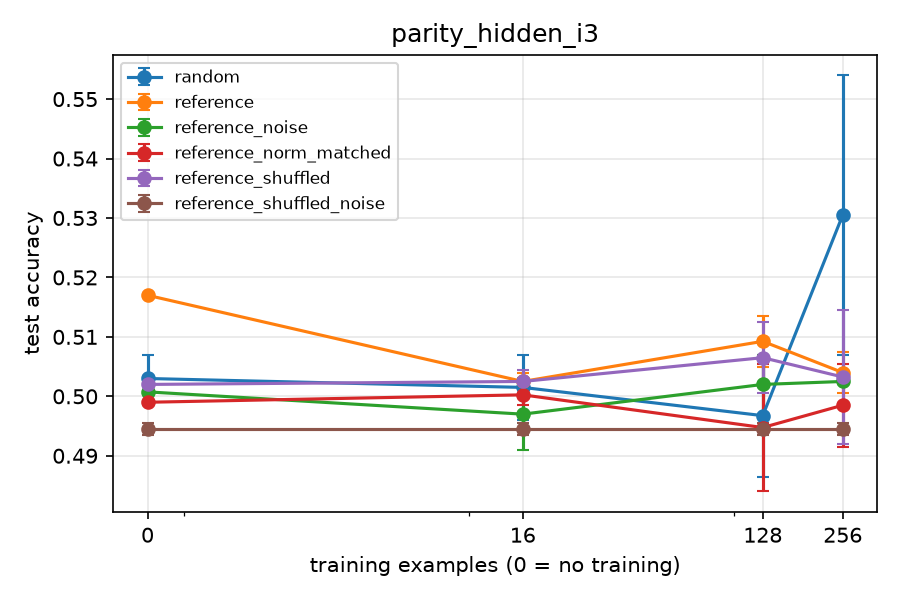
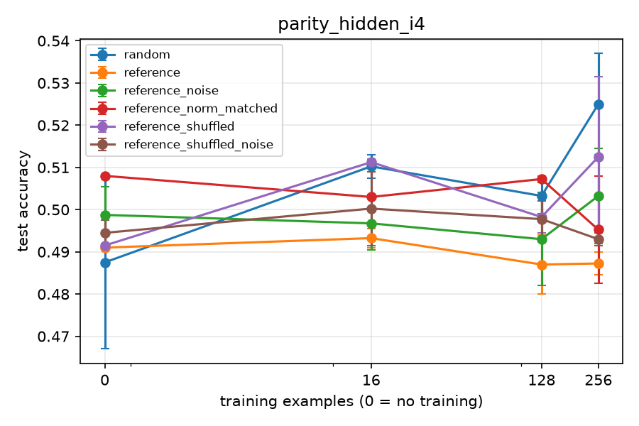
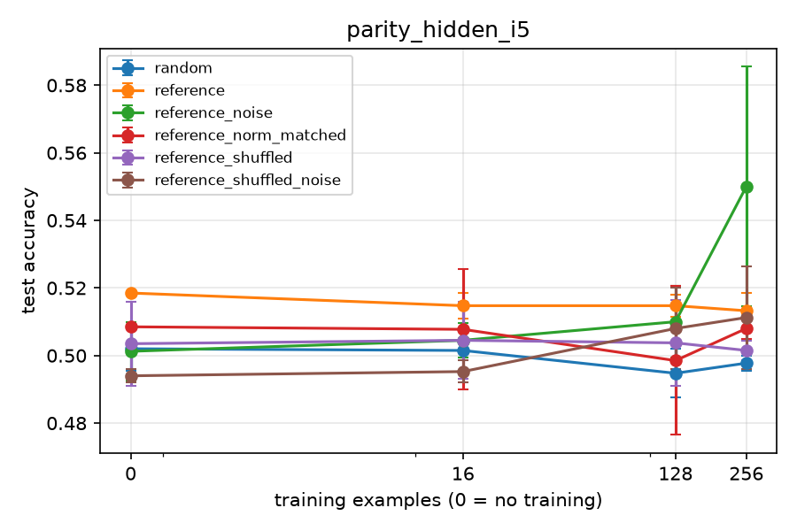

# Results: phase2_parity_f1_smoke_20261104_140536

Data multiplier = how many times more data the random-init arm needs to match this arm's mean test accuracy. Budget 0 rows give the init's worth in examples instead. Rules (margin 0.02): '≈ chance' = within the margin of a majority-class predictor, so no multiplier; 'both at ceiling' = this arm and random both have mean test accuracy >= 0.995 at this budget, so no multiplier; `>=` / `<=` = outside random's measured range; 'random flat here' = the random curve does not clearly rise between the bracketing budgets, so only the interval is known; otherwise a log-linear point estimate with its 95% bootstrap CI over seeds and the bracket it was interpolated in.

## Family: parity_hidden

**H9 canary (parity_hidden_i3):** written zero-shot reference mean 0.517, sample_00 0.517. within 0.5 ± 0.04 (mean and every sample).
**H9 canary (parity_hidden_i4):** written zero-shot reference mean 0.491, sample_00 0.491. within 0.5 ± 0.04 (mean and every sample).
**H9 canary (parity_hidden_i5):** written zero-shot reference mean 0.518, sample_00 0.518. within 0.5 ± 0.04 (mean and every sample).

**Primary:** written − random test accuracy at budgets 256, paired by seed, 95% bootstrap CI over seeds.

| instance | arm | budget | seeds | written − random (95% CI) |
|---|---|---|---|---|
| parity_hidden_i3 | reference | 256 | 2 | -0.027 (-0.054 to +0.000) |
| parity_hidden_i4 | reference | 256 | 2 | -0.038 (-0.047 to -0.029) |
| parity_hidden_i5 | reference | 256 | 2 | +0.015 (+0.008 to +0.023) |

Instances with CI lower bound > 0 (reference): 256: 1 of 3.

**Samples to target (B.8):** budget at which the arm's mean test accuracy reaches the target (log-linear on its own running-max curve; 0 = met zero-shot; `<= 16` = first met between 0 and 16; `>` = not met by the largest budget).

| instance | target | arm | random n | arm n | random / arm |
|---|---|---|---|---|---|
| parity_hidden_i3 | 0.95 | reference | > 256 | > 256 | undetermined (both censored) |
| parity_hidden_i3 | 0.99 | reference | > 256 | > 256 | undetermined (both censored) |
| parity_hidden_i4 | 0.95 | reference | > 256 | > 256 | undetermined (both censored) |
| parity_hidden_i4 | 0.99 | reference | > 256 | > 256 | undetermined (both censored) |
| parity_hidden_i5 | 0.95 | reference | > 256 | > 256 | undetermined (both censored) |
| parity_hidden_i5 | 0.99 | reference | > 256 | > 256 | undetermined (both censored) |

**Zero-shot test accuracy per sample and instance:**

| arm | sample | parity_hidden_i3 | parity_hidden_i4 | parity_hidden_i5 |
|---|---|---|---|---|
| reference | sample_00 | 0.517 | 0.491 | 0.518 |
| reference | mean | 0.517 | 0.491 | 0.518 |

**Controls pooled over instances (B.8 secondary 4):** A − B paired by seed; 95% CI from a bootstrap stratified by instance (seeds resampled within each instance, instances weighted equally). Only budgets measured in every instance are pooled.

| test | A | B | budget | instances | pairs | A − B (95% CI) |
|---|---|---|---|---|---|---|
| structure | reference_noise | reference_shuffled_noise | 0 | 3 | 6 | +0.006 (+0.000 to +0.011) |
| structure | reference_noise | reference_shuffled_noise | 16 | 3 | 6 | +0.003 (-0.005 to +0.010) |
| structure | reference_noise | reference_shuffled_noise | 128 | 3 | 6 | +0.002 (-0.002 to +0.005) |
| structure | reference_noise | reference_shuffled_noise | 256 | 3 | 6 | +0.019 (+0.009 to +0.029) |
| scale | reference | reference_norm_matched | 0 | 3 | 6 | +0.004 (+0.004 to +0.004) |
| scale | reference | reference_norm_matched | 16 | 3 | 6 | -0.000 (-0.008 to +0.008) |
| scale | reference | reference_norm_matched | 128 | 3 | 6 | +0.004 (-0.008 to +0.015) |
| scale | reference | reference_norm_matched | 256 | 3 | 6 | +0.001 (-0.008 to +0.010) |

H10 check (reference, structure CI lower bound > 0 at 16, 64 and 256): 16: no, 64: not measured, 256: yes.

## parity_hidden_i3

**H9 canary (parity_hidden_i3):** written zero-shot reference mean 0.517, sample_00 0.517. within 0.5 ± 0.04 (mean and every sample).

Majority-class baseline: 0.501

| arm | budget | seeds | test acc (95% CI) | step-0 selected | data multiplier |
|---|---|---|---|---|---|
| random | 0 | 2 | 0.503 (0.499-0.507) | 100% | - |
| random | 16 | 2 | 0.502 (0.496-0.507) | 50% | - |
| random | 128 | 2 | 0.497 (0.486-0.507) | 50% | - |
| random | 256 | 2 | 0.530 (0.507-0.554) | 50% | - |
| reference | 0 | 2 | 0.517 (0.517-0.517) | 100% | ≈ chance (no multiplier) |
| reference | 16 | 2 | 0.502 (0.501-0.504) | 0% | ≈ chance (no multiplier) |
| reference | 128 | 2 | 0.509 (0.505-0.513) | 0% | ≈ chance (no multiplier) |
| reference | 256 | 2 | 0.504 (0.500-0.507) | 0% | ≈ chance (no multiplier) |
| reference_noise | 0 | 2 | 0.501 (0.498-0.503) | 100% | ≈ chance (no multiplier) |
| reference_noise | 16 | 2 | 0.497 (0.491-0.503) | 50% | ≈ chance (no multiplier) |
| reference_noise | 128 | 2 | 0.502 (0.497-0.507) | 0% | ≈ chance (no multiplier) |
| reference_noise | 256 | 2 | 0.502 (0.502-0.503) | 50% | ≈ chance (no multiplier) |
| reference_norm_matched | 0 | 2 | 0.499 (0.499-0.499) | 100% | ≈ chance (no multiplier) |
| reference_norm_matched | 16 | 2 | 0.500 (0.498-0.502) | 0% | ≈ chance (no multiplier) |
| reference_norm_matched | 128 | 2 | 0.495 (0.484-0.505) | 0% | ≈ chance (no multiplier) |
| reference_norm_matched | 256 | 2 | 0.498 (0.491-0.505) | 0% | ≈ chance (no multiplier) |
| reference_shuffled | 0 | 2 | 0.502 (0.500-0.503) | 100% | ≈ chance (no multiplier) |
| reference_shuffled | 16 | 2 | 0.502 (0.500-0.504) | 50% | ≈ chance (no multiplier) |
| reference_shuffled | 128 | 2 | 0.506 (0.500-0.512) | 50% | ≈ chance (no multiplier) |
| reference_shuffled | 256 | 2 | 0.503 (0.492-0.514) | 0% | ≈ chance (no multiplier) |
| reference_shuffled_noise | 0 | 2 | 0.494 (0.493-0.495) | 100% | ≈ chance (no multiplier) |
| reference_shuffled_noise | 16 | 2 | 0.494 (0.493-0.495) | 100% | ≈ chance (no multiplier) |
| reference_shuffled_noise | 128 | 2 | 0.494 (0.493-0.495) | 100% | ≈ chance (no multiplier) |
| reference_shuffled_noise | 256 | 2 | 0.494 (0.493-0.495) | 100% | ≈ chance (no multiplier) |

**Per sample** (written arms; mean test accuracy, then mean test loss, over each sample's seeds; n=0 = zero-shot. Loss shows margin differences that accuracy hides). Samples get different seeds, so fine-tuned differences between samples also include seed (training-set) variation:

| arm | sample | seeds | acc n=0 | acc n=16 | acc n=128 | acc n=256 | loss n=0 | loss n=16 | loss n=128 | loss n=256 |
|---|---|---|---|---|---|---|---|---|---|---|
| reference | sample_00 | 0 1 | 0.517 | 0.502 | 0.509 | 0.504 | 1.95 | 4.43 | 1.41 | 1.92 |

**Controls** (test-accuracy difference A - B, paired by seed, 95% bootstrap CI; with few seeds the CI is rough):

| test | A | B | budget | seeds | A - B (95% CI) |
|---|---|---|---|---|---|
| structure | reference_noise | reference_shuffled_noise | 0 | 2 | +0.006 (+0.003 to +0.010) |
| structure | reference_noise | reference_shuffled_noise | 16 | 2 | +0.003 (-0.005 to +0.010) |
| structure | reference_noise | reference_shuffled_noise | 128 | 2 | +0.008 (+0.004 to +0.012) |
| structure | reference_noise | reference_shuffled_noise | 256 | 2 | +0.008 (+0.007 to +0.010) |
| scale | reference | reference_norm_matched | 0 | 2 | +0.018 (+0.018 to +0.018) |
| scale | reference | reference_norm_matched | 16 | 2 | +0.002 (-0.001 to +0.006) |
| scale | reference | reference_norm_matched | 128 | 2 | +0.015 (-0.000 to +0.029) |
| scale | reference | reference_norm_matched | 256 | 2 | +0.005 (-0.005 to +0.016) |
| structure (secondary) | reference | reference_shuffled | 0 | 2 | +0.015 (+0.014 to +0.017) |
| structure (secondary) | reference | reference_shuffled | 16 | 2 | +0.000 (-0.000 to +0.001) |
| structure (secondary) | reference | reference_shuffled | 128 | 2 | +0.003 (-0.007 to +0.013) |
| structure (secondary) | reference | reference_shuffled | 256 | 2 | +0.001 (-0.007 to +0.008) |

## parity_hidden_i4

**H9 canary (parity_hidden_i4):** written zero-shot reference mean 0.491, sample_00 0.491. within 0.5 ± 0.04 (mean and every sample).

Majority-class baseline: 0.508

| arm | budget | seeds | test acc (95% CI) | step-0 selected | data multiplier |
|---|---|---|---|---|---|
| random | 0 | 2 | 0.488 (0.467-0.508) | 100% | - |
| random | 16 | 2 | 0.510 (0.507-0.513) | 0% | - |
| random | 128 | 2 | 0.503 (0.499-0.507) | 0% | - |
| random | 256 | 2 | 0.525 (0.513-0.537) | 0% | - |
| reference | 0 | 2 | 0.491 (0.491-0.491) | 100% | ≈ chance (no multiplier) |
| reference | 16 | 2 | 0.493 (0.491-0.495) | 50% | ≈ chance (no multiplier) |
| reference | 128 | 2 | 0.487 (0.480-0.494) | 0% | ≈ chance (no multiplier) |
| reference | 256 | 2 | 0.487 (0.484-0.490) | 0% | ≈ chance (no multiplier) |
| reference_noise | 0 | 2 | 0.499 (0.492-0.505) | 100% | ≈ chance (no multiplier) |
| reference_noise | 16 | 2 | 0.497 (0.490-0.503) | 0% | ≈ chance (no multiplier) |
| reference_noise | 128 | 2 | 0.493 (0.482-0.504) | 0% | ≈ chance (no multiplier) |
| reference_noise | 256 | 2 | 0.503 (0.492-0.514) | 0% | ≈ chance (no multiplier) |
| reference_norm_matched | 0 | 2 | 0.508 (0.508-0.508) | 100% | ≈ chance (no multiplier) |
| reference_norm_matched | 16 | 2 | 0.503 (0.502-0.503) | 0% | ≈ chance (no multiplier) |
| reference_norm_matched | 128 | 2 | 0.507 (0.506-0.508) | 50% | ≈ chance (no multiplier) |
| reference_norm_matched | 256 | 2 | 0.495 (0.482-0.508) | 50% | ≈ chance (no multiplier) |
| reference_shuffled | 0 | 2 | 0.491 (0.491-0.491) | 100% | ≈ chance (no multiplier) |
| reference_shuffled | 16 | 2 | 0.511 (0.510-0.512) | 0% | ≈ chance (no multiplier) |
| reference_shuffled | 128 | 2 | 0.498 (0.494-0.502) | 0% | ≈ chance (no multiplier) |
| reference_shuffled | 256 | 2 | 0.512 (0.493-0.531) | 0% | ≈ chance (no multiplier) |
| reference_shuffled_noise | 0 | 2 | 0.494 (0.491-0.497) | 100% | ≈ chance (no multiplier) |
| reference_shuffled_noise | 16 | 2 | 0.500 (0.491-0.509) | 50% | ≈ chance (no multiplier) |
| reference_shuffled_noise | 128 | 2 | 0.498 (0.493-0.502) | 0% | ≈ chance (no multiplier) |
| reference_shuffled_noise | 256 | 2 | 0.493 (0.491-0.494) | 50% | ≈ chance (no multiplier) |

**Per sample** (written arms; mean test accuracy, then mean test loss, over each sample's seeds; n=0 = zero-shot. Loss shows margin differences that accuracy hides). Samples get different seeds, so fine-tuned differences between samples also include seed (training-set) variation:

| arm | sample | seeds | acc n=0 | acc n=16 | acc n=128 | acc n=256 | loss n=0 | loss n=16 | loss n=128 | loss n=256 |
|---|---|---|---|---|---|---|---|---|---|---|
| reference | sample_00 | 0 1 | 0.491 | 0.493 | 0.487 | 0.487 | 2.05 | 3 | 1.39 | 1.28 |

**Controls** (test-accuracy difference A - B, paired by seed, 95% bootstrap CI; with few seeds the CI is rough):

| test | A | B | budget | seeds | A - B (95% CI) |
|---|---|---|---|---|---|
| structure | reference_noise | reference_shuffled_noise | 0 | 2 | +0.004 (-0.006 to +0.014) |
| structure | reference_noise | reference_shuffled_noise | 16 | 2 | -0.004 (-0.019 to +0.012) |
| structure | reference_noise | reference_shuffled_noise | 128 | 2 | -0.005 (-0.012 to +0.002) |
| structure | reference_noise | reference_shuffled_noise | 256 | 2 | +0.010 (+0.001 to +0.020) |
| scale | reference | reference_norm_matched | 0 | 2 | -0.017 (-0.017 to -0.017) |
| scale | reference | reference_norm_matched | 16 | 2 | -0.010 (-0.011 to -0.008) |
| scale | reference | reference_norm_matched | 128 | 2 | -0.020 (-0.028 to -0.012) |
| scale | reference | reference_norm_matched | 256 | 2 | -0.008 (-0.024 to +0.008) |
| structure (secondary) | reference | reference_shuffled | 0 | 2 | -0.001 (-0.001 to -0.001) |
| structure (secondary) | reference | reference_shuffled | 16 | 2 | -0.018 (-0.021 to -0.015) |
| structure (secondary) | reference | reference_shuffled | 128 | 2 | -0.011 (-0.015 to -0.008) |
| structure (secondary) | reference | reference_shuffled | 256 | 2 | -0.025 (-0.041 to -0.009) |

## parity_hidden_i5

**H9 canary (parity_hidden_i5):** written zero-shot reference mean 0.518, sample_00 0.518. within 0.5 ± 0.04 (mean and every sample).

Majority-class baseline: 0.508

| arm | budget | seeds | test acc (95% CI) | step-0 selected | data multiplier |
|---|---|---|---|---|---|
| random | 0 | 2 | 0.502 (0.495-0.508) | 100% | - |
| random | 16 | 2 | 0.502 (0.501-0.502) | 0% | - |
| random | 128 | 2 | 0.495 (0.487-0.502) | 0% | - |
| random | 256 | 2 | 0.498 (0.495-0.500) | 50% | - |
| reference | 0 | 2 | 0.518 (0.518-0.518) | 100% | ≈ chance (no multiplier) |
| reference | 16 | 2 | 0.515 (0.511-0.518) | 50% | ≈ chance (no multiplier) |
| reference | 128 | 2 | 0.515 (0.511-0.518) | 0% | ≈ chance (no multiplier) |
| reference | 256 | 2 | 0.513 (0.508-0.518) | 50% | ≈ chance (no multiplier) |
| reference_noise | 0 | 2 | 0.501 (0.492-0.510) | 100% | ≈ chance (no multiplier) |
| reference_noise | 16 | 2 | 0.504 (0.499-0.509) | 0% | ≈ chance (no multiplier) |
| reference_noise | 128 | 2 | 0.510 (0.499-0.520) | 0% | ≈ chance (no multiplier) |
| reference_noise | 256 | 2 | 0.550 (0.514-0.586) | 0% | >= 1.00x |
| reference_norm_matched | 0 | 2 | 0.508 (0.508-0.508) | 100% | ≈ chance (no multiplier) |
| reference_norm_matched | 16 | 2 | 0.508 (0.490-0.525) | 0% | ≈ chance (no multiplier) |
| reference_norm_matched | 128 | 2 | 0.498 (0.476-0.520) | 0% | ≈ chance (no multiplier) |
| reference_norm_matched | 256 | 2 | 0.508 (0.505-0.511) | 0% | ≈ chance (no multiplier) |
| reference_shuffled | 0 | 2 | 0.504 (0.491-0.516) | 100% | ≈ chance (no multiplier) |
| reference_shuffled | 16 | 2 | 0.504 (0.493-0.516) | 50% | ≈ chance (no multiplier) |
| reference_shuffled | 128 | 2 | 0.504 (0.491-0.516) | 50% | ≈ chance (no multiplier) |
| reference_shuffled | 256 | 2 | 0.501 (0.498-0.504) | 0% | ≈ chance (no multiplier) |
| reference_shuffled_noise | 0 | 2 | 0.494 (0.492-0.496) | 100% | ≈ chance (no multiplier) |
| reference_shuffled_noise | 16 | 2 | 0.495 (0.492-0.498) | 50% | ≈ chance (no multiplier) |
| reference_shuffled_noise | 128 | 2 | 0.508 (0.496-0.520) | 50% | ≈ chance (no multiplier) |
| reference_shuffled_noise | 256 | 2 | 0.511 (0.496-0.526) | 50% | ≈ chance (no multiplier) |

**Per sample** (written arms; mean test accuracy, then mean test loss, over each sample's seeds; n=0 = zero-shot. Loss shows margin differences that accuracy hides). Samples get different seeds, so fine-tuned differences between samples also include seed (training-set) variation:

| arm | sample | seeds | acc n=0 | acc n=16 | acc n=128 | acc n=256 | loss n=0 | loss n=16 | loss n=128 | loss n=256 |
|---|---|---|---|---|---|---|---|---|---|---|
| reference | sample_00 | 0 1 | 0.518 | 0.515 | 0.515 | 0.513 | 1.94 | 2.21 | 1.66 | 1.86 |

**Controls** (test-accuracy difference A - B, paired by seed, 95% bootstrap CI; with few seeds the CI is rough):

| test | A | B | budget | seeds | A - B (95% CI) |
|---|---|---|---|---|---|
| structure | reference_noise | reference_shuffled_noise | 0 | 2 | +0.007 (+0.001 to +0.014) |
| structure | reference_noise | reference_shuffled_noise | 16 | 2 | +0.009 (+0.001 to +0.017) |
| structure | reference_noise | reference_shuffled_noise | 128 | 2 | +0.002 (+0.000 to +0.004) |
| structure | reference_noise | reference_shuffled_noise | 256 | 2 | +0.039 (+0.018 to +0.059) |
| scale | reference | reference_norm_matched | 0 | 2 | +0.010 (+0.010 to +0.010) |
| scale | reference | reference_norm_matched | 16 | 2 | +0.007 (-0.014 to +0.028) |
| scale | reference | reference_norm_matched | 128 | 2 | +0.016 (-0.002 to +0.035) |
| scale | reference | reference_norm_matched | 256 | 2 | +0.005 (+0.003 to +0.007) |
| structure (secondary) | reference | reference_shuffled | 0 | 2 | +0.015 (+0.002 to +0.027) |
| structure (secondary) | reference | reference_shuffled | 16 | 2 | +0.010 (-0.005 to +0.025) |
| structure (secondary) | reference | reference_shuffled | 128 | 2 | +0.011 (+0.002 to +0.020) |
| structure (secondary) | reference | reference_shuffled | 256 | 2 | +0.012 (+0.004 to +0.020) |
