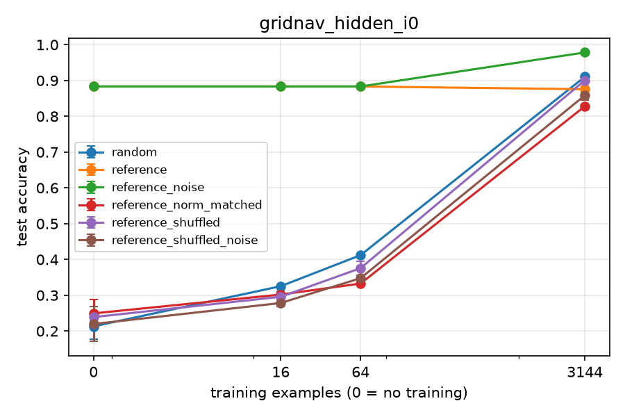
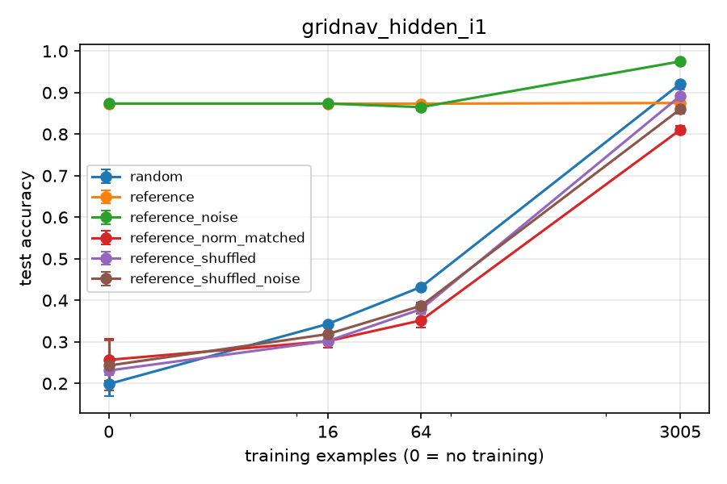
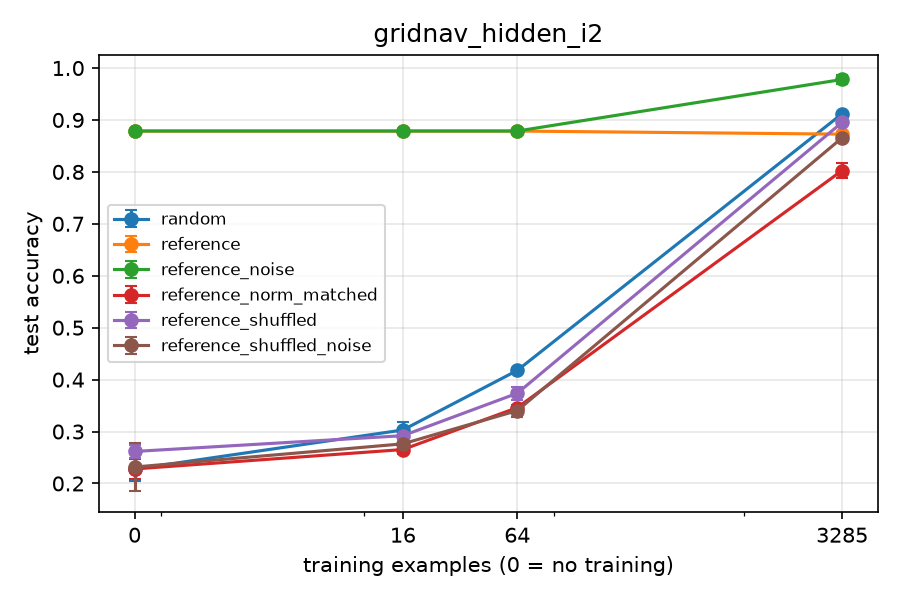
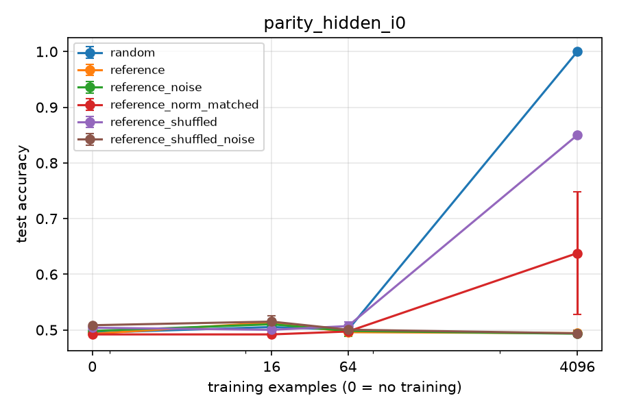
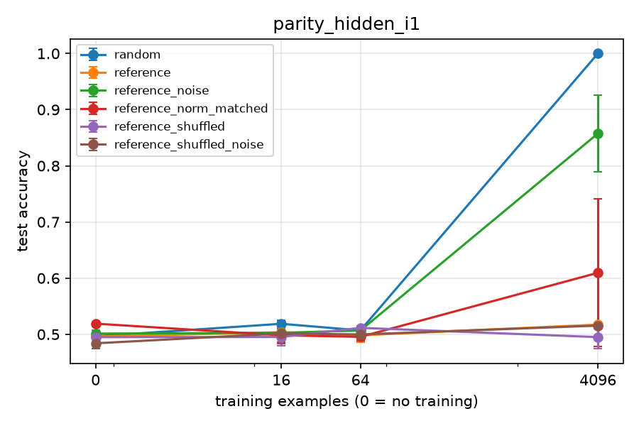
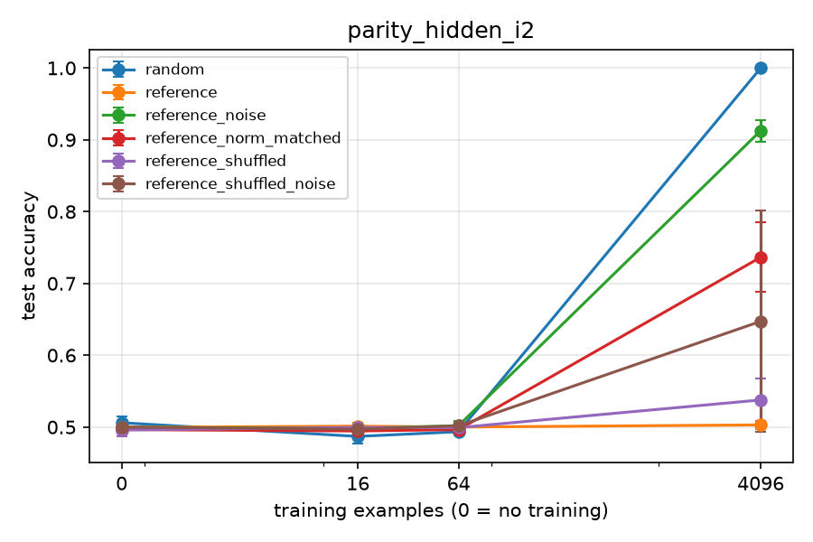
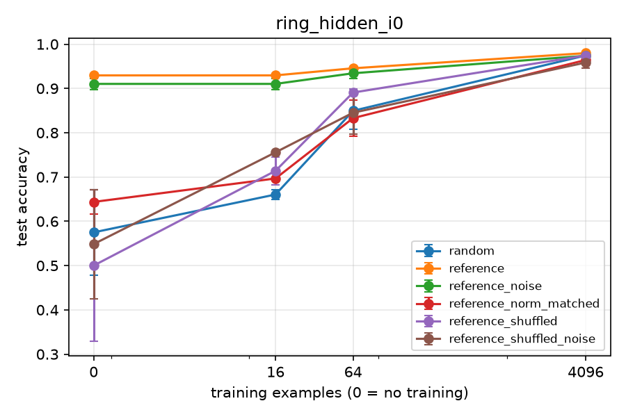
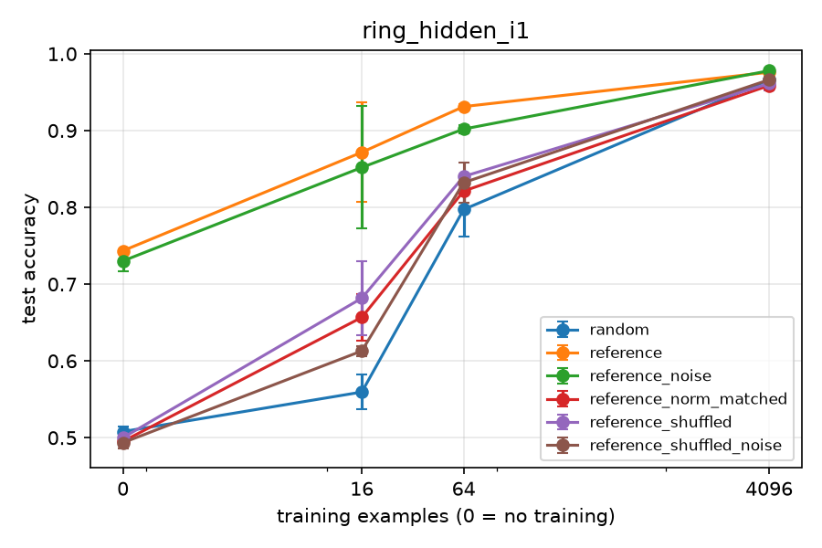
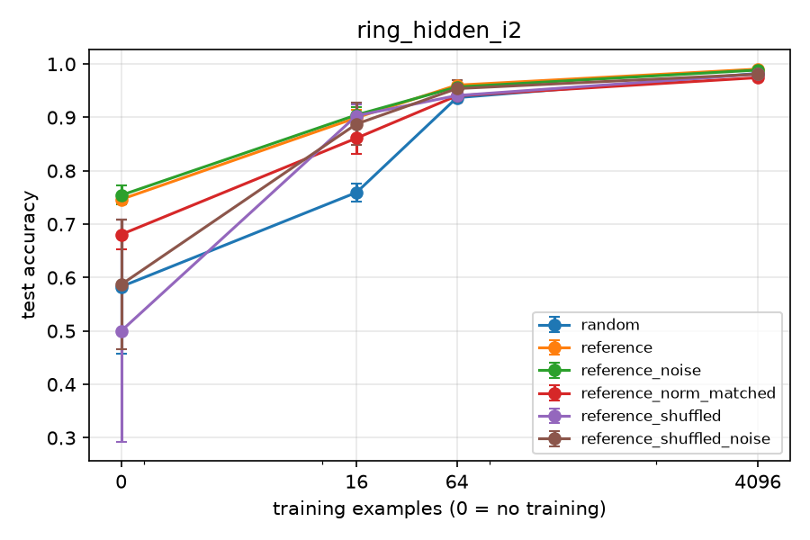

# Results: phase2_smoke_20261104_101051

Data multiplier = how many times more data the random-init arm needs to match this arm's mean test accuracy. Budget 0 rows give the init's worth in examples instead. Rules (margin 0.02): '≈ chance' = within the margin of a majority-class predictor, so no multiplier; 'both at ceiling' = this arm and random both have mean test accuracy >= 0.995 at this budget, so no multiplier; `>=` / `<=` = outside random's measured range; 'random flat here' = the random curve does not clearly rise between the bracketing budgets, so only the interval is known; otherwise a log-linear point estimate with its 95% bootstrap CI over seeds and the bracket it was interpolated in.

## Family: gridnav_hidden

**Primary (B.8):** written − random test accuracy, paired by seed, 95% bootstrap CI over seeds.

| instance | arm | budget | seeds | written − random (95% CI) |
|---|---|---|---|---|
| gridnav_hidden_i0 | reference | 16 | 2 | +0.558 (+0.555 to +0.561) |
| gridnav_hidden_i0 | reference | 64 | 2 | +0.471 (+0.470 to +0.473) |
| gridnav_hidden_i1 | reference | 16 | 2 | +0.530 (+0.529 to +0.531) |
| gridnav_hidden_i1 | reference | 64 | 2 | +0.441 (+0.439 to +0.444) |
| gridnav_hidden_i2 | reference | 16 | 2 | +0.576 (+0.560 to +0.591) |
| gridnav_hidden_i2 | reference | 64 | 2 | +0.461 (+0.456 to +0.466) |

Instances with CI lower bound > 0 (reference): 16: 3 of 3, 64: 3 of 3.

**Samples to target (B.8):** budget at which the arm's mean test accuracy reaches the target (log-linear on its own running-max curve; 0 = met zero-shot; `<= 16` = first met between 0 and 16; `>` = not met by the largest budget).

| instance | target | arm | random n | arm n | random / arm |
|---|---|---|---|---|---|
| gridnav_hidden_i0 | 0.95 | reference | > 3144 | > 3144 | undetermined (both censored) |
| gridnav_hidden_i0 | 0.99 | reference | > 3144 | > 3144 | undetermined (both censored) |
| gridnav_hidden_i1 | 0.95 | reference | > 3005 | > 3005 | undetermined (both censored) |
| gridnav_hidden_i1 | 0.99 | reference | > 3005 | > 3005 | undetermined (both censored) |
| gridnav_hidden_i2 | 0.95 | reference | > 3285 | > 3285 | undetermined (both censored) |
| gridnav_hidden_i2 | 0.99 | reference | > 3285 | > 3285 | undetermined (both censored) |

**Zero-shot test accuracy per sample and instance:**

| arm | sample | gridnav_hidden_i0 | gridnav_hidden_i1 | gridnav_hidden_i2 |
|---|---|---|---|---|
| reference | sample_00 | 0.883 | 0.873 | 0.879 |
| reference | mean | 0.883 | 0.873 | 0.879 |

**Controls pooled over instances (B.8 secondary 4):** A − B paired by seed; 95% CI from a bootstrap stratified by instance (seeds resampled within each instance, instances weighted equally). Only budgets measured in every instance are pooled.

| test | A | B | budget | instances | pairs | A − B (95% CI) |
|---|---|---|---|---|---|---|
| structure | reference_noise | reference_shuffled_noise | 0 | 3 | 6 | +0.647 (+0.611 to +0.684) |
| structure | reference_noise | reference_shuffled_noise | 16 | 3 | 6 | +0.587 (+0.580 to +0.595) |
| structure | reference_noise | reference_shuffled_noise | 64 | 3 | 6 | +0.517 (+0.512 to +0.523) |
| scale | reference | reference_norm_matched | 0 | 3 | 6 | +0.634 (+0.604 to +0.663) |
| scale | reference | reference_norm_matched | 16 | 3 | 6 | +0.589 (+0.581 to +0.597) |
| scale | reference | reference_norm_matched | 64 | 3 | 6 | +0.535 (+0.528 to +0.542) |

H10 check (reference, structure CI lower bound > 0 at 16, 64 and 256): 16: yes, 64: yes, 256: not measured.

## Family: parity_hidden

**H9 canary (parity_hidden_i0):** written zero-shot reference mean 0.493, sample_00 0.493. within 0.5 ± 0.04 (mean and every sample).
**H9 canary (parity_hidden_i1):** written zero-shot reference mean 0.496, sample_00 0.496. within 0.5 ± 0.04 (mean and every sample).
**H9 canary (parity_hidden_i2):** written zero-shot reference mean 0.499, sample_00 0.499. within 0.5 ± 0.04 (mean and every sample).

**Primary (B.8):** written − random test accuracy, paired by seed, 95% bootstrap CI over seeds.

| instance | arm | budget | seeds | written − random (95% CI) |
|---|---|---|---|---|
| parity_hidden_i0 | reference | 16 | 2 | +0.008 (-0.005 to +0.022) |
| parity_hidden_i0 | reference | 64 | 2 | -0.004 (-0.010 to +0.002) |
| parity_hidden_i1 | reference | 16 | 2 | -0.015 (-0.016 to -0.014) |
| parity_hidden_i1 | reference | 64 | 2 | -0.009 (-0.015 to -0.003) |
| parity_hidden_i2 | reference | 16 | 2 | +0.014 (-0.002 to +0.030) |
| parity_hidden_i2 | reference | 64 | 2 | +0.006 (+0.005 to +0.008) |

Instances with CI lower bound > 0 (reference): 16: 0 of 3, 64: 1 of 3.

**Samples to target (B.8):** budget at which the arm's mean test accuracy reaches the target (log-linear on its own running-max curve; 0 = met zero-shot; `<= 16` = first met between 0 and 16; `>` = not met by the largest budget).

| instance | target | arm | random n | arm n | random / arm |
|---|---|---|---|---|---|
| parity_hidden_i0 | 0.95 | reference | 2690 | > 4096 | <= 0.66x |
| parity_hidden_i0 | 0.99 | reference | 3766 | > 4096 | <= 0.92x |
| parity_hidden_i1 | 0.95 | reference | 2659 | > 4096 | <= 0.65x |
| parity_hidden_i1 | 0.99 | reference | 3757 | > 4096 | <= 0.92x |
| parity_hidden_i2 | 0.95 | reference | 2689 | > 4096 | <= 0.66x |
| parity_hidden_i2 | 0.99 | reference | 3765 | > 4096 | <= 0.92x |

**Zero-shot test accuracy per sample and instance:**

| arm | sample | parity_hidden_i0 | parity_hidden_i1 | parity_hidden_i2 |
|---|---|---|---|---|
| reference | sample_00 | 0.493 | 0.496 | 0.499 |
| reference | mean | 0.493 | 0.496 | 0.499 |

**Controls pooled over instances (B.8 secondary 4):** A − B paired by seed; 95% CI from a bootstrap stratified by instance (seeds resampled within each instance, instances weighted equally). Only budgets measured in every instance are pooled.

| test | A | B | budget | instances | pairs | A − B (95% CI) |
|---|---|---|---|---|---|---|
| structure | reference_noise | reference_shuffled_noise | 0 | 3 | 6 | +0.002 (-0.007 to +0.012) |
| structure | reference_noise | reference_shuffled_noise | 16 | 3 | 6 | -0.001 (-0.004 to +0.003) |
| structure | reference_noise | reference_shuffled_noise | 64 | 3 | 6 | +0.002 (-0.003 to +0.006) |
| structure | reference_noise | reference_shuffled_noise | 4096 | 3 | 6 | +0.202 (+0.133 to +0.272) |
| scale | reference | reference_norm_matched | 0 | 3 | 6 | -0.006 (-0.006 to -0.006) |
| scale | reference | reference_norm_matched | 16 | 3 | 6 | +0.011 (+0.007 to +0.015) |
| scale | reference | reference_norm_matched | 64 | 3 | 6 | +0.002 (-0.002 to +0.006) |
| scale | reference | reference_norm_matched | 4096 | 3 | 6 | -0.157 (-0.238 to -0.075) |

H10 check (reference, structure CI lower bound > 0 at 16, 64 and 256): 16: no, 64: no, 256: not measured.

## Family: ring_hidden

**Primary (B.8):** written − random test accuracy, paired by seed, 95% bootstrap CI over seeds.

| instance | arm | budget | seeds | written − random (95% CI) |
|---|---|---|---|---|
| ring_hidden_i0 | reference | 16 | 2 | +0.269 (+0.258 to +0.280) |
| ring_hidden_i0 | reference | 64 | 2 | +0.096 (+0.050 to +0.141) |
| ring_hidden_i1 | reference | 16 | 2 | +0.312 (+0.225 to +0.399) |
| ring_hidden_i1 | reference | 64 | 2 | +0.134 (+0.096 to +0.173) |
| ring_hidden_i2 | reference | 16 | 2 | +0.140 (+0.138 to +0.141) |
| ring_hidden_i2 | reference | 64 | 2 | +0.024 (+0.016 to +0.031) |

Instances with CI lower bound > 0 (reference): 16: 3 of 3, 64: 3 of 3.

**Samples to target (B.8):** budget at which the arm's mean test accuracy reaches the target (log-linear on its own running-max curve; 0 = met zero-shot; `<= 16` = first met between 0 and 16; `>` = not met by the largest budget).

| instance | target | arm | random n | arm n | random / arm |
|---|---|---|---|---|---|
| ring_hidden_i0 | 0.95 | reference | 1813 | 111 | 16.40x |
| ring_hidden_i0 | 0.99 | reference | > 4096 | > 4096 | undetermined (both censored) |
| ring_hidden_i1 | 0.95 | reference | 2761 | 366 | 7.55x |
| ring_hidden_i1 | 0.99 | reference | > 4096 | > 4096 | undetermined (both censored) |
| ring_hidden_i2 | 0.95 | reference | 210 | 50 | 4.17x |
| ring_hidden_i2 | 0.99 | reference | > 4096 | 3822 | >= 1.07x |

**Zero-shot test accuracy per sample and instance:**

| arm | sample | ring_hidden_i0 | ring_hidden_i1 | ring_hidden_i2 |
|---|---|---|---|---|
| reference | sample_00 | 0.929 | 0.744 | 0.747 |
| reference | mean | 0.929 | 0.744 | 0.747 |

**Controls pooled over instances (B.8 secondary 4):** A − B paired by seed; 95% CI from a bootstrap stratified by instance (seeds resampled within each instance, instances weighted equally). Only budgets measured in every instance are pooled.

| test | A | B | budget | instances | pairs | A − B (95% CI) |
|---|---|---|---|---|---|---|
| structure | reference_noise | reference_shuffled_noise | 0 | 3 | 6 | +0.255 (+0.172 to +0.339) |
| structure | reference_noise | reference_shuffled_noise | 16 | 3 | 6 | +0.137 (+0.104 to +0.169) |
| structure | reference_noise | reference_shuffled_noise | 64 | 3 | 6 | +0.054 (+0.031 to +0.077) |
| structure | reference_noise | reference_shuffled_noise | 4096 | 3 | 6 | +0.012 (+0.005 to +0.018) |
| scale | reference | reference_norm_matched | 0 | 3 | 6 | +0.200 (+0.181 to +0.218) |
| scale | reference | reference_norm_matched | 16 | 3 | 6 | +0.162 (+0.145 to +0.179) |
| scale | reference | reference_norm_matched | 64 | 3 | 6 | +0.081 (+0.060 to +0.102) |
| scale | reference | reference_norm_matched | 4096 | 3 | 6 | +0.016 (+0.013 to +0.020) |

H10 check (reference, structure CI lower bound > 0 at 16, 64 and 256): 16: yes, 64: yes, 256: not measured.

## gridnav_hidden_i0

Majority-class baseline: 0.284

| arm | budget | seeds | test acc (95% CI) | step-0 selected | data multiplier |
|---|---|---|---|---|---|
| random | 0 | 2 | 0.213 (0.177-0.249) | 100% | - |
| random | 16 | 2 | 0.325 (0.322-0.329) | 0% | - |
| random | 64 | 2 | 0.412 (0.411-0.413) | 0% | - |
| random | 3144 | 2 | 0.910 (0.909-0.912) | 0% | - |
| reference | 0 | 2 | 0.883 (0.883-0.883) | 100% | worth 2546 ex. (CI 2513-2579; bracket 64 ex.-3144 ex.) |
| reference | 16 | 2 | 0.883 (0.883-0.883) | 100% | 159.12x (CI 157.09-161.19; bracket 4.00x-196.50x) |
| reference | 64 | 2 | 0.883 (0.883-0.883) | 100% | 39.78x (CI 39.27-40.30; bracket 1.00x-49.12x) |
| reference | 3144 | 2 | 0.876 (0.867-0.884) | 0% | 0.76x (CI 0.71-0.82; bracket 0.02x-1.00x) |
| reference_noise | 0 | 2 | 0.883 (0.883-0.883) | 100% | worth 2546 ex. (CI 2513-2579; bracket 64 ex.-3144 ex.) |
| reference_noise | 16 | 2 | 0.883 (0.883-0.883) | 100% | 159.12x (CI 157.09-161.19; bracket 4.00x-196.50x) |
| reference_noise | 64 | 2 | 0.883 (0.883-0.883) | 100% | 39.78x (CI 39.27-40.30; bracket 1.00x-49.12x) |
| reference_noise | 3144 | 2 | 0.978 (0.978-0.979) | 0% | >= 1.00x |
| reference_norm_matched | 0 | 2 | 0.249 (0.211-0.287) | 100% | ≈ chance (no multiplier) |
| reference_norm_matched | 16 | 2 | 0.302 (0.294-0.310) | 0% | ≈ chance (no multiplier) |
| reference_norm_matched | 64 | 2 | 0.333 (0.329-0.336) | 0% | 0.28x (CI 0.25-0.31; bracket 0.25x-1.00x) |
| reference_norm_matched | 3144 | 2 | 0.828 (0.822-0.834) | 0% | 0.53x (CI 0.50-0.56; bracket 0.02x-1.00x) |
| reference_shuffled | 0 | 2 | 0.239 (0.229-0.249) | 100% | ≈ chance (no multiplier) |
| reference_shuffled | 16 | 2 | 0.296 (0.280-0.311) | 0% | ≈ chance (no multiplier) |
| reference_shuffled | 64 | 2 | 0.376 (0.357-0.395) | 0% | 0.56x (CI 0.40-0.77; bracket 0.25x-1.00x) |
| reference_shuffled | 3144 | 2 | 0.900 (0.893-0.908) | 0% | 0.92x (CI 0.86-0.99; bracket 0.02x-1.00x) |
| reference_shuffled_noise | 0 | 2 | 0.220 (0.171-0.269) | 100% | ≈ chance (no multiplier) |
| reference_shuffled_noise | 16 | 2 | 0.278 (0.269-0.288) | 50% | ≈ chance (no multiplier) |
| reference_shuffled_noise | 64 | 2 | 0.348 (0.342-0.353) | 0% | 0.36x (CI 0.31-0.41; bracket 0.25x-1.00x) |
| reference_shuffled_noise | 3144 | 2 | 0.858 (0.846-0.871) | 0% | 0.67x (CI 0.60-0.74; bracket 0.02x-1.00x) |

**Per sample** (written arms; mean test accuracy, then mean test loss, over each sample's seeds; n=0 = zero-shot. Loss shows margin differences that accuracy hides). Samples get different seeds, so fine-tuned differences between samples also include seed (training-set) variation:

| arm | sample | seeds | acc n=0 | acc n=16 | acc n=64 | acc n=3144 | loss n=0 | loss n=16 | loss n=64 | loss n=3144 |
|---|---|---|---|---|---|---|---|---|---|---|
| reference | sample_00 | 0 1 | 0.883 | 0.883 | 0.883 | 0.876 | 0.515 | 0.515 | 0.515 | 0.416 |

**Controls** (test-accuracy difference A - B, paired by seed, 95% bootstrap CI; with few seeds the CI is rough):

| test | A | B | budget | seeds | A - B (95% CI) |
|---|---|---|---|---|---|
| structure | reference_noise | reference_shuffled_noise | 0 | 2 | +0.664 (+0.615 to +0.713) |
| structure | reference_noise | reference_shuffled_noise | 16 | 2 | +0.605 (+0.595 to +0.615) |
| structure | reference_noise | reference_shuffled_noise | 64 | 2 | +0.536 (+0.530 to +0.541) |
| structure | reference_noise | reference_shuffled_noise | 3144 | 2 | +0.120 (+0.107 to +0.133) |
| scale | reference | reference_norm_matched | 0 | 2 | +0.634 (+0.596 to +0.672) |
| scale | reference | reference_norm_matched | 16 | 2 | +0.581 (+0.573 to +0.589) |
| scale | reference | reference_norm_matched | 64 | 2 | +0.551 (+0.547 to +0.554) |
| scale | reference | reference_norm_matched | 3144 | 2 | +0.048 (+0.045 to +0.050) |
| structure (secondary) | reference | reference_shuffled | 0 | 2 | +0.644 (+0.634 to +0.655) |
| structure (secondary) | reference | reference_shuffled | 16 | 2 | +0.588 (+0.572 to +0.603) |
| structure (secondary) | reference | reference_shuffled | 64 | 2 | +0.508 (+0.489 to +0.527) |
| structure (secondary) | reference | reference_shuffled | 3144 | 2 | -0.025 (-0.025 to -0.024) |

## gridnav_hidden_i1

Majority-class baseline: 0.309

| arm | budget | seeds | test acc (95% CI) | step-0 selected | data multiplier |
|---|---|---|---|---|---|
| random | 0 | 2 | 0.199 (0.169-0.229) | 100% | - |
| random | 16 | 2 | 0.343 (0.342-0.344) | 0% | - |
| random | 64 | 2 | 0.432 (0.429-0.435) | 0% | - |
| random | 3005 | 2 | 0.921 (0.919-0.923) | 0% | - |
| reference | 0 | 2 | 0.873 (0.873-0.873) | 100% | worth 2060 ex. (CI 2027-2094; bracket 64 ex.-3005 ex.) |
| reference | 16 | 2 | 0.873 (0.873-0.873) | 100% | 128.75x (CI 126.67-130.86; bracket 4.00x-187.81x) |
| reference | 64 | 2 | 0.873 (0.873-0.873) | 100% | 32.19x (CI 31.67-32.71; bracket 1.00x-46.95x) |
| reference | 3005 | 2 | 0.875 (0.875-0.875) | 0% | 0.69x (CI 0.68-0.71; bracket 0.02x-1.00x) |
| reference_noise | 0 | 2 | 0.874 (0.873-0.874) | 100% | worth 2065 ex. (CI 2031-2101; bracket 64 ex.-3005 ex.) |
| reference_noise | 16 | 2 | 0.874 (0.873-0.874) | 100% | 129.09x (CI 126.94-131.29; bracket 4.00x-187.81x) |
| reference_noise | 64 | 2 | 0.865 (0.857-0.873) | 50% | 30.15x (CI 27.85-32.65; bracket 1.00x-46.95x) |
| reference_noise | 3005 | 2 | 0.975 (0.973-0.977) | 0% | >= 1.00x |
| reference_norm_matched | 0 | 2 | 0.257 (0.207-0.307) | 100% | ≈ chance (no multiplier) |
| reference_norm_matched | 16 | 2 | 0.302 (0.287-0.317) | 0% | ≈ chance (no multiplier) |
| reference_norm_matched | 64 | 2 | 0.352 (0.335-0.368) | 0% | 0.29x (CI 0.25-0.37; bracket 0.25x-1.00x) |
| reference_norm_matched | 3005 | 2 | 0.810 (0.801-0.819) | 0% | 0.42x (CI 0.38-0.45; bracket 0.02x-1.00x) |
| reference_shuffled | 0 | 2 | 0.231 (0.221-0.241) | 100% | ≈ chance (no multiplier) |
| reference_shuffled | 16 | 2 | 0.302 (0.301-0.303) | 0% | ≈ chance (no multiplier) |
| reference_shuffled | 64 | 2 | 0.379 (0.375-0.383) | 0% | 0.44x (CI 0.40-0.47; bracket 0.25x-1.00x) |
| reference_shuffled | 3005 | 2 | 0.892 (0.877-0.907) | 0% | 0.79x (CI 0.69-0.91; bracket 0.02x-1.00x) |
| reference_shuffled_noise | 0 | 2 | 0.243 (0.183-0.303) | 100% | ≈ chance (no multiplier) |
| reference_shuffled_noise | 16 | 2 | 0.319 (0.315-0.323) | 0% | ≈ chance (no multiplier) |
| reference_shuffled_noise | 64 | 2 | 0.387 (0.379-0.395) | 0% | 0.49x (CI 0.43-0.57; bracket 0.25x-1.00x) |
| reference_shuffled_noise | 3005 | 2 | 0.860 (0.849-0.871) | 0% | 0.62x (CI 0.56-0.68; bracket 0.02x-1.00x) |

**Per sample** (written arms; mean test accuracy, then mean test loss, over each sample's seeds; n=0 = zero-shot. Loss shows margin differences that accuracy hides). Samples get different seeds, so fine-tuned differences between samples also include seed (training-set) variation:

| arm | sample | seeds | acc n=0 | acc n=16 | acc n=64 | acc n=3005 | loss n=0 | loss n=16 | loss n=64 | loss n=3005 |
|---|---|---|---|---|---|---|---|---|---|---|
| reference | sample_00 | 0 1 | 0.873 | 0.873 | 0.873 | 0.875 | 0.588 | 0.588 | 0.588 | 0.475 |

**Controls** (test-accuracy difference A - B, paired by seed, 95% bootstrap CI; with few seeds the CI is rough):

| test | A | B | budget | seeds | A - B (95% CI) |
|---|---|---|---|---|---|
| structure | reference_noise | reference_shuffled_noise | 0 | 2 | +0.631 (+0.570 to +0.691) |
| structure | reference_noise | reference_shuffled_noise | 16 | 2 | +0.555 (+0.551 to +0.559) |
| structure | reference_noise | reference_shuffled_noise | 64 | 2 | +0.478 (+0.478 to +0.479) |
| structure | reference_noise | reference_shuffled_noise | 3005 | 2 | +0.115 (+0.102 to +0.128) |
| scale | reference | reference_norm_matched | 0 | 2 | +0.617 (+0.567 to +0.667) |
| scale | reference | reference_norm_matched | 16 | 2 | +0.572 (+0.557 to +0.587) |
| scale | reference | reference_norm_matched | 64 | 2 | +0.522 (+0.505 to +0.538) |
| scale | reference | reference_norm_matched | 3005 | 2 | +0.065 (+0.056 to +0.073) |
| structure (secondary) | reference | reference_shuffled | 0 | 2 | +0.642 (+0.632 to +0.653) |
| structure (secondary) | reference | reference_shuffled | 16 | 2 | +0.571 (+0.570 to +0.573) |
| structure (secondary) | reference | reference_shuffled | 64 | 2 | +0.495 (+0.491 to +0.499) |
| structure (secondary) | reference | reference_shuffled | 3005 | 2 | -0.017 (-0.032 to -0.002) |

## gridnav_hidden_i2

Majority-class baseline: 0.274

| arm | budget | seeds | test acc (95% CI) | step-0 selected | data multiplier |
|---|---|---|---|---|---|
| random | 0 | 2 | 0.228 (0.205-0.250) | 100% | - |
| random | 16 | 2 | 0.303 (0.287-0.319) | 0% | - |
| random | 64 | 2 | 0.418 (0.413-0.423) | 0% | - |
| random | 3285 | 2 | 0.912 (0.909-0.915) | 0% | - |
| reference | 0 | 2 | 0.879 (0.879-0.879) | 100% | worth 2519 ex. (CI 2463-2576; bracket 64 ex.-3285 ex.) |
| reference | 16 | 2 | 0.879 (0.879-0.879) | 100% | 157.43x (CI 153.91-160.99; bracket 4.00x-205.31x) |
| reference | 64 | 2 | 0.879 (0.879-0.879) | 100% | 39.36x (CI 38.48-40.25; bracket 1.00x-51.33x) |
| reference | 3285 | 2 | 0.873 (0.869-0.877) | 0% | 0.73x (CI 0.69-0.77; bracket 0.02x-1.00x) |
| reference_noise | 0 | 2 | 0.879 (0.879-0.879) | 100% | worth 2519 ex. (CI 2463-2576; bracket 64 ex.-3285 ex.) |
| reference_noise | 16 | 2 | 0.879 (0.879-0.879) | 100% | 157.43x (CI 153.91-160.99; bracket 4.00x-205.31x) |
| reference_noise | 64 | 2 | 0.879 (0.879-0.879) | 100% | 39.36x (CI 38.48-40.25; bracket 1.00x-51.33x) |
| reference_noise | 3285 | 2 | 0.978 (0.970-0.986) | 0% | >= 1.00x |
| reference_norm_matched | 0 | 2 | 0.228 (0.209-0.247) | 100% | ≈ chance (no multiplier) |
| reference_norm_matched | 16 | 2 | 0.265 (0.257-0.274) | 0% | ≈ chance (no multiplier) |
| reference_norm_matched | 64 | 2 | 0.346 (0.342-0.350) | 0% | 0.42x (CI 0.35-0.49; bracket 0.25x-1.00x) |
| reference_norm_matched | 3285 | 2 | 0.803 (0.788-0.817) | 0% | 0.42x (CI 0.37-0.48; bracket 0.02x-1.00x) |
| reference_shuffled | 0 | 2 | 0.262 (0.249-0.274) | 100% | ≈ chance (no multiplier) |
| reference_shuffled | 16 | 2 | 0.292 (0.292-0.292) | 0% | ≈ chance (no multiplier) |
| reference_shuffled | 64 | 2 | 0.374 (0.361-0.387) | 0% | 0.59x (CI 0.45-0.72; bracket 0.25x-1.00x) |
| reference_shuffled | 3285 | 2 | 0.895 (0.893-0.898) | 0% | 0.88x (CI 0.84-0.91; bracket 0.02x-1.00x) |
| reference_shuffled_noise | 0 | 2 | 0.232 (0.185-0.279) | 100% | ≈ chance (no multiplier) |
| reference_shuffled_noise | 16 | 2 | 0.276 (0.263-0.289) | 0% | ≈ chance (no multiplier) |
| reference_shuffled_noise | 64 | 2 | 0.340 (0.329-0.352) | 0% | 0.39x (CI 0.29-0.50; bracket 0.25x-1.00x) |
| reference_shuffled_noise | 3285 | 2 | 0.866 (0.862-0.869) | 0% | 0.69x (CI 0.66-0.73; bracket 0.02x-1.00x) |

**Per sample** (written arms; mean test accuracy, then mean test loss, over each sample's seeds; n=0 = zero-shot. Loss shows margin differences that accuracy hides). Samples get different seeds, so fine-tuned differences between samples also include seed (training-set) variation:

| arm | sample | seeds | acc n=0 | acc n=16 | acc n=64 | acc n=3285 | loss n=0 | loss n=16 | loss n=64 | loss n=3285 |
|---|---|---|---|---|---|---|---|---|---|---|
| reference | sample_00 | 0 1 | 0.879 | 0.879 | 0.879 | 0.873 | 0.588 | 0.588 | 0.588 | 0.458 |

**Controls** (test-accuracy difference A - B, paired by seed, 95% bootstrap CI; with few seeds the CI is rough):

| test | A | B | budget | seeds | A - B (95% CI) |
|---|---|---|---|---|---|
| structure | reference_noise | reference_shuffled_noise | 0 | 2 | +0.647 (+0.600 to +0.694) |
| structure | reference_noise | reference_shuffled_noise | 16 | 2 | +0.602 (+0.589 to +0.615) |
| structure | reference_noise | reference_shuffled_noise | 64 | 2 | +0.538 (+0.527 to +0.550) |
| structure | reference_noise | reference_shuffled_noise | 3285 | 2 | +0.112 (+0.101 to +0.124) |
| scale | reference | reference_norm_matched | 0 | 2 | +0.651 (+0.631 to +0.670) |
| scale | reference | reference_norm_matched | 16 | 2 | +0.613 (+0.605 to +0.622) |
| scale | reference | reference_norm_matched | 64 | 2 | +0.533 (+0.529 to +0.537) |
| scale | reference | reference_norm_matched | 3285 | 2 | +0.070 (+0.059 to +0.081) |
| structure (secondary) | reference | reference_shuffled | 0 | 2 | +0.617 (+0.605 to +0.629) |
| structure (secondary) | reference | reference_shuffled | 16 | 2 | +0.587 (+0.587 to +0.587) |
| structure (secondary) | reference | reference_shuffled | 64 | 2 | +0.505 (+0.492 to +0.518) |
| structure (secondary) | reference | reference_shuffled | 3285 | 2 | -0.023 (-0.024 to -0.021) |

## parity_hidden_i0

**H9 canary (parity_hidden_i0):** written zero-shot reference mean 0.493, sample_00 0.493. within 0.5 ± 0.04 (mean and every sample).

Majority-class baseline: 0.508

| arm | budget | seeds | test acc (95% CI) | step-0 selected | data multiplier |
|---|---|---|---|---|---|
| random | 0 | 2 | 0.495 (0.492-0.498) | 100% | - |
| random | 16 | 2 | 0.505 (0.494-0.516) | 0% | - |
| random | 64 | 2 | 0.500 (0.495-0.505) | 0% | - |
| random | 4096 | 2 | 1.000 (1.000-1.000) | 0% | - |
| reference | 0 | 2 | 0.493 (0.493-0.493) | 100% | ≈ chance (no multiplier) |
| reference | 16 | 2 | 0.514 (0.511-0.516) | 0% | ≈ chance (no multiplier) |
| reference | 64 | 2 | 0.496 (0.495-0.497) | 0% | ≈ chance (no multiplier) |
| reference | 4096 | 2 | 0.494 (0.493-0.495) | 0% | ≈ chance (no multiplier) |
| reference_noise | 0 | 2 | 0.498 (0.488-0.508) | 100% | ≈ chance (no multiplier) |
| reference_noise | 16 | 2 | 0.510 (0.505-0.515) | 0% | ≈ chance (no multiplier) |
| reference_noise | 64 | 2 | 0.498 (0.488-0.508) | 50% | ≈ chance (no multiplier) |
| reference_noise | 4096 | 2 | 0.493 (0.488-0.498) | 50% | ≈ chance (no multiplier) |
| reference_norm_matched | 0 | 2 | 0.492 (0.492-0.492) | 100% | ≈ chance (no multiplier) |
| reference_norm_matched | 16 | 2 | 0.492 (0.492-0.492) | 100% | ≈ chance (no multiplier) |
| reference_norm_matched | 64 | 2 | 0.497 (0.492-0.502) | 50% | ≈ chance (no multiplier) |
| reference_norm_matched | 4096 | 2 | 0.638 (0.527-0.749) | 0% | 0.05x (CI 0.02-0.12; bracket 0.02x-1.00x) |
| reference_shuffled | 0 | 2 | 0.504 (0.499-0.508) | 100% | ≈ chance (no multiplier) |
| reference_shuffled | 16 | 2 | 0.500 (0.499-0.501) | 50% | ≈ chance (no multiplier) |
| reference_shuffled | 64 | 2 | 0.507 (0.499-0.514) | 50% | ≈ chance (no multiplier) |
| reference_shuffled | 4096 | 2 | 0.850 (0.847-0.853) | 0% | 0.28x (CI 0.27-0.29; bracket 0.02x-1.00x) |
| reference_shuffled_noise | 0 | 2 | 0.508 (0.508-0.508) | 100% | ≈ chance (no multiplier) |
| reference_shuffled_noise | 16 | 2 | 0.515 (0.505-0.525) | 0% | ≈ chance (no multiplier) |
| reference_shuffled_noise | 64 | 2 | 0.500 (0.497-0.503) | 0% | ≈ chance (no multiplier) |
| reference_shuffled_noise | 4096 | 2 | 0.494 (0.488-0.500) | 0% | ≈ chance (no multiplier) |

**Per sample** (written arms; mean test accuracy, then mean test loss, over each sample's seeds; n=0 = zero-shot. Loss shows margin differences that accuracy hides). Samples get different seeds, so fine-tuned differences between samples also include seed (training-set) variation:

| arm | sample | seeds | acc n=0 | acc n=16 | acc n=64 | acc n=4096 | loss n=0 | loss n=16 | loss n=64 | loss n=4096 |
|---|---|---|---|---|---|---|---|---|---|---|
| reference | sample_00 | 0 1 | 0.493 | 0.514 | 0.496 | 0.494 | 2.05 | 12.8 | 1.95 | 1.75 |

**Controls** (test-accuracy difference A - B, paired by seed, 95% bootstrap CI; with few seeds the CI is rough):

| test | A | B | budget | seeds | A - B (95% CI) |
|---|---|---|---|---|---|
| structure | reference_noise | reference_shuffled_noise | 0 | 2 | -0.010 (-0.020 to -0.000) |
| structure | reference_noise | reference_shuffled_noise | 16 | 2 | -0.005 (-0.010 to +0.000) |
| structure | reference_noise | reference_shuffled_noise | 64 | 2 | -0.002 (-0.009 to +0.005) |
| structure | reference_noise | reference_shuffled_noise | 4096 | 2 | -0.001 (-0.012 to +0.010) |
| scale | reference | reference_norm_matched | 0 | 2 | +0.001 (+0.001 to +0.001) |
| scale | reference | reference_norm_matched | 16 | 2 | +0.022 (+0.019 to +0.024) |
| scale | reference | reference_norm_matched | 64 | 2 | -0.001 (-0.007 to +0.005) |
| scale | reference | reference_norm_matched | 4096 | 2 | -0.144 (-0.256 to -0.032) |
| structure (secondary) | reference | reference_shuffled | 0 | 2 | -0.011 (-0.015 to -0.007) |
| structure (secondary) | reference | reference_shuffled | 16 | 2 | +0.013 (+0.010 to +0.017) |
| structure (secondary) | reference | reference_shuffled | 64 | 2 | -0.011 (-0.017 to -0.005) |
| structure (secondary) | reference | reference_shuffled | 4096 | 2 | -0.356 (-0.357 to -0.354) |

## parity_hidden_i1

**H9 canary (parity_hidden_i1):** written zero-shot reference mean 0.496, sample_00 0.496. within 0.5 ± 0.04 (mean and every sample).

Majority-class baseline: 0.519

| arm | budget | seeds | test acc (95% CI) | step-0 selected | data multiplier |
|---|---|---|---|---|---|
| random | 0 | 2 | 0.496 (0.474-0.519) | 100% | - |
| random | 16 | 2 | 0.519 (0.513-0.524) | 0% | - |
| random | 64 | 2 | 0.507 (0.500-0.514) | 0% | - |
| random | 4096 | 2 | 1.000 (1.000-1.000) | 0% | - |
| reference | 0 | 2 | 0.496 (0.496-0.496) | 100% | ≈ chance (no multiplier) |
| reference | 16 | 2 | 0.504 (0.497-0.510) | 0% | ≈ chance (no multiplier) |
| reference | 64 | 2 | 0.498 (0.485-0.511) | 0% | ≈ chance (no multiplier) |
| reference | 4096 | 2 | 0.517 (0.517-0.517) | 0% | ≈ chance (no multiplier) |
| reference_noise | 0 | 2 | 0.501 (0.482-0.520) | 100% | ≈ chance (no multiplier) |
| reference_noise | 16 | 2 | 0.503 (0.484-0.521) | 0% | ≈ chance (no multiplier) |
| reference_noise | 64 | 2 | 0.507 (0.503-0.510) | 0% | ≈ chance (no multiplier) |
| reference_noise | 4096 | 2 | 0.857 (0.789-0.925) | 0% | 0.29x (CI 0.16-0.53; bracket 0.02x-1.00x) |
| reference_norm_matched | 0 | 2 | 0.519 (0.519-0.519) | 100% | ≈ chance (no multiplier) |
| reference_norm_matched | 16 | 2 | 0.498 (0.486-0.510) | 0% | ≈ chance (no multiplier) |
| reference_norm_matched | 64 | 2 | 0.495 (0.489-0.502) | 0% | ≈ chance (no multiplier) |
| reference_norm_matched | 4096 | 2 | 0.609 (0.478-0.741) | 0% | ≈ chance (no multiplier) |
| reference_shuffled | 0 | 2 | 0.495 (0.482-0.507) | 100% | ≈ chance (no multiplier) |
| reference_shuffled | 16 | 2 | 0.495 (0.479-0.511) | 0% | ≈ chance (no multiplier) |
| reference_shuffled | 64 | 2 | 0.511 (0.508-0.514) | 0% | ≈ chance (no multiplier) |
| reference_shuffled | 4096 | 2 | 0.495 (0.475-0.515) | 0% | ≈ chance (no multiplier) |
| reference_shuffled_noise | 0 | 2 | 0.484 (0.483-0.484) | 100% | ≈ chance (no multiplier) |
| reference_shuffled_noise | 16 | 2 | 0.502 (0.484-0.519) | 0% | ≈ chance (no multiplier) |
| reference_shuffled_noise | 64 | 2 | 0.500 (0.494-0.505) | 0% | ≈ chance (no multiplier) |
| reference_shuffled_noise | 4096 | 2 | 0.516 (0.514-0.517) | 0% | ≈ chance (no multiplier) |

**Per sample** (written arms; mean test accuracy, then mean test loss, over each sample's seeds; n=0 = zero-shot. Loss shows margin differences that accuracy hides). Samples get different seeds, so fine-tuned differences between samples also include seed (training-set) variation:

| arm | sample | seeds | acc n=0 | acc n=16 | acc n=64 | acc n=4096 | loss n=0 | loss n=16 | loss n=64 | loss n=4096 |
|---|---|---|---|---|---|---|---|---|---|---|
| reference | sample_00 | 0 1 | 0.496 | 0.504 | 0.498 | 0.517 | 2.03 | 2.73 | 2.69 | 1.42 |

**Controls** (test-accuracy difference A - B, paired by seed, 95% bootstrap CI; with few seeds the CI is rough):

| test | A | B | budget | seeds | A - B (95% CI) |
|---|---|---|---|---|---|
| structure | reference_noise | reference_shuffled_noise | 0 | 2 | +0.017 (-0.002 to +0.036) |
| structure | reference_noise | reference_shuffled_noise | 16 | 2 | +0.001 (+0.000 to +0.002) |
| structure | reference_noise | reference_shuffled_noise | 64 | 2 | +0.007 (+0.005 to +0.009) |
| structure | reference_noise | reference_shuffled_noise | 4096 | 2 | +0.342 (+0.272 to +0.411) |
| scale | reference | reference_norm_matched | 0 | 2 | -0.023 (-0.023 to -0.023) |
| scale | reference | reference_norm_matched | 16 | 2 | +0.005 (+0.000 to +0.011) |
| scale | reference | reference_norm_matched | 64 | 2 | +0.003 (-0.004 to +0.009) |
| scale | reference | reference_norm_matched | 4096 | 2 | -0.092 (-0.224 to +0.039) |
| structure (secondary) | reference | reference_shuffled | 0 | 2 | +0.001 (-0.011 to +0.014) |
| structure (secondary) | reference | reference_shuffled | 16 | 2 | +0.008 (-0.001 to +0.018) |
| structure (secondary) | reference | reference_shuffled | 64 | 2 | -0.013 (-0.029 to +0.003) |
| structure (secondary) | reference | reference_shuffled | 4096 | 2 | +0.022 (+0.002 to +0.042) |

## parity_hidden_i2

**H9 canary (parity_hidden_i2):** written zero-shot reference mean 0.499, sample_00 0.499. within 0.5 ± 0.04 (mean and every sample).

Majority-class baseline: 0.503

| arm | budget | seeds | test acc (95% CI) | step-0 selected | data multiplier |
|---|---|---|---|---|---|
| random | 0 | 2 | 0.506 (0.497-0.514) | 100% | - |
| random | 16 | 2 | 0.487 (0.476-0.497) | 50% | - |
| random | 64 | 2 | 0.493 (0.489-0.497) | 50% | - |
| random | 4096 | 2 | 1.000 (1.000-1.000) | 0% | - |
| reference | 0 | 2 | 0.499 (0.499-0.499) | 100% | ≈ chance (no multiplier) |
| reference | 16 | 2 | 0.501 (0.496-0.506) | 0% | ≈ chance (no multiplier) |
| reference | 64 | 2 | 0.500 (0.497-0.502) | 0% | ≈ chance (no multiplier) |
| reference | 4096 | 2 | 0.503 (0.497-0.509) | 0% | ≈ chance (no multiplier) |
| reference_noise | 0 | 2 | 0.500 (0.496-0.503) | 100% | ≈ chance (no multiplier) |
| reference_noise | 16 | 2 | 0.498 (0.496-0.500) | 50% | ≈ chance (no multiplier) |
| reference_noise | 64 | 2 | 0.502 (0.496-0.508) | 50% | ≈ chance (no multiplier) |
| reference_noise | 4096 | 2 | 0.913 (0.897-0.928) | 0% | 0.49x (CI 0.43-0.56; bracket 0.02x-1.00x) |
| reference_norm_matched | 0 | 2 | 0.496 (0.496-0.496) | 100% | ≈ chance (no multiplier) |
| reference_norm_matched | 16 | 2 | 0.494 (0.492-0.496) | 50% | ≈ chance (no multiplier) |
| reference_norm_matched | 64 | 2 | 0.496 (0.496-0.496) | 50% | ≈ chance (no multiplier) |
| reference_norm_matched | 4096 | 2 | 0.736 (0.688-0.785) | 0% | 0.11x (CI 0.08-0.17; bracket 0.02x-1.00x) |
| reference_shuffled | 0 | 2 | 0.496 (0.487-0.505) | 100% | ≈ chance (no multiplier) |
| reference_shuffled | 16 | 2 | 0.499 (0.497-0.502) | 0% | ≈ chance (no multiplier) |
| reference_shuffled | 64 | 2 | 0.499 (0.492-0.506) | 0% | ≈ chance (no multiplier) |
| reference_shuffled | 4096 | 2 | 0.538 (0.508-0.568) | 0% | 0.02x (CI 0.02-0.03; bracket 0.02x-1.00x) |
| reference_shuffled_noise | 0 | 2 | 0.500 (0.498-0.502) | 100% | ≈ chance (no multiplier) |
| reference_shuffled_noise | 16 | 2 | 0.497 (0.489-0.505) | 0% | ≈ chance (no multiplier) |
| reference_shuffled_noise | 64 | 2 | 0.502 (0.501-0.502) | 0% | ≈ chance (no multiplier) |
| reference_shuffled_noise | 4096 | 2 | 0.647 (0.493-0.801) | 0% | ≈ chance (no multiplier) |

**Per sample** (written arms; mean test accuracy, then mean test loss, over each sample's seeds; n=0 = zero-shot. Loss shows margin differences that accuracy hides). Samples get different seeds, so fine-tuned differences between samples also include seed (training-set) variation:

| arm | sample | seeds | acc n=0 | acc n=16 | acc n=64 | acc n=4096 | loss n=0 | loss n=16 | loss n=64 | loss n=4096 |
|---|---|---|---|---|---|---|---|---|---|---|
| reference | sample_00 | 0 1 | 0.499 | 0.501 | 0.500 | 0.503 | 2.02 | 2.68 | 2.44 | 0.926 |

**Controls** (test-accuracy difference A - B, paired by seed, 95% bootstrap CI; with few seeds the CI is rough):

| test | A | B | budget | seeds | A - B (95% CI) |
|---|---|---|---|---|---|
| structure | reference_noise | reference_shuffled_noise | 0 | 2 | -0.000 (-0.002 to +0.001) |
| structure | reference_noise | reference_shuffled_noise | 16 | 2 | +0.001 (-0.005 to +0.007) |
| structure | reference_noise | reference_shuffled_noise | 64 | 2 | +0.000 (-0.006 to +0.007) |
| structure | reference_noise | reference_shuffled_noise | 4096 | 2 | +0.265 (+0.127 to +0.404) |
| scale | reference | reference_norm_matched | 0 | 2 | +0.003 (+0.003 to +0.003) |
| scale | reference | reference_norm_matched | 16 | 2 | +0.007 (-0.001 to +0.014) |
| scale | reference | reference_norm_matched | 64 | 2 | +0.003 (+0.001 to +0.006) |
| scale | reference | reference_norm_matched | 4096 | 2 | -0.233 (-0.288 to -0.179) |
| structure (secondary) | reference | reference_shuffled | 0 | 2 | +0.004 (-0.006 to +0.013) |
| structure (secondary) | reference | reference_shuffled | 16 | 2 | +0.002 (-0.006 to +0.009) |
| structure (secondary) | reference | reference_shuffled | 64 | 2 | +0.001 (-0.004 to +0.005) |
| structure (secondary) | reference | reference_shuffled | 4096 | 2 | -0.035 (-0.071 to +0.001) |

## ring_hidden_i0

Majority-class baseline: 0.671

| arm | budget | seeds | test acc (95% CI) | step-0 selected | data multiplier |
|---|---|---|---|---|---|
| random | 0 | 2 | 0.575 (0.478-0.671) | 100% | - |
| random | 16 | 2 | 0.660 (0.649-0.671) | 50% | - |
| random | 64 | 2 | 0.850 (0.808-0.891) | 0% | - |
| random | 4096 | 2 | 0.974 (0.969-0.980) | 0% | - |
| reference | 0 | 2 | 0.929 (0.929-0.929) | 100% | worth 917 ex. (CI 387-1476; bracket 64 ex.-4096 ex.) |
| reference | 16 | 2 | 0.929 (0.929-0.929) | 100% | 57.28x (CI 24.18-92.28; bracket 4.00x-256.00x) |
| reference | 64 | 2 | 0.946 (0.942-0.950) | 0% | 24.39x (CI 12.37-34.88; bracket 1.00x-64.00x) |
| reference | 4096 | 2 | 0.980 (0.978-0.982) | 0% | >= 1.00x |
| reference_noise | 0 | 2 | 0.910 (0.898-0.922) | 100% | worth 483 ex. (CI 91-1118; bracket 64 ex.-4096 ex.) |
| reference_noise | 16 | 2 | 0.910 (0.898-0.922) | 100% | 30.19x (CI 5.67-69.85; bracket 4.00x-256.00x) |
| reference_noise | 64 | 2 | 0.934 (0.922-0.946) | 50% | 16.77x (CI 4.80-31.41; bracket 1.00x-64.00x) |
| reference_noise | 4096 | 2 | 0.974 (0.972-0.976) | 0% | 0.98x (CI 0.75-1.00; bracket 0.02x-1.00x) |
| reference_norm_matched | 0 | 2 | 0.644 (0.616-0.671) | 100% | ≈ chance (no multiplier) |
| reference_norm_matched | 16 | 2 | 0.697 (0.694-0.700) | 0% | 1.30x (CI 1.17-1.51; bracket 1.00x-4.00x) |
| reference_norm_matched | 64 | 2 | 0.833 (0.792-0.874) | 0% | 0.89x (CI 0.55-5.13; bracket 0.25x-1.00x) |
| reference_norm_matched | 4096 | 2 | 0.964 (0.961-0.968) | 0% | 0.71x (CI 0.48-0.95; bracket 0.02x-1.00x) |
| reference_shuffled | 0 | 2 | 0.500 (0.329-0.671) | 100% | ≈ chance (no multiplier) |
| reference_shuffled | 16 | 2 | 0.714 (0.683-0.745) | 0% | 1.48x (CI 1.09-2.21; bracket 1.00x-4.00x) |
| reference_shuffled | 64 | 2 | 0.891 (0.883-0.898) | 0% | 3.94x (CI 0.95-9.59; bracket 1.00x-64.00x) |
| reference_shuffled | 4096 | 2 | 0.975 (0.972-0.978) | 0% | >= 1.00x |
| reference_shuffled_noise | 0 | 2 | 0.548 (0.425-0.671) | 100% | ≈ chance (no multiplier) |
| reference_shuffled_noise | 16 | 2 | 0.756 (0.754-0.757) | 0% | 2.01x (CI 1.70-2.53; bracket 1.00x-4.00x) |
| reference_shuffled_noise | 64 | 2 | 0.845 (0.796-0.894) | 0% | 0.97x (CI 0.57-8.57; bracket 0.25x-1.00x) |
| reference_shuffled_noise | 4096 | 2 | 0.958 (0.946-0.971) | 0% | 0.59x (CI 0.24-1.00; bracket 0.02x-1.00x) |

**Per sample** (written arms; mean test accuracy, then mean test loss, over each sample's seeds; n=0 = zero-shot. Loss shows margin differences that accuracy hides). Samples get different seeds, so fine-tuned differences between samples also include seed (training-set) variation:

| arm | sample | seeds | acc n=0 | acc n=16 | acc n=64 | acc n=4096 | loss n=0 | loss n=16 | loss n=64 | loss n=4096 |
|---|---|---|---|---|---|---|---|---|---|---|
| reference | sample_00 | 0 1 | 0.929 | 0.929 | 0.946 | 0.980 | 0.181 | 0.181 | 0.149 | 0.121 |

**Controls** (test-accuracy difference A - B, paired by seed, 95% bootstrap CI; with few seeds the CI is rough):

| test | A | B | budget | seeds | A - B (95% CI) |
|---|---|---|---|---|---|
| structure | reference_noise | reference_shuffled_noise | 0 | 2 | +0.362 (+0.251 to +0.473) |
| structure | reference_noise | reference_shuffled_noise | 16 | 2 | +0.155 (+0.144 to +0.165) |
| structure | reference_noise | reference_shuffled_noise | 64 | 2 | +0.089 (+0.052 to +0.126) |
| structure | reference_noise | reference_shuffled_noise | 4096 | 2 | +0.015 (+0.001 to +0.030) |
| scale | reference | reference_norm_matched | 0 | 2 | +0.286 (+0.258 to +0.314) |
| scale | reference | reference_norm_matched | 16 | 2 | +0.233 (+0.230 to +0.236) |
| scale | reference | reference_norm_matched | 64 | 2 | +0.112 (+0.068 to +0.157) |
| scale | reference | reference_norm_matched | 4096 | 2 | +0.016 (+0.010 to +0.021) |
| structure (secondary) | reference | reference_shuffled | 0 | 2 | +0.429 (+0.258 to +0.601) |
| structure (secondary) | reference | reference_shuffled | 16 | 2 | +0.215 (+0.184 to +0.246) |
| structure (secondary) | reference | reference_shuffled | 64 | 2 | +0.055 (+0.051 to +0.058) |
| structure (secondary) | reference | reference_shuffled | 4096 | 2 | +0.005 (+0.004 to +0.006) |

## ring_hidden_i1

Majority-class baseline: 0.501

| arm | budget | seeds | test acc (95% CI) | step-0 selected | data multiplier |
|---|---|---|---|---|---|
| random | 0 | 2 | 0.508 (0.501-0.514) | 100% | - |
| random | 16 | 2 | 0.559 (0.537-0.582) | 0% | - |
| random | 64 | 2 | 0.797 (0.762-0.832) | 0% | - |
| random | 4096 | 2 | 0.966 (0.958-0.974) | 0% | - |
| reference | 0 | 2 | 0.744 (0.744-0.744) | 100% | worth 47 ex. (CI 39-57; bracket 16 ex.-64 ex.) |
| reference | 16 | 2 | 0.872 (0.807-0.936) | 0% | 25.09x (CI 3.52-146.78; bracket 4.00x-256.00x) |
| reference | 64 | 2 | 0.931 (0.927-0.935) | 0% | 27.18x (CI 18.30-36.23; bracket 1.00x-64.00x) |
| reference | 4096 | 2 | 0.976 (0.975-0.978) | 0% | >= 1.00x |
| reference_noise | 0 | 2 | 0.730 (0.717-0.744) | 100% | worth 43 ex. (CI 36-56; bracket 16 ex.-64 ex.) |
| reference_noise | 16 | 2 | 0.852 (0.772-0.931) | 0% | 15.42x (CI 2.96-128.97; bracket 4.00x-256.00x) |
| reference_noise | 64 | 2 | 0.902 (0.896-0.907) | 0% | 13.22x (CI 7.40-19.45; bracket 1.00x-64.00x) |
| reference_noise | 4096 | 2 | 0.978 (0.976-0.981) | 0% | >= 1.00x |
| reference_norm_matched | 0 | 2 | 0.495 (0.489-0.501) | 100% | ≈ chance (no multiplier) |
| reference_norm_matched | 16 | 2 | 0.657 (0.626-0.687) | 0% | 1.76x (CI 1.33-2.39; bracket 1.00x-4.00x) |
| reference_norm_matched | 64 | 2 | 0.821 (0.806-0.837) | 0% | 1.81x (CI 0.88-4.54; bracket 1.00x-64.00x) |
| reference_norm_matched | 4096 | 2 | 0.959 (0.955-0.963) | 0% | 0.84x (CI 0.63-1.00; bracket 0.02x-1.00x) |
| reference_shuffled | 0 | 2 | 0.500 (0.498-0.501) | 100% | ≈ chance (no multiplier) |
| reference_shuffled | 16 | 2 | 0.682 (0.634-0.730) | 0% | 2.04x (CI 1.40-3.19; bracket 1.00x-4.00x) |
| reference_shuffled | 64 | 2 | 0.840 (0.838-0.843) | 0% | 2.89x (CI 1.19-5.23; bracket 1.00x-64.00x) |
| reference_shuffled | 4096 | 2 | 0.961 (0.953-0.970) | 0% | 0.89x (CI 0.60-1.00; bracket 0.02x-1.00x) |
| reference_shuffled_noise | 0 | 2 | 0.493 (0.485-0.501) | 100% | ≈ chance (no multiplier) |
| reference_shuffled_noise | 16 | 2 | 0.613 (0.607-0.620) | 0% | 1.37x (CI 1.17-1.60; bracket 1.00x-4.00x) |
| reference_shuffled_noise | 64 | 2 | 0.832 (0.806-0.858) | 0% | 2.37x (CI 0.88-7.04; bracket 1.00x-64.00x) |
| reference_shuffled_noise | 4096 | 2 | 0.966 (0.965-0.968) | 0% | >= 1.00x |

**Per sample** (written arms; mean test accuracy, then mean test loss, over each sample's seeds; n=0 = zero-shot. Loss shows margin differences that accuracy hides). Samples get different seeds, so fine-tuned differences between samples also include seed (training-set) variation:

| arm | sample | seeds | acc n=0 | acc n=16 | acc n=64 | acc n=4096 | loss n=0 | loss n=16 | loss n=64 | loss n=4096 |
|---|---|---|---|---|---|---|---|---|---|---|
| reference | sample_00 | 0 1 | 0.744 | 0.872 | 0.931 | 0.976 | 0.868 | 0.443 | 0.199 | 0.134 |

**Controls** (test-accuracy difference A - B, paired by seed, 95% bootstrap CI; with few seeds the CI is rough):

| test | A | B | budget | seeds | A - B (95% CI) |
|---|---|---|---|---|---|
| structure | reference_noise | reference_shuffled_noise | 0 | 2 | +0.237 (+0.231 to +0.242) |
| structure | reference_noise | reference_shuffled_noise | 16 | 2 | +0.239 (+0.166 to +0.312) |
| structure | reference_noise | reference_shuffled_noise | 64 | 2 | +0.070 (+0.038 to +0.101) |
| structure | reference_noise | reference_shuffled_noise | 4096 | 2 | +0.012 (+0.008 to +0.016) |
| scale | reference | reference_norm_matched | 0 | 2 | +0.248 (+0.242 to +0.255) |
| scale | reference | reference_norm_matched | 16 | 2 | +0.215 (+0.181 to +0.249) |
| scale | reference | reference_norm_matched | 64 | 2 | +0.110 (+0.091 to +0.129) |
| scale | reference | reference_norm_matched | 4096 | 2 | +0.017 (+0.012 to +0.023) |
| structure (secondary) | reference | reference_shuffled | 0 | 2 | +0.244 (+0.242 to +0.245) |
| structure (secondary) | reference | reference_shuffled | 16 | 2 | +0.190 (+0.078 to +0.302) |
| structure (secondary) | reference | reference_shuffled | 64 | 2 | +0.091 (+0.090 to +0.092) |
| structure (secondary) | reference | reference_shuffled | 4096 | 2 | +0.015 (+0.008 to +0.022) |

## ring_hidden_i2

Majority-class baseline: 0.709

| arm | budget | seeds | test acc (95% CI) | step-0 selected | data multiplier |
|---|---|---|---|---|---|
| random | 0 | 2 | 0.583 (0.458-0.709) | 100% | - |
| random | 16 | 2 | 0.760 (0.743-0.776) | 0% | - |
| random | 64 | 2 | 0.937 (0.931-0.943) | 0% | - |
| random | 4096 | 2 | 0.983 (0.977-0.989) | 0% | - |
| reference | 0 | 2 | 0.747 (0.747-0.747) | 100% | <= 16 ex. |
| reference | 16 | 2 | 0.899 (0.884-0.914) | 0% | 2.98x (CI 2.55-3.50; bracket 1.00x-4.00x) |
| reference | 64 | 2 | 0.961 (0.959-0.963) | 0% | 8.57x (CI 4.95-14.83; bracket 1.00x-64.00x) |
| reference | 4096 | 2 | 0.990 (0.990-0.991) | 0% | >= 1.00x |
| reference_noise | 0 | 2 | 0.754 (0.737-0.772) | 100% | <= 16 ex. |
| reference_noise | 16 | 2 | 0.905 (0.890-0.919) | 0% | 3.11x (CI 2.67-3.64; bracket 1.00x-4.00x) |
| reference_noise | 64 | 2 | 0.957 (0.956-0.959) | 0% | 6.22x (CI 3.60-10.77; bracket 1.00x-64.00x) |
| reference_noise | 4096 | 2 | 0.989 (0.985-0.993) | 0% | >= 1.00x |
| reference_norm_matched | 0 | 2 | 0.681 (0.653-0.709) | 100% | ≈ chance (no multiplier) |
| reference_norm_matched | 16 | 2 | 0.861 (0.831-0.891) | 0% | 2.21x (CI 1.61-2.91; bracket 1.00x-4.00x) |
| reference_norm_matched | 64 | 2 | 0.941 (0.927-0.954) | 0% | 1.38x (CI 0.89-6.41; bracket 1.00x-64.00x) |
| reference_norm_matched | 4096 | 2 | 0.975 (0.973-0.977) | 0% | 0.48x (CI 0.27-1.00; bracket 0.02x-1.00x) |
| reference_shuffled | 0 | 2 | 0.500 (0.291-0.709) | 100% | ≈ chance (no multiplier) |
| reference_shuffled | 16 | 2 | 0.903 (0.882-0.924) | 0% | 3.07x (CI 2.49-3.80; bracket 1.00x-4.00x) |
| reference_shuffled | 64 | 2 | 0.941 (0.930-0.952) | 0% | 1.44x (CI 0.91-5.24; bracket 1.00x-64.00x) |
| reference_shuffled | 4096 | 2 | 0.981 (0.981-0.982) | 0% | 0.89x (CI 0.52-1.00; bracket 0.02x-1.00x) |
| reference_shuffled_noise | 0 | 2 | 0.587 (0.466-0.709) | 100% | ≈ chance (no multiplier) |
| reference_shuffled_noise | 16 | 2 | 0.888 (0.849-0.927) | 0% | 2.72x (CI 1.87-3.87; bracket 1.00x-4.00x) |
| reference_shuffled_noise | 64 | 2 | 0.954 (0.938-0.970) | 0% | 4.73x (CI 0.96-32.28; bracket 1.00x-64.00x) |
| reference_shuffled_noise | 4096 | 2 | 0.981 (0.980-0.982) | 0% | 0.87x (CI 0.50-1.00; bracket 0.02x-1.00x) |

**Per sample** (written arms; mean test accuracy, then mean test loss, over each sample's seeds; n=0 = zero-shot. Loss shows margin differences that accuracy hides). Samples get different seeds, so fine-tuned differences between samples also include seed (training-set) variation:

| arm | sample | seeds | acc n=0 | acc n=16 | acc n=64 | acc n=4096 | loss n=0 | loss n=16 | loss n=64 | loss n=4096 |
|---|---|---|---|---|---|---|---|---|---|---|
| reference | sample_00 | 0 1 | 0.747 | 0.899 | 0.961 | 0.990 | 0.548 | 0.271 | 0.103 | 0.0656 |

**Controls** (test-accuracy difference A - B, paired by seed, 95% bootstrap CI; with few seeds the CI is rough):

| test | A | B | budget | seeds | A - B (95% CI) |
|---|---|---|---|---|---|
| structure | reference_noise | reference_shuffled_noise | 0 | 2 | +0.167 (+0.028 to +0.306) |
| structure | reference_noise | reference_shuffled_noise | 16 | 2 | +0.017 (-0.008 to +0.041) |
| structure | reference_noise | reference_shuffled_noise | 64 | 2 | +0.003 (-0.011 to +0.018) |
| structure | reference_noise | reference_shuffled_noise | 4096 | 2 | +0.008 (+0.005 to +0.011) |
| scale | reference | reference_norm_matched | 0 | 2 | +0.066 (+0.038 to +0.094) |
| scale | reference | reference_norm_matched | 16 | 2 | +0.038 (+0.023 to +0.053) |
| scale | reference | reference_norm_matched | 64 | 2 | +0.020 (+0.005 to +0.035) |
| scale | reference | reference_norm_matched | 4096 | 2 | +0.016 (+0.013 to +0.018) |
| structure (secondary) | reference | reference_shuffled | 0 | 2 | +0.247 (+0.038 to +0.455) |
| structure (secondary) | reference | reference_shuffled | 16 | 2 | -0.004 (-0.040 to +0.032) |
| structure (secondary) | reference | reference_shuffled | 64 | 2 | +0.020 (+0.007 to +0.032) |
| structure (secondary) | reference | reference_shuffled | 4096 | 2 | +0.009 (+0.008 to +0.010) |
