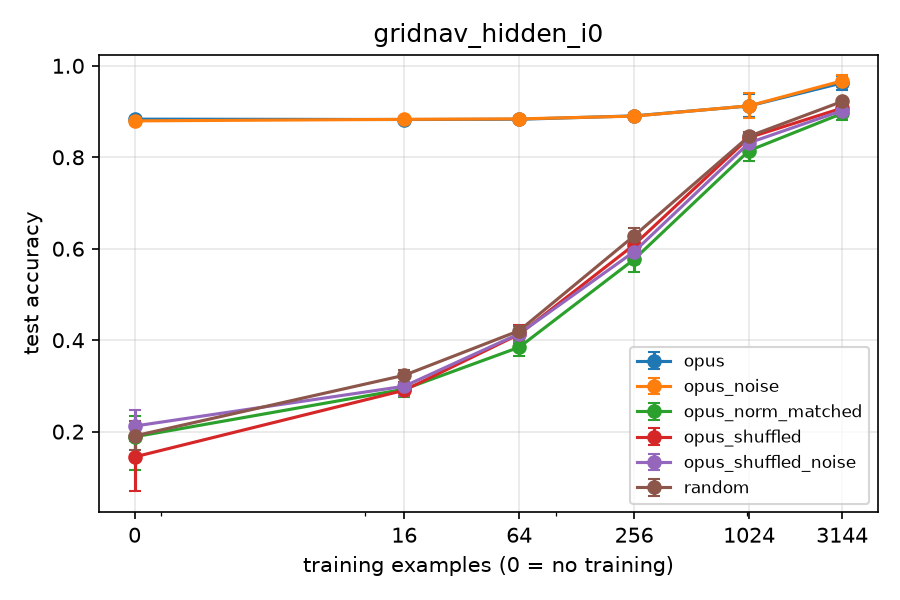
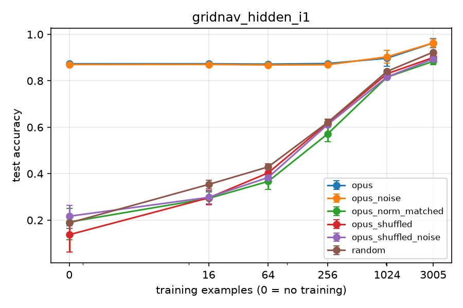
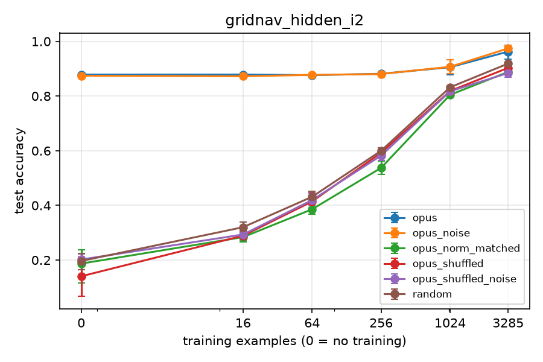
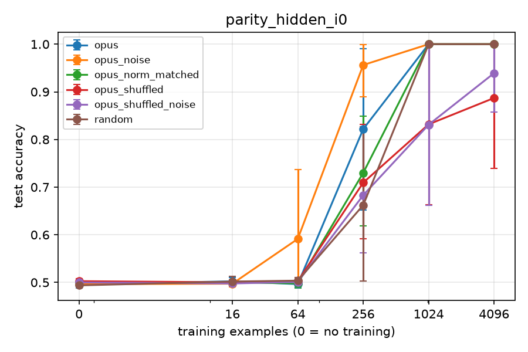
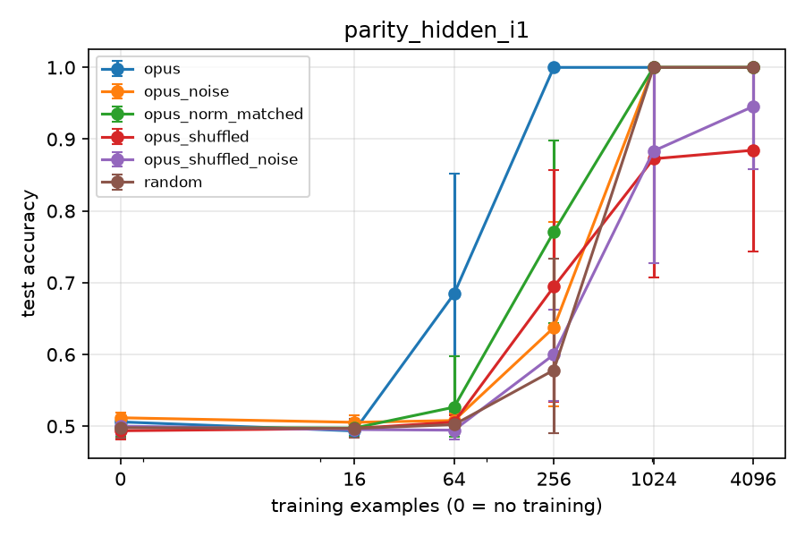
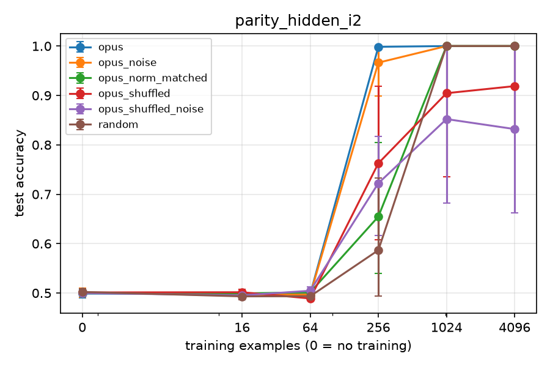
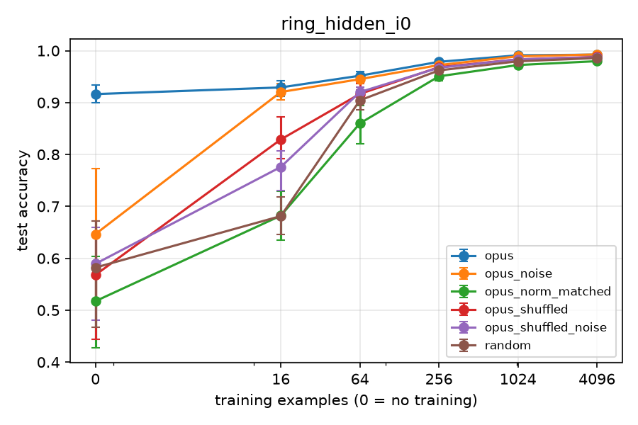
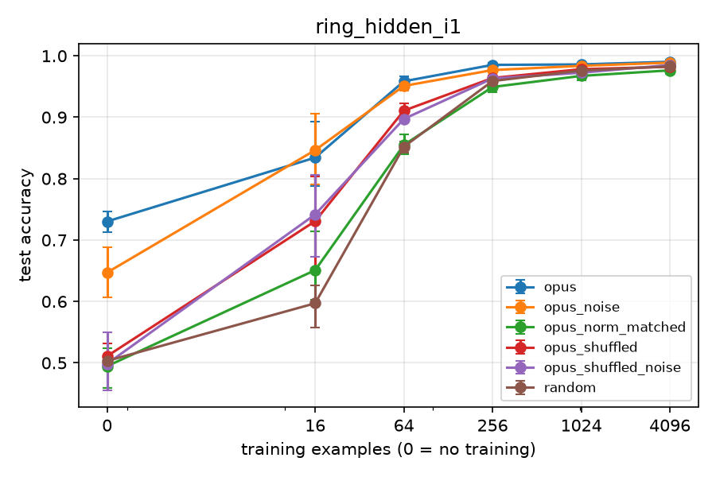
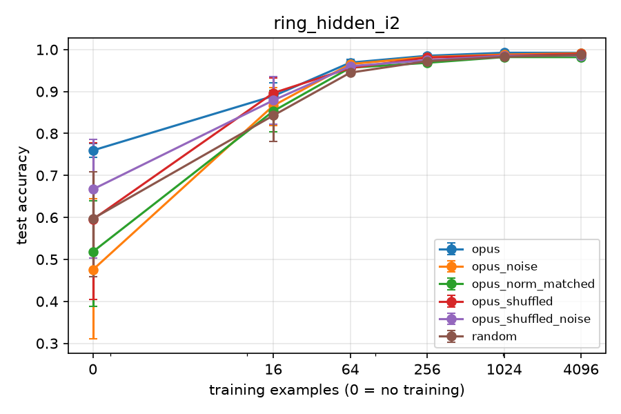

# Results: phase2_v1

Data multiplier = how many times more data the random-init arm needs to match this arm's mean test accuracy. Budget 0 rows give the init's worth in examples instead. Rules (margin 0.02): '≈ chance' = within the margin of a majority-class predictor, so no multiplier; 'both at ceiling' = this arm and random both have mean test accuracy >= 0.995 at this budget, so no multiplier; `>=` / `<=` = outside random's measured range; 'random flat here' = the random curve does not clearly rise between the bracketing budgets, so only the interval is known; otherwise a log-linear point estimate with its 95% bootstrap CI over seeds and the bracket it was interpolated in.

## Family: gridnav_hidden

**Primary (B.8):** written − random test accuracy, paired by seed, 95% bootstrap CI over seeds.

| instance | arm | budget | seeds | written − random (95% CI) |
|---|---|---|---|---|
| gridnav_hidden_i0 | opus | 16 | 6 | +0.559 (+0.547 to +0.574) |
| gridnav_hidden_i0 | opus | 64 | 6 | +0.462 (+0.453 to +0.472) |
| gridnav_hidden_i1 | opus | 16 | 6 | +0.519 (+0.501 to +0.539) |
| gridnav_hidden_i1 | opus | 64 | 6 | +0.443 (+0.428 to +0.453) |
| gridnav_hidden_i2 | opus | 16 | 6 | +0.558 (+0.539 to +0.575) |
| gridnav_hidden_i2 | opus | 64 | 6 | +0.445 (+0.422 to +0.461) |

Instances with CI lower bound > 0 (opus): 16: 3 of 3, 64: 3 of 3.

**Samples to target (B.8):** budget at which the arm's mean test accuracy reaches the target (log-linear on its own running-max curve; 0 = met zero-shot; `<= 16` = first met between 0 and 16; `>` = not met by the largest budget).

| instance | target | arm | random n | arm n | random / arm |
|---|---|---|---|---|---|
| gridnav_hidden_i0 | 0.95 | opus | > 3144 | 2377 | >= 1.32x |
| gridnav_hidden_i0 | 0.99 | opus | > 3144 | > 3144 | undetermined (both censored) |
| gridnav_hidden_i1 | 0.95 | opus | > 3005 | 2431 | >= 1.24x |
| gridnav_hidden_i1 | 0.99 | opus | > 3005 | > 3005 | undetermined (both censored) |
| gridnav_hidden_i2 | 0.95 | opus | > 3285 | 2542 | >= 1.29x |
| gridnav_hidden_i2 | 0.99 | opus | > 3285 | > 3285 | undetermined (both censored) |

**Zero-shot test accuracy per sample and instance:**

| arm | sample | gridnav_hidden_i0 | gridnav_hidden_i1 | gridnav_hidden_i2 |
|---|---|---|---|---|
| opus | sample_00 | 0.883 | 0.873 | 0.879 |
| opus | sample_01 | 0.883 | 0.873 | 0.879 |
| opus | sample_02 | 0.883 | 0.873 | 0.879 |
| opus | mean | 0.883 | 0.873 | 0.879 |

**Controls pooled over instances (B.8 secondary 4):** A − B paired by seed; 95% CI from a bootstrap stratified by instance (seeds resampled within each instance, instances weighted equally). Only budgets measured in every instance are pooled.

| test | A | B | budget | instances | pairs | A − B (95% CI) |
|---|---|---|---|---|---|---|
| structure | opus_noise | opus_shuffled_noise | 0 | 3 | 18 | +0.664 (+0.646 to +0.684) |
| structure | opus_noise | opus_shuffled_noise | 16 | 3 | 18 | +0.578 (+0.564 to +0.592) |
| structure | opus_noise | opus_shuffled_noise | 64 | 3 | 18 | +0.471 (+0.460 to +0.481) |
| structure | opus_noise | opus_shuffled_noise | 256 | 3 | 18 | +0.284 (+0.274 to +0.296) |
| structure | opus_noise | opus_shuffled_noise | 1024 | 3 | 18 | +0.086 (+0.069 to +0.104) |
| scale | opus | opus_norm_matched | 0 | 3 | 18 | +0.689 (+0.654 to +0.731) |
| scale | opus | opus_norm_matched | 16 | 3 | 18 | +0.588 (+0.576 to +0.600) |
| scale | opus | opus_norm_matched | 64 | 3 | 18 | +0.498 (+0.482 to +0.513) |
| scale | opus | opus_norm_matched | 256 | 3 | 18 | +0.320 (+0.303 to +0.338) |
| scale | opus | opus_norm_matched | 1024 | 3 | 18 | +0.093 (+0.076 to +0.111) |

H10 check (claude-opus-5-5__claudecode-noexec__finetune_family, structure CI lower bound > 0 at 16, 64 and 256): 16: yes, 64: yes, 256: yes.

## Family: parity_hidden

**H9 canary (parity_hidden_i0):** written zero-shot opus mean 0.496, sample_00 0.509, sample_01 0.495, sample_02 0.484. within 0.5 ± 0.04 (mean and every sample).
**H9 canary (parity_hidden_i1):** written zero-shot opus mean 0.506, sample_00 0.507, sample_01 0.511, sample_02 0.500. within 0.5 ± 0.04 (mean and every sample).
**H9 canary (parity_hidden_i2):** written zero-shot opus mean 0.499, sample_00 0.504, sample_01 0.508, sample_02 0.483. within 0.5 ± 0.04 (mean and every sample).

**Primary (B.8):** written − random test accuracy, paired by seed, 95% bootstrap CI over seeds.

| instance | arm | budget | seeds | written − random (95% CI) |
|---|---|---|---|---|
| parity_hidden_i0 | opus | 16 | 6 | +0.000 (-0.012 to +0.010) |
| parity_hidden_i0 | opus | 64 | 6 | -0.007 (-0.012 to -0.004) |
| parity_hidden_i1 | opus | 16 | 6 | -0.004 (-0.014 to +0.005) |
| parity_hidden_i1 | opus | 64 | 6 | +0.182 (+0.020 to +0.345) |
| parity_hidden_i2 | opus | 16 | 6 | +0.005 (-0.002 to +0.013) |
| parity_hidden_i2 | opus | 64 | 6 | +0.004 (-0.004 to +0.014) |

Instances with CI lower bound > 0 (opus): 16: 0 of 3, 64: 1 of 3.

**Samples to target (B.8):** budget at which the arm's mean test accuracy reaches the target (log-linear on its own running-max curve; 0 = met zero-shot; `<= 16` = first met between 0 and 16; `>` = not met by the largest budget).

| instance | target | arm | random n | arm n | random / arm |
|---|---|---|---|---|---|
| parity_hidden_i0 | 0.95 | opus | 834 | 694 | 1.20x |
| parity_hidden_i0 | 0.99 | opus | 983 | 947 | 1.04x |
| parity_hidden_i1 | 0.95 | opus | 869 | 206 | 4.23x |
| parity_hidden_i1 | 0.99 | opus | 991 | 245 | 4.04x |
| parity_hidden_i2 | 0.95 | opus | 866 | 224 | 3.87x |
| parity_hidden_i2 | 0.99 | opus | 990 | 250 | 3.96x |

**Zero-shot test accuracy per sample and instance:**

| arm | sample | parity_hidden_i0 | parity_hidden_i1 | parity_hidden_i2 |
|---|---|---|---|---|
| opus | sample_00 | 0.509 | 0.507 | 0.504 |
| opus | sample_01 | 0.495 | 0.511 | 0.508 |
| opus | sample_02 | 0.484 | 0.500 | 0.483 |
| opus | mean | 0.496 | 0.506 | 0.499 |

**Controls pooled over instances (B.8 secondary 4):** A − B paired by seed; 95% CI from a bootstrap stratified by instance (seeds resampled within each instance, instances weighted equally). Only budgets measured in every instance are pooled.

| test | A | B | budget | instances | pairs | A − B (95% CI) |
|---|---|---|---|---|---|---|
| structure | opus_noise | opus_shuffled_noise | 0 | 3 | 18 | +0.003 (-0.004 to +0.011) |
| structure | opus_noise | opus_shuffled_noise | 16 | 3 | 18 | +0.004 (-0.002 to +0.009) |
| structure | opus_noise | opus_shuffled_noise | 64 | 3 | 18 | +0.032 (-0.000 to +0.081) |
| structure | opus_noise | opus_shuffled_noise | 256 | 3 | 18 | +0.185 (+0.100 to +0.274) |
| structure | opus_noise | opus_shuffled_noise | 1024 | 3 | 18 | +0.144 (+0.049 to +0.243) |
| structure | opus_noise | opus_shuffled_noise | 4096 | 3 | 18 | +0.094 (+0.025 to +0.169) |
| scale | opus | opus_norm_matched | 0 | 3 | 18 | +0.001 (-0.005 to +0.007) |
| scale | opus | opus_norm_matched | 16 | 3 | 18 | -0.001 (-0.007 to +0.005) |
| scale | opus | opus_norm_matched | 64 | 3 | 18 | +0.051 (-0.010 to +0.111) |
| scale | opus | opus_norm_matched | 256 | 3 | 18 | +0.222 (+0.112 to +0.316) |
| scale | opus | opus_norm_matched | 1024 | 3 | 18 | +0.000 (+0.000 to +0.000) |
| scale | opus | opus_norm_matched | 4096 | 3 | 18 | +0.000 (+0.000 to +0.000) |

H10 check (claude-opus-5-5__claudecode-noexec__finetune_family, structure CI lower bound > 0 at 16, 64 and 256): 16: no, 64: no, 256: yes.

## Family: ring_hidden

**Primary (B.8):** written − random test accuracy, paired by seed, 95% bootstrap CI over seeds.

| instance | arm | budget | seeds | written − random (95% CI) |
|---|---|---|---|---|
| ring_hidden_i0 | opus | 16 | 6 | +0.248 (+0.215 to +0.279) |
| ring_hidden_i0 | opus | 64 | 6 | +0.047 (+0.030 to +0.063) |
| ring_hidden_i1 | opus | 16 | 6 | +0.237 (+0.208 to +0.280) |
| ring_hidden_i1 | opus | 64 | 6 | +0.107 (+0.095 to +0.118) |
| ring_hidden_i2 | opus | 16 | 6 | +0.046 (-0.011 to +0.122) |
| ring_hidden_i2 | opus | 64 | 6 | +0.024 (+0.012 to +0.037) |

Instances with CI lower bound > 0 (opus): 16: 2 of 3, 64: 3 of 3.

**Samples to target (B.8):** budget at which the arm's mean test accuracy reaches the target (log-linear on its own running-max curve; 0 = met zero-shot; `<= 16` = first met between 0 and 16; `>` = not met by the largest budget).

| instance | target | arm | random n | arm n | random / arm |
|---|---|---|---|---|---|
| ring_hidden_i0 | 0.95 | opus | 192 | 57 | 3.34x |
| ring_hidden_i0 | 0.99 | opus | > 4096 | 909 | >= 4.51x |
| ring_hidden_i1 | 0.95 | opus | 228 | 58 | 3.91x |
| ring_hidden_i1 | 0.99 | opus | > 4096 | 3682 | >= 1.11x |
| ring_hidden_i2 | 0.95 | opus | 82 | 46 | 1.79x |
| ring_hidden_i2 | 0.99 | opus | > 4096 | 645 | >= 6.35x |

**Zero-shot test accuracy per sample and instance:**

| arm | sample | ring_hidden_i0 | ring_hidden_i1 | ring_hidden_i2 |
|---|---|---|---|---|
| opus | sample_00 | 0.887 | 0.702 | 0.788 |
| opus | sample_01 | 0.923 | 0.738 | 0.752 |
| opus | sample_02 | 0.938 | 0.752 | 0.738 |
| opus | mean | 0.916 | 0.730 | 0.760 |

**Controls pooled over instances (B.8 secondary 4):** A − B paired by seed; 95% CI from a bootstrap stratified by instance (seeds resampled within each instance, instances weighted equally). Only budgets measured in every instance are pooled.

| test | A | B | budget | instances | pairs | A − B (95% CI) |
|---|---|---|---|---|---|---|
| structure | opus_noise | opus_shuffled_noise | 0 | 3 | 18 | +0.005 (-0.098 to +0.138) |
| structure | opus_noise | opus_shuffled_noise | 16 | 3 | 18 | +0.079 (+0.054 to +0.107) |
| structure | opus_noise | opus_shuffled_noise | 64 | 3 | 18 | +0.028 (+0.021 to +0.036) |
| structure | opus_noise | opus_shuffled_noise | 256 | 3 | 18 | +0.009 (+0.004 to +0.013) |
| structure | opus_noise | opus_shuffled_noise | 1024 | 3 | 18 | +0.007 (+0.004 to +0.010) |
| structure | opus_noise | opus_shuffled_noise | 4096 | 3 | 18 | +0.005 (+0.003 to +0.007) |
| scale | opus | opus_norm_matched | 0 | 3 | 18 | +0.292 (+0.238 to +0.349) |
| scale | opus | opus_norm_matched | 16 | 3 | 18 | +0.155 (+0.120 to +0.192) |
| scale | opus | opus_norm_matched | 64 | 3 | 18 | +0.069 (+0.054 to +0.087) |
| scale | opus | opus_norm_matched | 256 | 3 | 18 | +0.027 (+0.023 to +0.031) |
| scale | opus | opus_norm_matched | 1024 | 3 | 18 | +0.016 (+0.013 to +0.019) |
| scale | opus | opus_norm_matched | 4096 | 3 | 18 | +0.012 (+0.009 to +0.016) |

H10 check (claude-opus-5-5__claudecode-noexec__finetune_family, structure CI lower bound > 0 at 16, 64 and 256): 16: yes, 64: yes, 256: yes.

## gridnav_hidden_i0

Majority-class baseline: 0.284

| arm | budget | seeds | test acc (95% CI) | step-0 selected | data multiplier |
|---|---|---|---|---|---|
| opus | 0 | 6 | 0.883 (0.883-0.883) | 100% | worth 1777 ex. (CI 1649-1884; bracket 1024 ex.-3144 ex.) |
| opus | 16 | 6 | 0.883 (0.881-0.883) | 50% | 109.78x (CI 101.61-116.63; bracket 64.00x-196.50x) |
| opus | 64 | 6 | 0.883 (0.882-0.884) | 33% | 27.67x (CI 25.70-29.40; bracket 16.00x-49.12x) |
| opus | 256 | 6 | 0.890 (0.884-0.897) | 0% | 7.71x (CI 6.81-8.73; bracket 4.00x-12.28x) |
| opus | 1024 | 6 | 0.912 (0.887-0.938) | 0% | 2.66x (CI 1.81-3.07; bracket 1.00x-3.07x) |
| opus | 3144 | 6 | 0.963 (0.946-0.978) | 0% | >= 1.00x |
| opus_noise | 0 | 6 | 0.880 (0.874-0.883) | 100% | worth 1680 ex. (CI 1477-1837; bracket 1024 ex.-3144 ex.) |
| opus_noise | 16 | 6 | 0.883 (0.882-0.883) | 33% | 110.32x (CI 102.23-117.11; bracket 64.00x-196.50x) |
| opus_noise | 64 | 6 | 0.884 (0.883-0.885) | 17% | 27.99x (CI 25.96-29.76; bracket 16.00x-49.12x) |
| opus_noise | 256 | 6 | 0.890 (0.883-0.897) | 0% | 7.66x (CI 6.75-8.73; bracket 4.00x-12.28x) |
| opus_noise | 1024 | 6 | 0.912 (0.885-0.940) | 0% | 2.67x (CI 1.76-3.07; bracket 1.00x-3.07x) |
| opus_noise | 3144 | 6 | 0.967 (0.953-0.979) | 0% | >= 1.00x |
| opus_norm_matched | 0 | 6 | 0.189 (0.117-0.234) | 100% | ≈ chance (no multiplier) |
| opus_norm_matched | 16 | 6 | 0.293 (0.275-0.306) | 0% | ≈ chance (no multiplier) |
| opus_norm_matched | 64 | 6 | 0.385 (0.366-0.401) | 0% | 0.60x (CI 0.45-0.78; bracket 0.25x-1.00x) |
| opus_norm_matched | 256 | 6 | 0.577 (0.550-0.606) | 0% | 0.71x (CI 0.58-0.88; bracket 0.25x-1.00x) |
| opus_norm_matched | 1024 | 6 | 0.815 (0.791-0.833) | 0% | 0.82x (CI 0.70-0.93; bracket 0.25x-1.00x) |
| opus_norm_matched | 3144 | 6 | 0.896 (0.882-0.909) | 0% | 0.68x (CI 0.55-0.83; bracket 0.33x-1.00x) |
| opus_shuffled | 0 | 6 | 0.145 (0.069-0.213) | 100% | ≈ chance (no multiplier) |
| opus_shuffled | 16 | 6 | 0.290 (0.283-0.298) | 0% | ≈ chance (no multiplier) |
| opus_shuffled | 64 | 6 | 0.413 (0.394-0.433) | 0% | 0.90x (CI 0.66-1.10; bracket 0.25x-1.00x) |
| opus_shuffled | 256 | 6 | 0.609 (0.597-0.620) | 0% | 0.88x (CI 0.78-1.01; bracket 0.25x-1.00x) |
| opus_shuffled | 1024 | 6 | 0.843 (0.837-0.849) | 0% | 0.98x (CI 0.92-1.10; bracket 0.25x-1.00x) |
| opus_shuffled | 3144 | 6 | 0.907 (0.901-0.916) | 0% | 0.81x (CI 0.72-0.92; bracket 0.33x-1.00x) |
| opus_shuffled_noise | 0 | 6 | 0.212 (0.179-0.248) | 100% | ≈ chance (no multiplier) |
| opus_shuffled_noise | 16 | 6 | 0.299 (0.278-0.326) | 0% | ≈ chance (no multiplier) |
| opus_shuffled_noise | 64 | 6 | 0.414 (0.397-0.430) | 0% | 0.91x (CI 0.70-1.08; bracket 0.25x-1.00x) |
| opus_shuffled_noise | 256 | 6 | 0.594 (0.566-0.612) | 0% | 0.79x (CI 0.65-0.95; bracket 0.25x-1.00x) |
| opus_shuffled_noise | 1024 | 6 | 0.832 (0.826-0.839) | 0% | 0.91x (CI 0.85-0.97; bracket 0.25x-1.00x) |
| opus_shuffled_noise | 3144 | 6 | 0.902 (0.897-0.907) | 0% | 0.75x (CI 0.68-0.81; bracket 0.33x-1.00x) |
| random | 0 | 6 | 0.191 (0.159-0.222) | 100% | - |
| random | 16 | 6 | 0.323 (0.309-0.335) | 0% | - |
| random | 64 | 6 | 0.421 (0.411-0.430) | 0% | - |
| random | 256 | 6 | 0.628 (0.610-0.645) | 0% | - |
| random | 1024 | 6 | 0.846 (0.838-0.855) | 0% | - |
| random | 3144 | 6 | 0.922 (0.919-0.925) | 0% | - |

**Per sample** (written arms; mean test accuracy, then mean test loss, over each sample's seeds; n=0 = zero-shot. Loss shows margin differences that accuracy hides). Samples get different seeds, so fine-tuned differences between samples also include seed (training-set) variation:

| arm | sample | seeds | acc n=0 | acc n=16 | acc n=64 | acc n=256 | acc n=1024 | acc n=3144 | loss n=0 | loss n=16 | loss n=64 | loss n=256 | loss n=1024 | loss n=3144 |
|---|---|---|---|---|---|---|---|---|---|---|---|---|---|---|
| opus | sample_00 | 0 3 | 0.883 | 0.883 | 0.883 | 0.885 | 0.886 | 0.972 | 2.82 | 2.79 | 2.56 | 2.46 | 2.39 | 0.0951 |
| opus | sample_01 | 1 4 | 0.883 | 0.883 | 0.883 | 0.903 | 0.962 | 0.983 | 0.5 | 0.594 | 0.465 | 0.308 | 0.129 | 0.0568 |
| opus | sample_02 | 2 5 | 0.883 | 0.882 | 0.883 | 0.883 | 0.889 | 0.933 | 2.93 | 2.84 | 2.9 | 2.77 | 2.56 | 0.271 |

**Controls** (test-accuracy difference A - B, paired by seed, 95% bootstrap CI; with few seeds the CI is rough):

| test | A | B | budget | seeds | A - B (95% CI) |
|---|---|---|---|---|---|
| structure | opus_noise | opus_shuffled_noise | 0 | 6 | +0.667 (+0.634 to +0.697) |
| structure | opus_noise | opus_shuffled_noise | 16 | 6 | +0.584 (+0.557 to +0.605) |
| structure | opus_noise | opus_shuffled_noise | 64 | 6 | +0.470 (+0.453 to +0.488) |
| structure | opus_noise | opus_shuffled_noise | 256 | 6 | +0.296 (+0.275 to +0.323) |
| structure | opus_noise | opus_shuffled_noise | 1024 | 6 | +0.081 (+0.048 to +0.115) |
| structure | opus_noise | opus_shuffled_noise | 3144 | 6 | +0.065 (+0.055 to +0.073) |
| scale | opus | opus_norm_matched | 0 | 6 | +0.695 (+0.649 to +0.766) |
| scale | opus | opus_norm_matched | 16 | 6 | +0.590 (+0.577 to +0.608) |
| scale | opus | opus_norm_matched | 64 | 6 | +0.499 (+0.481 to +0.518) |
| scale | opus | opus_norm_matched | 256 | 6 | +0.314 (+0.282 to +0.343) |
| scale | opus | opus_norm_matched | 1024 | 6 | +0.098 (+0.065 to +0.132) |
| scale | opus | opus_norm_matched | 3144 | 6 | +0.067 (+0.053 to +0.086) |
| structure (secondary) | opus | opus_shuffled | 0 | 6 | +0.739 (+0.670 to +0.814) |
| structure (secondary) | opus | opus_shuffled | 16 | 6 | +0.592 (+0.585 to +0.599) |
| structure (secondary) | opus | opus_shuffled | 64 | 6 | +0.470 (+0.450 to +0.490) |
| structure (secondary) | opus | opus_shuffled | 256 | 6 | +0.282 (+0.268 to +0.297) |
| structure (secondary) | opus | opus_shuffled | 1024 | 6 | +0.069 (+0.043 to +0.097) |
| structure (secondary) | opus | opus_shuffled | 3144 | 6 | +0.055 (+0.038 to +0.073) |

## gridnav_hidden_i1

Majority-class baseline: 0.309

| arm | budget | seeds | test acc (95% CI) | step-0 selected | data multiplier |
|---|---|---|---|---|---|
| opus | 0 | 6 | 0.873 (0.873-0.873) | 100% | worth 1566 ex. (CI 1484-1641; bracket 1024 ex.-3005 ex.) |
| opus | 16 | 6 | 0.873 (0.872-0.874) | 33% | 97.88x (CI 92.56-102.59; bracket 64.00x-187.81x) |
| opus | 64 | 6 | 0.872 (0.870-0.874) | 0% | 23.98x (CI 22.53-25.34; bracket 16.00x-46.95x) |
| opus | 256 | 6 | 0.874 (0.871-0.879) | 0% | 6.20x (CI 5.74-6.65; bracket 4.00x-11.74x) |
| opus | 1024 | 6 | 0.897 (0.863-0.932) | 0% | 2.09x (CI 1.35-2.93; bracket 1.00x-2.93x) |
| opus | 3005 | 6 | 0.963 (0.943-0.982) | 0% | >= 1.00x |
| opus_noise | 0 | 6 | 0.870 (0.867-0.873) | 100% | worth 1506 ex. (CI 1394-1603; bracket 1024 ex.-3005 ex.) |
| opus_noise | 16 | 6 | 0.871 (0.866-0.874) | 17% | 94.41x (CI 86.54-101.24; bracket 64.00x-187.81x) |
| opus_noise | 64 | 6 | 0.868 (0.864-0.873) | 0% | 22.93x (CI 21.09-24.58; bracket 16.00x-46.95x) |
| opus_noise | 256 | 6 | 0.869 (0.864-0.873) | 0% | 5.79x (CI 5.29-6.23; bracket 4.00x-11.74x) |
| opus_noise | 1024 | 6 | 0.903 (0.876-0.931) | 0% | 2.26x (CI 1.58-2.93; bracket 1.00x-2.93x) |
| opus_noise | 3005 | 6 | 0.963 (0.945-0.979) | 0% | >= 1.00x |
| opus_norm_matched | 0 | 6 | 0.192 (0.116-0.251) | 100% | ≈ chance (no multiplier) |
| opus_norm_matched | 16 | 6 | 0.294 (0.268-0.321) | 0% | ≈ chance (no multiplier) |
| opus_norm_matched | 64 | 6 | 0.367 (0.332-0.404) | 0% | 0.32x (CI 0.25-0.66; bracket 0.25x-1.00x) |
| opus_norm_matched | 256 | 6 | 0.571 (0.539-0.599) | 0% | 0.70x (CI 0.54-0.89; bracket 0.25x-1.00x) |
| opus_norm_matched | 1024 | 6 | 0.816 (0.810-0.824) | 0% | 0.86x (CI 0.81-0.91; bracket 0.25x-1.00x) |
| opus_norm_matched | 3005 | 6 | 0.884 (0.870-0.898) | 0% | 0.60x (CI 0.49-0.73; bracket 0.34x-1.00x) |
| opus_shuffled | 0 | 6 | 0.137 (0.062-0.208) | 100% | ≈ chance (no multiplier) |
| opus_shuffled | 16 | 6 | 0.296 (0.267-0.327) | 0% | ≈ chance (no multiplier) |
| opus_shuffled | 64 | 6 | 0.404 (0.379-0.428) | 0% | 0.62x (CI 0.36-1.01; bracket 0.25x-1.00x) |
| opus_shuffled | 256 | 6 | 0.618 (0.602-0.632) | 0% | 0.98x (CI 0.84-1.12; bracket 0.25x-1.00x) |
| opus_shuffled | 1024 | 6 | 0.831 (0.824-0.836) | 0% | 0.94x (CI 0.89-0.99; bracket 0.25x-1.00x) |
| opus_shuffled | 3005 | 6 | 0.900 (0.890-0.911) | 0% | 0.74x (CI 0.64-0.85; bracket 0.34x-1.00x) |
| opus_shuffled_noise | 0 | 6 | 0.217 (0.176-0.265) | 100% | ≈ chance (no multiplier) |
| opus_shuffled_noise | 16 | 6 | 0.298 (0.270-0.325) | 0% | ≈ chance (no multiplier) |
| opus_shuffled_noise | 64 | 6 | 0.384 (0.366-0.401) | 0% | 0.43x (CI 0.28-0.63; bracket 0.25x-1.00x) |
| opus_shuffled_noise | 256 | 6 | 0.611 (0.607-0.616) | 0% | 0.94x (CI 0.84-1.05; bracket 0.25x-1.00x) |
| opus_shuffled_noise | 1024 | 6 | 0.816 (0.811-0.822) | 0% | 0.86x (CI 0.81-0.90; bracket 0.25x-1.00x) |
| opus_shuffled_noise | 3005 | 6 | 0.895 (0.883-0.905) | 0% | 0.69x (CI 0.59-0.79; bracket 0.34x-1.00x) |
| random | 0 | 6 | 0.188 (0.164-0.212) | 100% | - |
| random | 16 | 6 | 0.354 (0.335-0.372) | 0% | - |
| random | 64 | 6 | 0.429 (0.420-0.442) | 0% | - |
| random | 256 | 6 | 0.621 (0.605-0.636) | 0% | - |
| random | 1024 | 6 | 0.841 (0.835-0.847) | 0% | - |
| random | 3005 | 6 | 0.923 (0.921-0.926) | 0% | - |

**Per sample** (written arms; mean test accuracy, then mean test loss, over each sample's seeds; n=0 = zero-shot. Loss shows margin differences that accuracy hides). Samples get different seeds, so fine-tuned differences between samples also include seed (training-set) variation:

| arm | sample | seeds | acc n=0 | acc n=16 | acc n=64 | acc n=256 | acc n=1024 | acc n=3005 | loss n=0 | loss n=16 | loss n=64 | loss n=256 | loss n=1024 | loss n=3005 |
|---|---|---|---|---|---|---|---|---|---|---|---|---|---|---|
| opus | sample_00 | 0 3 | 0.873 | 0.875 | 0.874 | 0.874 | 0.882 | 0.970 | 3.18 | 3.11 | 3 | 2.85 | 0.444 | 0.103 |
| opus | sample_01 | 1 4 | 0.873 | 0.872 | 0.871 | 0.877 | 0.959 | 0.988 | 0.532 | 0.531 | 0.483 | 0.352 | 0.136 | 0.0474 |
| opus | sample_02 | 2 5 | 0.873 | 0.873 | 0.870 | 0.872 | 0.851 | 0.931 | 3.49 | 3.48 | 3.33 | 3.07 | 0.646 | 0.249 |

**Controls** (test-accuracy difference A - B, paired by seed, 95% bootstrap CI; with few seeds the CI is rough):

| test | A | B | budget | seeds | A - B (95% CI) |
|---|---|---|---|---|---|
| structure | opus_noise | opus_shuffled_noise | 0 | 6 | +0.653 (+0.606 to +0.695) |
| structure | opus_noise | opus_shuffled_noise | 16 | 6 | +0.572 (+0.545 to +0.602) |
| structure | opus_noise | opus_shuffled_noise | 64 | 6 | +0.485 (+0.470 to +0.499) |
| structure | opus_noise | opus_shuffled_noise | 256 | 6 | +0.258 (+0.249 to +0.263) |
| structure | opus_noise | opus_shuffled_noise | 1024 | 6 | +0.087 (+0.060 to +0.117) |
| structure | opus_noise | opus_shuffled_noise | 3005 | 6 | +0.069 (+0.054 to +0.087) |
| scale | opus | opus_norm_matched | 0 | 6 | +0.681 (+0.622 to +0.757) |
| scale | opus | opus_norm_matched | 16 | 6 | +0.580 (+0.553 to +0.607) |
| scale | opus | opus_norm_matched | 64 | 6 | +0.505 (+0.466 to +0.541) |
| scale | opus | opus_norm_matched | 256 | 6 | +0.303 (+0.273 to +0.335) |
| scale | opus | opus_norm_matched | 1024 | 6 | +0.082 (+0.051 to +0.114) |
| scale | opus | opus_norm_matched | 3005 | 6 | +0.079 (+0.054 to +0.097) |
| structure (secondary) | opus | opus_shuffled | 0 | 6 | +0.736 (+0.665 to +0.812) |
| structure (secondary) | opus | opus_shuffled | 16 | 6 | +0.577 (+0.548 to +0.605) |
| structure (secondary) | opus | opus_shuffled | 64 | 6 | +0.468 (+0.443 to +0.495) |
| structure (secondary) | opus | opus_shuffled | 256 | 6 | +0.256 (+0.243 to +0.270) |
| structure (secondary) | opus | opus_shuffled | 1024 | 6 | +0.067 (+0.036 to +0.100) |
| structure (secondary) | opus | opus_shuffled | 3005 | 6 | +0.063 (+0.043 to +0.083) |

## gridnav_hidden_i2

Majority-class baseline: 0.274

| arm | budget | seeds | test acc (95% CI) | step-0 selected | data multiplier |
|---|---|---|---|---|---|
| opus | 0 | 6 | 0.879 (0.879-0.879) | 100% | worth 1918 ex. (CI 1823-2003; bracket 1024 ex.-3285 ex.) |
| opus | 16 | 6 | 0.879 (0.879-0.879) | 67% | 119.89x (CI 113.96-125.20; bracket 64.00x-205.31x) |
| opus | 64 | 6 | 0.876 (0.872-0.880) | 0% | 29.05x (CI 27.02-30.94; bracket 16.00x-51.33x) |
| opus | 256 | 6 | 0.881 (0.877-0.887) | 0% | 7.78x (CI 7.17-8.50; bracket 4.00x-12.83x) |
| opus | 1024 | 6 | 0.905 (0.879-0.933) | 0% | 2.69x (CI 1.87-3.21; bracket 1.00x-3.21x) |
| opus | 3285 | 6 | 0.963 (0.934-0.985) | 0% | >= 1.00x |
| opus_noise | 0 | 6 | 0.874 (0.868-0.879) | 100% | worth 1807 ex. (CI 1628-1961; bracket 1024 ex.-3285 ex.) |
| opus_noise | 16 | 6 | 0.872 (0.866-0.877) | 50% | 110.10x (CI 99.94-119.28; bracket 64.00x-205.31x) |
| opus_noise | 64 | 6 | 0.877 (0.874-0.880) | 0% | 29.44x (CI 27.53-31.25; bracket 16.00x-51.33x) |
| opus_noise | 256 | 6 | 0.881 (0.877-0.885) | 0% | 7.69x (CI 7.15-8.31; bracket 4.00x-12.83x) |
| opus_noise | 1024 | 6 | 0.907 (0.881-0.933) | 0% | 2.74x (CI 1.96-3.21; bracket 1.00x-3.21x) |
| opus_noise | 3285 | 6 | 0.974 (0.964-0.984) | 0% | >= 1.00x |
| opus_norm_matched | 0 | 6 | 0.187 (0.116-0.237) | 100% | ≈ chance (no multiplier) |
| opus_norm_matched | 16 | 6 | 0.284 (0.267-0.300) | 0% | ≈ chance (no multiplier) |
| opus_norm_matched | 64 | 6 | 0.386 (0.368-0.404) | 0% | 0.57x (CI 0.42-0.75; bracket 0.25x-1.00x) |
| opus_norm_matched | 256 | 6 | 0.537 (0.514-0.561) | 0% | 0.60x (CI 0.48-0.74; bracket 0.25x-1.00x) |
| opus_norm_matched | 1024 | 6 | 0.804 (0.793-0.816) | 0% | 0.85x (CI 0.79-0.91; bracket 0.25x-1.00x) |
| opus_norm_matched | 3285 | 6 | 0.888 (0.878-0.901) | 0% | 0.66x (CI 0.58-0.79; bracket 0.31x-1.00x) |
| opus_shuffled | 0 | 6 | 0.141 (0.067-0.210) | 100% | ≈ chance (no multiplier) |
| opus_shuffled | 16 | 6 | 0.289 (0.275-0.308) | 0% | ≈ chance (no multiplier) |
| opus_shuffled | 64 | 6 | 0.414 (0.383-0.447) | 0% | 0.81x (CI 0.53-1.17; bracket 0.25x-1.00x) |
| opus_shuffled | 256 | 6 | 0.592 (0.575-0.604) | 0% | 0.94x (CI 0.81-1.05; bracket 0.25x-1.00x) |
| opus_shuffled | 1024 | 6 | 0.818 (0.810-0.826) | 0% | 0.92x (CI 0.87-0.97; bracket 0.25x-1.00x) |
| opus_shuffled | 3285 | 6 | 0.903 (0.892-0.913) | 0% | 0.81x (CI 0.69-0.94; bracket 0.31x-1.00x) |
| opus_shuffled_noise | 0 | 6 | 0.202 (0.184-0.222) | 100% | ≈ chance (no multiplier) |
| opus_shuffled_noise | 16 | 6 | 0.294 (0.271-0.320) | 0% | ≈ chance (no multiplier) |
| opus_shuffled_noise | 64 | 6 | 0.419 (0.401-0.444) | 0% | 0.86x (CI 0.63-1.13; bracket 0.25x-1.00x) |
| opus_shuffled_noise | 256 | 6 | 0.582 (0.564-0.598) | 0% | 0.86x (CI 0.73-1.00; bracket 0.25x-1.00x) |
| opus_shuffled_noise | 1024 | 6 | 0.817 (0.813-0.821) | 0% | 0.92x (CI 0.88-0.95; bracket 0.25x-1.00x) |
| opus_shuffled_noise | 3285 | 6 | 0.884 (0.870-0.894) | 0% | 0.63x (CI 0.52-0.72; bracket 0.31x-1.00x) |
| random | 0 | 6 | 0.197 (0.164-0.225) | 100% | - |
| random | 16 | 6 | 0.320 (0.304-0.340) | 0% | - |
| random | 64 | 6 | 0.431 (0.417-0.451) | 0% | - |
| random | 256 | 6 | 0.600 (0.592-0.610) | 0% | - |
| random | 1024 | 6 | 0.832 (0.827-0.838) | 0% | - |
| random | 3285 | 6 | 0.919 (0.915-0.923) | 0% | - |

**Per sample** (written arms; mean test accuracy, then mean test loss, over each sample's seeds; n=0 = zero-shot. Loss shows margin differences that accuracy hides). Samples get different seeds, so fine-tuned differences between samples also include seed (training-set) variation:

| arm | sample | seeds | acc n=0 | acc n=16 | acc n=64 | acc n=256 | acc n=1024 | acc n=3285 | loss n=0 | loss n=16 | loss n=64 | loss n=256 | loss n=1024 | loss n=3285 |
|---|---|---|---|---|---|---|---|---|---|---|---|---|---|---|
| opus | sample_00 | 0 3 | 0.879 | 0.879 | 0.877 | 0.878 | 0.884 | 0.977 | 3.39 | 3.34 | 3.21 | 3.06 | 0.424 | 0.0879 |
| opus | sample_01 | 1 4 | 0.879 | 0.879 | 0.876 | 0.891 | 0.957 | 0.990 | 0.52 | 0.512 | 0.442 | 0.358 | 0.128 | 0.0401 |
| opus | sample_02 | 2 5 | 0.879 | 0.879 | 0.876 | 0.876 | 0.875 | 0.920 | 3.72 | 3.72 | 3.4 | 3.41 | 1.86 | 0.229 |

**Controls** (test-accuracy difference A - B, paired by seed, 95% bootstrap CI; with few seeds the CI is rough):

| test | A | B | budget | seeds | A - B (95% CI) |
|---|---|---|---|---|---|
| structure | opus_noise | opus_shuffled_noise | 0 | 6 | +0.672 (+0.654 to +0.688) |
| structure | opus_noise | opus_shuffled_noise | 16 | 6 | +0.579 (+0.555 to +0.600) |
| structure | opus_noise | opus_shuffled_noise | 64 | 6 | +0.458 (+0.434 to +0.477) |
| structure | opus_noise | opus_shuffled_noise | 256 | 6 | +0.298 (+0.280 to +0.320) |
| structure | opus_noise | opus_shuffled_noise | 1024 | 6 | +0.090 (+0.065 to +0.116) |
| structure | opus_noise | opus_shuffled_noise | 3285 | 6 | +0.090 (+0.071 to +0.113) |
| scale | opus | opus_norm_matched | 0 | 6 | +0.692 (+0.642 to +0.763) |
| scale | opus | opus_norm_matched | 16 | 6 | +0.595 (+0.578 to +0.612) |
| scale | opus | opus_norm_matched | 64 | 6 | +0.491 (+0.472 to +0.509) |
| scale | opus | opus_norm_matched | 256 | 6 | +0.344 (+0.318 to +0.370) |
| scale | opus | opus_norm_matched | 1024 | 6 | +0.101 (+0.077 to +0.131) |
| scale | opus | opus_norm_matched | 3285 | 6 | +0.074 (+0.034 to +0.103) |
| structure (secondary) | opus | opus_shuffled | 0 | 6 | +0.738 (+0.668 to +0.812) |
| structure (secondary) | opus | opus_shuffled | 16 | 6 | +0.590 (+0.570 to +0.604) |
| structure (secondary) | opus | opus_shuffled | 64 | 6 | +0.462 (+0.427 to +0.495) |
| structure (secondary) | opus | opus_shuffled | 256 | 6 | +0.289 (+0.275 to +0.309) |
| structure (secondary) | opus | opus_shuffled | 1024 | 6 | +0.087 (+0.061 to +0.118) |
| structure (secondary) | opus | opus_shuffled | 3285 | 6 | +0.060 (+0.023 to +0.093) |

## parity_hidden_i0

**H9 canary (parity_hidden_i0):** written zero-shot opus mean 0.496, sample_00 0.509, sample_01 0.495, sample_02 0.484. within 0.5 ± 0.04 (mean and every sample).

Majority-class baseline: 0.508

| arm | budget | seeds | test acc (95% CI) | step-0 selected | data multiplier |
|---|---|---|---|---|---|
| opus | 0 | 6 | 0.496 (0.488-0.504) | 100% | ≈ chance (no multiplier) |
| opus | 16 | 6 | 0.502 (0.496-0.510) | 0% | ≈ chance (no multiplier) |
| opus | 64 | 6 | 0.496 (0.490-0.503) | 0% | ≈ chance (no multiplier) |
| opus | 256 | 6 | 0.822 (0.651-0.990) | 0% | 1.93x (CI 0.60-3.87; bracket 1.00x-4.00x) |
| opus | 1024 | 6 | 1.000 (1.000-1.000) | 0% | both at ceiling |
| opus | 4096 | 6 | 1.000 (1.000-1.000) | 0% | both at ceiling |
| opus_noise | 0 | 6 | 0.496 (0.492-0.501) | 100% | ≈ chance (no multiplier) |
| opus_noise | 16 | 6 | 0.497 (0.490-0.504) | 0% | ≈ chance (no multiplier) |
| opus_noise | 64 | 6 | 0.591 (0.501-0.737) | 0% | ≈ chance (no multiplier) |
| opus_noise | 256 | 6 | 0.956 (0.889-0.999) | 0% | 3.34x (CI 2.20-3.99; bracket 1.00x-4.00x) |
| opus_noise | 1024 | 6 | 1.000 (1.000-1.000) | 0% | both at ceiling |
| opus_noise | 4096 | 6 | 1.000 (1.000-1.000) | 0% | both at ceiling |
| opus_norm_matched | 0 | 6 | 0.500 (0.495-0.505) | 100% | ≈ chance (no multiplier) |
| opus_norm_matched | 16 | 6 | 0.500 (0.494-0.505) | 0% | ≈ chance (no multiplier) |
| opus_norm_matched | 64 | 6 | 0.498 (0.488-0.507) | 0% | ≈ chance (no multiplier) |
| opus_norm_matched | 256 | 6 | 0.730 (0.618-0.849) | 0% | 1.32x (CI 0.49-2.36; bracket 1.00x-4.00x) |
| opus_norm_matched | 1024 | 6 | 1.000 (1.000-1.000) | 0% | both at ceiling |
| opus_norm_matched | 4096 | 6 | 1.000 (1.000-1.000) | 0% | both at ceiling |
| opus_shuffled | 0 | 6 | 0.503 (0.497-0.508) | 100% | ≈ chance (no multiplier) |
| opus_shuffled | 16 | 6 | 0.500 (0.495-0.506) | 0% | ≈ chance (no multiplier) |
| opus_shuffled | 64 | 6 | 0.503 (0.496-0.510) | 0% | ≈ chance (no multiplier) |
| opus_shuffled | 256 | 6 | 0.709 (0.592-0.831) | 0% | 1.21x (CI 0.43-2.15; bracket 1.00x-4.00x) |
| opus_shuffled | 1024 | 6 | 0.832 (0.662-1.000) | 0% | 0.50x (CI 0.15-1.00; bracket 0.25x-1.00x) |
| opus_shuffled | 4096 | 6 | 0.887 (0.740-1.000) | 0% | 0.16x (CI 0.06-0.25; bracket 0.06x-0.25x) |
| opus_shuffled_noise | 0 | 6 | 0.500 (0.495-0.505) | 100% | ≈ chance (no multiplier) |
| opus_shuffled_noise | 16 | 6 | 0.498 (0.492-0.504) | 17% | ≈ chance (no multiplier) |
| opus_shuffled_noise | 64 | 6 | 0.501 (0.492-0.509) | 0% | ≈ chance (no multiplier) |
| opus_shuffled_noise | 256 | 6 | 0.683 (0.562-0.821) | 0% | 1.09x (CI 0.37-2.10; bracket 1.00x-4.00x) |
| opus_shuffled_noise | 1024 | 6 | 0.831 (0.661-1.000) | 0% | 0.50x (CI 0.15-1.00; bracket 0.25x-1.00x) |
| opus_shuffled_noise | 4096 | 6 | 0.939 (0.857-1.000) | 0% | 0.19x (CI 0.11-0.25; bracket 0.06x-0.25x) |
| random | 0 | 6 | 0.494 (0.492-0.496) | 100% | - |
| random | 16 | 6 | 0.502 (0.491-0.513) | 17% | - |
| random | 64 | 6 | 0.504 (0.497-0.511) | 0% | - |
| random | 256 | 6 | 0.662 (0.503-0.826) | 0% | - |
| random | 1024 | 6 | 1.000 (1.000-1.000) | 0% | - |
| random | 4096 | 6 | 1.000 (1.000-1.000) | 0% | - |

**Per sample** (written arms; mean test accuracy, then mean test loss, over each sample's seeds; n=0 = zero-shot. Loss shows margin differences that accuracy hides). Samples get different seeds, so fine-tuned differences between samples also include seed (training-set) variation:

| arm | sample | seeds | acc n=0 | acc n=16 | acc n=64 | acc n=256 | acc n=1024 | acc n=4096 | loss n=0 | loss n=16 | loss n=64 | loss n=256 | loss n=1024 | loss n=4096 |
|---|---|---|---|---|---|---|---|---|---|---|---|---|---|---|
| opus | sample_00 | 0 3 | 0.509 | 0.510 | 0.497 | 1.000 | 1.000 | 1.000 | 0.855 | 5.4 | 3.43 | 0.00102 | 0.000263 | 3.75e-05 |
| opus | sample_01 | 1 4 | 0.495 | 0.497 | 0.494 | 0.721 | 1.000 | 1.000 | 0.695 | 1.23 | 0.795 | 0.653 | 0.000489 | 0.00124 |
| opus | sample_02 | 2 5 | 0.484 | 0.499 | 0.498 | 0.744 | 1.000 | 1.000 | 0.765 | 1.24 | 1.92 | 0.383 | 0.000143 | 0.000134 |

**Controls** (test-accuracy difference A - B, paired by seed, 95% bootstrap CI; with few seeds the CI is rough):

| test | A | B | budget | seeds | A - B (95% CI) |
|---|---|---|---|---|---|
| structure | opus_noise | opus_shuffled_noise | 0 | 6 | -0.004 (-0.011 to +0.004) |
| structure | opus_noise | opus_shuffled_noise | 16 | 6 | -0.000 (-0.004 to +0.003) |
| structure | opus_noise | opus_shuffled_noise | 64 | 6 | +0.090 (+0.000 to +0.238) |
| structure | opus_noise | opus_shuffled_noise | 256 | 6 | +0.273 (+0.142 to +0.398) |
| structure | opus_noise | opus_shuffled_noise | 1024 | 6 | +0.169 (+0.000 to +0.339) |
| structure | opus_noise | opus_shuffled_noise | 4096 | 6 | +0.061 (+0.000 to +0.143) |
| scale | opus | opus_norm_matched | 0 | 6 | -0.004 (-0.013 to +0.002) |
| scale | opus | opus_norm_matched | 16 | 6 | +0.002 (-0.007 to +0.011) |
| scale | opus | opus_norm_matched | 64 | 6 | -0.001 (-0.007 to +0.004) |
| scale | opus | opus_norm_matched | 256 | 6 | +0.092 (-0.151 to +0.309) |
| scale | opus | opus_norm_matched | 1024 | 6 | +0.000 (+0.000 to +0.000) |
| scale | opus | opus_norm_matched | 4096 | 6 | +0.000 (+0.000 to +0.000) |
| structure (secondary) | opus | opus_shuffled | 0 | 6 | -0.007 (-0.016 to +0.005) |
| structure (secondary) | opus | opus_shuffled | 16 | 6 | +0.002 (-0.004 to +0.013) |
| structure (secondary) | opus | opus_shuffled | 64 | 6 | -0.006 (-0.017 to +0.003) |
| structure (secondary) | opus | opus_shuffled | 256 | 6 | +0.112 (-0.139 to +0.311) |
| structure (secondary) | opus | opus_shuffled | 1024 | 6 | +0.168 (+0.000 to +0.337) |
| structure (secondary) | opus | opus_shuffled | 4096 | 6 | +0.113 (+0.000 to +0.260) |

## parity_hidden_i1

**H9 canary (parity_hidden_i1):** written zero-shot opus mean 0.506, sample_00 0.507, sample_01 0.511, sample_02 0.500. within 0.5 ± 0.04 (mean and every sample).

Majority-class baseline: 0.519

| arm | budget | seeds | test acc (95% CI) | step-0 selected | data multiplier |
|---|---|---|---|---|---|
| opus | 0 | 6 | 0.506 (0.502-0.510) | 100% | ≈ chance (no multiplier) |
| opus | 16 | 6 | 0.493 (0.486-0.501) | 0% | ≈ chance (no multiplier) |
| opus | 64 | 6 | 0.684 (0.521-0.852) | 0% | ≈ chance (no multiplier) |
| opus | 256 | 6 | 1.000 (1.000-1.000) | 0% | 4.00x (CI 4.00-4.00; bracket 1.00x-4.00x) |
| opus | 1024 | 6 | 1.000 (1.000-1.000) | 0% | both at ceiling |
| opus | 4096 | 6 | 1.000 (1.000-1.000) | 0% | both at ceiling |
| opus_noise | 0 | 6 | 0.512 (0.503-0.519) | 100% | ≈ chance (no multiplier) |
| opus_noise | 16 | 6 | 0.505 (0.496-0.515) | 17% | ≈ chance (no multiplier) |
| opus_noise | 64 | 6 | 0.508 (0.499-0.518) | 17% | ≈ chance (no multiplier) |
| opus_noise | 256 | 6 | 0.637 (0.528-0.784) | 0% | ≈ chance (no multiplier) |
| opus_noise | 1024 | 6 | 1.000 (1.000-1.000) | 0% | both at ceiling |
| opus_noise | 4096 | 6 | 1.000 (1.000-1.000) | 0% | both at ceiling |
| opus_norm_matched | 0 | 6 | 0.498 (0.486-0.511) | 100% | ≈ chance (no multiplier) |
| opus_norm_matched | 16 | 6 | 0.497 (0.486-0.510) | 0% | ≈ chance (no multiplier) |
| opus_norm_matched | 64 | 6 | 0.526 (0.485-0.597) | 0% | ≈ chance (no multiplier) |
| opus_norm_matched | 256 | 6 | 0.771 (0.643-0.898) | 0% | 1.88x (CI 0.88-2.94; bracket 1.00x-4.00x) |
| opus_norm_matched | 1024 | 6 | 1.000 (1.000-1.000) | 0% | both at ceiling |
| opus_norm_matched | 4096 | 6 | 1.000 (1.000-1.000) | 0% | both at ceiling |
| opus_shuffled | 0 | 6 | 0.494 (0.481-0.506) | 100% | ≈ chance (no multiplier) |
| opus_shuffled | 16 | 6 | 0.497 (0.490-0.503) | 0% | ≈ chance (no multiplier) |
| opus_shuffled | 64 | 6 | 0.506 (0.495-0.516) | 0% | ≈ chance (no multiplier) |
| opus_shuffled | 256 | 6 | 0.694 (0.534-0.856) | 0% | 1.46x (CI 0.40-2.65; bracket 1.00x-4.00x) |
| opus_shuffled | 1024 | 6 | 0.873 (0.708-1.000) | 0% | 0.66x (CI 0.34-1.00; bracket 0.25x-1.00x) |
| opus_shuffled | 4096 | 6 | 0.885 (0.743-1.000) | 0% | 0.17x (CI 0.10-0.25; bracket 0.06x-0.25x) |
| opus_shuffled_noise | 0 | 6 | 0.500 (0.487-0.513) | 100% | ≈ chance (no multiplier) |
| opus_shuffled_noise | 16 | 6 | 0.495 (0.484-0.508) | 17% | ≈ chance (no multiplier) |
| opus_shuffled_noise | 64 | 6 | 0.494 (0.482-0.508) | 17% | ≈ chance (no multiplier) |
| opus_shuffled_noise | 256 | 6 | 0.600 (0.535-0.662) | 0% | 1.07x (CI 0.37-1.48; bracket 1.00x-4.00x) |
| opus_shuffled_noise | 1024 | 6 | 0.884 (0.727-1.000) | 0% | 0.68x (CI 0.37-1.00; bracket 0.25x-1.00x) |
| opus_shuffled_noise | 4096 | 6 | 0.946 (0.858-1.000) | 0% | 0.21x (CI 0.15-0.25; bracket 0.06x-0.25x) |
| random | 0 | 6 | 0.498 (0.484-0.512) | 100% | - |
| random | 16 | 6 | 0.497 (0.484-0.510) | 17% | - |
| random | 64 | 6 | 0.502 (0.496-0.509) | 0% | - |
| random | 256 | 6 | 0.578 (0.490-0.733) | 17% | - |
| random | 1024 | 6 | 1.000 (1.000-1.000) | 0% | - |
| random | 4096 | 6 | 1.000 (1.000-1.000) | 0% | - |

**Per sample** (written arms; mean test accuracy, then mean test loss, over each sample's seeds; n=0 = zero-shot. Loss shows margin differences that accuracy hides). Samples get different seeds, so fine-tuned differences between samples also include seed (training-set) variation:

| arm | sample | seeds | acc n=0 | acc n=16 | acc n=64 | acc n=256 | acc n=1024 | acc n=4096 | loss n=0 | loss n=16 | loss n=64 | loss n=256 | loss n=1024 | loss n=4096 |
|---|---|---|---|---|---|---|---|---|---|---|---|---|---|---|
| opus | sample_00 | 0 3 | 0.507 | 0.503 | 0.542 | 1.000 | 1.000 | 1.000 | 0.837 | 2.66 | 1.16 | 0.00348 | 2.69e-05 | 1.24e-05 |
| opus | sample_01 | 1 4 | 0.511 | 0.495 | 1.000 | 1.000 | 1.000 | 1.000 | 0.693 | 0.708 | 0.107 | 0.00102 | 0.000349 | 0.000407 |
| opus | sample_02 | 2 5 | 0.500 | 0.482 | 0.511 | 1.000 | 1.000 | 1.000 | 0.748 | 3.43 | 2.35 | 0.0138 | 0.000176 | 0.000147 |

**Controls** (test-accuracy difference A - B, paired by seed, 95% bootstrap CI; with few seeds the CI is rough):

| test | A | B | budget | seeds | A - B (95% CI) |
|---|---|---|---|---|---|
| structure | opus_noise | opus_shuffled_noise | 0 | 6 | +0.012 (-0.008 to +0.031) |
| structure | opus_noise | opus_shuffled_noise | 16 | 6 | +0.010 (-0.004 to +0.026) |
| structure | opus_noise | opus_shuffled_noise | 64 | 6 | +0.013 (-0.003 to +0.032) |
| structure | opus_noise | opus_shuffled_noise | 256 | 6 | +0.038 (-0.091 to +0.235) |
| structure | opus_noise | opus_shuffled_noise | 1024 | 6 | +0.117 (+0.000 to +0.273) |
| structure | opus_noise | opus_shuffled_noise | 4096 | 6 | +0.054 (+0.000 to +0.142) |
| scale | opus | opus_norm_matched | 0 | 6 | +0.008 (-0.004 to +0.019) |
| scale | opus | opus_norm_matched | 16 | 6 | -0.004 (-0.015 to +0.007) |
| scale | opus | opus_norm_matched | 64 | 6 | +0.158 (-0.018 to +0.338) |
| scale | opus | opus_norm_matched | 256 | 6 | +0.229 (+0.102 to +0.356) |
| scale | opus | opus_norm_matched | 1024 | 6 | +0.000 (+0.000 to +0.000) |
| scale | opus | opus_norm_matched | 4096 | 6 | +0.000 (+0.000 to +0.000) |
| structure (secondary) | opus | opus_shuffled | 0 | 6 | +0.012 (-0.004 to +0.028) |
| structure (secondary) | opus | opus_shuffled | 16 | 6 | -0.003 (-0.014 to +0.007) |
| structure (secondary) | opus | opus_shuffled | 64 | 6 | +0.179 (+0.016 to +0.344) |
| structure (secondary) | opus | opus_shuffled | 256 | 6 | +0.306 (+0.143 to +0.466) |
| structure (secondary) | opus | opus_shuffled | 1024 | 6 | +0.127 (+0.000 to +0.293) |
| structure (secondary) | opus | opus_shuffled | 4096 | 6 | +0.115 (+0.000 to +0.257) |

## parity_hidden_i2

**H9 canary (parity_hidden_i2):** written zero-shot opus mean 0.499, sample_00 0.504, sample_01 0.508, sample_02 0.483. within 0.5 ± 0.04 (mean and every sample).

Majority-class baseline: 0.503

| arm | budget | seeds | test acc (95% CI) | step-0 selected | data multiplier |
|---|---|---|---|---|---|
| opus | 0 | 6 | 0.499 (0.490-0.507) | 100% | ≈ chance (no multiplier) |
| opus | 16 | 6 | 0.498 (0.493-0.504) | 0% | ≈ chance (no multiplier) |
| opus | 64 | 6 | 0.498 (0.492-0.504) | 0% | ≈ chance (no multiplier) |
| opus | 256 | 6 | 0.998 (0.997-1.000) | 0% | 3.98x (CI 3.95-4.00; bracket 1.00x-4.00x) |
| opus | 1024 | 6 | 1.000 (1.000-1.000) | 0% | both at ceiling |
| opus | 4096 | 6 | 1.000 (1.000-1.000) | 0% | both at ceiling |
| opus_noise | 0 | 6 | 0.501 (0.492-0.510) | 100% | ≈ chance (no multiplier) |
| opus_noise | 16 | 6 | 0.496 (0.492-0.501) | 17% | ≈ chance (no multiplier) |
| opus_noise | 64 | 6 | 0.497 (0.488-0.507) | 0% | ≈ chance (no multiplier) |
| opus_noise | 256 | 6 | 0.966 (0.899-1.000) | 0% | 3.57x (CI 2.70-4.00; bracket 1.00x-4.00x) |
| opus_noise | 1024 | 6 | 1.000 (1.000-1.000) | 0% | both at ceiling |
| opus_noise | 4096 | 6 | 1.000 (1.000-1.000) | 0% | both at ceiling |
| opus_norm_matched | 0 | 6 | 0.499 (0.496-0.502) | 100% | ≈ chance (no multiplier) |
| opus_norm_matched | 16 | 6 | 0.499 (0.492-0.508) | 0% | ≈ chance (no multiplier) |
| opus_norm_matched | 64 | 6 | 0.501 (0.495-0.508) | 0% | ≈ chance (no multiplier) |
| opus_norm_matched | 256 | 6 | 0.655 (0.540-0.805) | 0% | 1.26x (CI 0.39-2.15; bracket 1.00x-4.00x) |
| opus_norm_matched | 1024 | 6 | 1.000 (1.000-1.000) | 0% | both at ceiling |
| opus_norm_matched | 4096 | 6 | 1.000 (1.000-1.000) | 0% | both at ceiling |
| opus_shuffled | 0 | 6 | 0.501 (0.499-0.503) | 100% | ≈ chance (no multiplier) |
| opus_shuffled | 16 | 6 | 0.502 (0.496-0.508) | 0% | ≈ chance (no multiplier) |
| opus_shuffled | 64 | 6 | 0.489 (0.485-0.494) | 0% | ≈ chance (no multiplier) |
| opus_shuffled | 256 | 6 | 0.763 (0.607-0.918) | 0% | 1.80x (CI 0.77-3.13; bracket 1.00x-4.00x) |
| opus_shuffled | 1024 | 6 | 0.905 (0.735-1.000) | 0% | 0.73x (CI 0.38-1.00; bracket 0.25x-1.00x) |
| opus_shuffled | 4096 | 6 | 0.919 (0.835-1.000) | 0% | 0.19x (CI 0.13-0.25; bracket 0.06x-0.25x) |
| opus_shuffled_noise | 0 | 6 | 0.500 (0.498-0.502) | 100% | ≈ chance (no multiplier) |
| opus_shuffled_noise | 16 | 6 | 0.495 (0.493-0.499) | 17% | ≈ chance (no multiplier) |
| opus_shuffled_noise | 64 | 6 | 0.505 (0.497-0.513) | 0% | ≈ chance (no multiplier) |
| opus_shuffled_noise | 256 | 6 | 0.722 (0.617-0.817) | 0% | 1.58x (CI 0.77-2.27; bracket 1.00x-4.00x) |
| opus_shuffled_noise | 1024 | 6 | 0.852 (0.682-1.000) | 0% | 0.61x (CI 0.29-1.00; bracket 0.25x-1.00x) |
| opus_shuffled_noise | 4096 | 6 | 0.832 (0.663-1.000) | 0% | 0.14x (CI 0.06-0.25; bracket 0.06x-0.25x) |
| random | 0 | 6 | 0.502 (0.496-0.509) | 100% | - |
| random | 16 | 6 | 0.493 (0.487-0.499) | 17% | - |
| random | 64 | 6 | 0.493 (0.489-0.498) | 17% | - |
| random | 256 | 6 | 0.587 (0.494-0.733) | 0% | - |
| random | 1024 | 6 | 1.000 (1.000-1.000) | 0% | - |
| random | 4096 | 6 | 1.000 (1.000-1.000) | 0% | - |

**Per sample** (written arms; mean test accuracy, then mean test loss, over each sample's seeds; n=0 = zero-shot. Loss shows margin differences that accuracy hides). Samples get different seeds, so fine-tuned differences between samples also include seed (training-set) variation:

| arm | sample | seeds | acc n=0 | acc n=16 | acc n=64 | acc n=256 | acc n=1024 | acc n=4096 | loss n=0 | loss n=16 | loss n=64 | loss n=256 | loss n=1024 | loss n=4096 |
|---|---|---|---|---|---|---|---|---|---|---|---|---|---|---|
| opus | sample_00 | 0 3 | 0.504 | 0.499 | 0.495 | 0.997 | 1.000 | 1.000 | 0.85 | 2.13 | 2.21 | 0.0177 | 0.000626 | 0.000265 |
| opus | sample_01 | 1 4 | 0.508 | 0.497 | 0.500 | 1.000 | 1.000 | 1.000 | 0.693 | 0.713 | 0.988 | 0.00172 | 0.000369 | 0.000201 |
| opus | sample_02 | 2 5 | 0.483 | 0.499 | 0.498 | 0.998 | 1.000 | 1.000 | 0.757 | 2.5 | 1.57 | 0.0361 | 0.000186 | 0.000167 |

**Controls** (test-accuracy difference A - B, paired by seed, 95% bootstrap CI; with few seeds the CI is rough):

| test | A | B | budget | seeds | A - B (95% CI) |
|---|---|---|---|---|---|
| structure | opus_noise | opus_shuffled_noise | 0 | 6 | +0.001 (-0.006 to +0.009) |
| structure | opus_noise | opus_shuffled_noise | 16 | 6 | +0.001 (-0.005 to +0.007) |
| structure | opus_noise | opus_shuffled_noise | 64 | 6 | -0.008 (-0.021 to +0.009) |
| structure | opus_noise | opus_shuffled_noise | 256 | 6 | +0.244 (+0.097 to +0.379) |
| structure | opus_noise | opus_shuffled_noise | 1024 | 6 | +0.148 (+0.000 to +0.318) |
| structure | opus_noise | opus_shuffled_noise | 4096 | 6 | +0.168 (+0.000 to +0.337) |
| scale | opus | opus_norm_matched | 0 | 6 | -0.001 (-0.010 to +0.008) |
| scale | opus | opus_norm_matched | 16 | 6 | -0.001 (-0.009 to +0.009) |
| scale | opus | opus_norm_matched | 64 | 6 | -0.003 (-0.007 to -0.001) |
| scale | opus | opus_norm_matched | 256 | 6 | +0.344 (+0.185 to +0.460) |
| scale | opus | opus_norm_matched | 1024 | 6 | +0.000 (+0.000 to +0.000) |
| scale | opus | opus_norm_matched | 4096 | 6 | +0.000 (+0.000 to +0.000) |
| structure (secondary) | opus | opus_shuffled | 0 | 6 | -0.002 (-0.011 to +0.005) |
| structure (secondary) | opus | opus_shuffled | 16 | 6 | -0.003 (-0.010 to +0.003) |
| structure (secondary) | opus | opus_shuffled | 64 | 6 | +0.009 (+0.001 to +0.017) |
| structure (secondary) | opus | opus_shuffled | 256 | 6 | +0.236 (+0.079 to +0.392) |
| structure (secondary) | opus | opus_shuffled | 1024 | 6 | +0.095 (+0.000 to +0.265) |
| structure (secondary) | opus | opus_shuffled | 4096 | 6 | +0.081 (+0.000 to +0.165) |

## ring_hidden_i0

Majority-class baseline: 0.671

| arm | budget | seeds | test acc (95% CI) | step-0 selected | data multiplier |
|---|---|---|---|---|---|
| opus | 0 | 6 | 0.916 (0.900-0.933) | 100% | worth 85 ex. (CI 59-132; bracket 64 ex.-256 ex.) |
| opus | 16 | 6 | 0.929 (0.912-0.942) | 33% | 7.27x (CI 3.98-10.50; bracket 4.00x-16.00x) |
| opus | 64 | 6 | 0.952 (0.943-0.959) | 0% | 3.13x (CI 2.35-3.96; bracket 1.00x-4.00x) |
| opus | 256 | 6 | 0.978 (0.974-0.983) | 0% | 1.00-4.00x (random flat here) |
| opus | 1024 | 6 | 0.991 (0.988-0.994) | 0% | >= 4.00x |
| opus | 4096 | 6 | 0.992 (0.989-0.995) | 0% | >= 1.00x |
| opus_noise | 0 | 6 | 0.647 (0.520-0.773) | 100% | ≈ chance (no multiplier) |
| opus_noise | 16 | 6 | 0.920 (0.905-0.937) | 0% | 5.88x (CI 3.80-9.10; bracket 4.00x-16.00x) |
| opus_noise | 64 | 6 | 0.945 (0.938-0.953) | 0% | 2.66x (CI 1.94-3.33; bracket 1.00x-4.00x) |
| opus_noise | 256 | 6 | 0.972 (0.967-0.978) | 0% | 1.00-4.00x (random flat here) |
| opus_noise | 1024 | 6 | 0.989 (0.987-0.991) | 0% | >= 4.00x |
| opus_noise | 4096 | 6 | 0.993 (0.991-0.994) | 0% | >= 1.00x |
| opus_norm_matched | 0 | 6 | 0.517 (0.427-0.604) | 100% | ≈ chance (no multiplier) |
| opus_norm_matched | 16 | 6 | 0.682 (0.635-0.730) | 17% | ≈ chance (no multiplier) |
| opus_norm_matched | 64 | 6 | 0.860 (0.820-0.895) | 0% | 0.76x (CI 0.58-0.97; bracket 0.25x-1.00x) |
| opus_norm_matched | 256 | 6 | 0.951 (0.942-0.959) | 0% | 0.76x (CI 0.58-0.95; bracket 0.25x-1.00x) |
| opus_norm_matched | 1024 | 6 | 0.972 (0.970-0.976) | 0% | 0.25-1.00x (random flat here) |
| opus_norm_matched | 4096 | 6 | 0.980 (0.976-0.984) | 0% | 0.25-1.00x (random flat here) |
| opus_shuffled | 0 | 6 | 0.568 (0.443-0.672) | 100% | ≈ chance (no multiplier) |
| opus_shuffled | 16 | 6 | 0.829 (0.792-0.872) | 0% | 2.50x (CI 1.91-3.36; bracket 1.00x-4.00x) |
| opus_shuffled | 64 | 6 | 0.917 (0.901-0.936) | 0% | 1.35x (CI 0.92-2.22; bracket 1.00x-4.00x) |
| opus_shuffled | 256 | 6 | 0.968 (0.961-0.975) | 0% | 1.00-4.00x (random flat here) |
| opus_shuffled | 1024 | 6 | 0.983 (0.980-0.986) | 0% | 1.00-4.00x (random flat here) |
| opus_shuffled | 4096 | 6 | 0.988 (0.986-0.990) | 0% | >= 1.00x |
| opus_shuffled_noise | 0 | 6 | 0.589 (0.480-0.660) | 100% | ≈ chance (no multiplier) |
| opus_shuffled_noise | 16 | 6 | 0.776 (0.730-0.808) | 0% | 1.80x (CI 1.31-2.30; bracket 1.00x-4.00x) |
| opus_shuffled_noise | 64 | 6 | 0.920 (0.910-0.930) | 0% | 1.46x (CI 0.97-2.03; bracket 1.00x-4.00x) |
| opus_shuffled_noise | 256 | 6 | 0.967 (0.961-0.973) | 0% | 1.00-4.00x (random flat here) |
| opus_shuffled_noise | 1024 | 6 | 0.983 (0.981-0.985) | 0% | 1.00-4.00x (random flat here) |
| opus_shuffled_noise | 4096 | 6 | 0.987 (0.986-0.989) | 0% | >= 1.00x |
| random | 0 | 6 | 0.582 (0.468-0.671) | 100% | - |
| random | 16 | 6 | 0.681 (0.646-0.718) | 0% | - |
| random | 64 | 6 | 0.904 (0.885-0.925) | 0% | - |
| random | 256 | 6 | 0.962 (0.957-0.967) | 0% | - |
| random | 1024 | 6 | 0.980 (0.974-0.983) | 0% | - |
| random | 4096 | 6 | 0.986 (0.981-0.989) | 0% | - |

**Per sample** (written arms; mean test accuracy, then mean test loss, over each sample's seeds; n=0 = zero-shot. Loss shows margin differences that accuracy hides). Samples get different seeds, so fine-tuned differences between samples also include seed (training-set) variation:

| arm | sample | seeds | acc n=0 | acc n=16 | acc n=64 | acc n=256 | acc n=1024 | acc n=4096 | loss n=0 | loss n=16 | loss n=64 | loss n=256 | loss n=1024 | loss n=4096 |
|---|---|---|---|---|---|---|---|---|---|---|---|---|---|---|
| opus | sample_00 | 0 3 | 0.887 | 0.915 | 0.940 | 0.971 | 0.987 | 0.994 | 0.422 | 0.327 | 0.199 | 0.088 | 0.029 | 0.0166 |
| opus | sample_01 | 1 4 | 0.923 | 0.935 | 0.962 | 0.980 | 0.993 | 0.989 | 0.181 | 0.147 | 0.0934 | 0.0728 | 0.0586 | 0.0528 |
| opus | sample_02 | 2 5 | 0.938 | 0.937 | 0.953 | 0.985 | 0.993 | 0.994 | 0.184 | 0.2 | 0.13 | 0.0445 | 0.0337 | 0.0303 |

**Controls** (test-accuracy difference A - B, paired by seed, 95% bootstrap CI; with few seeds the CI is rough):

| test | A | B | budget | seeds | A - B (95% CI) |
|---|---|---|---|---|---|
| structure | opus_noise | opus_shuffled_noise | 0 | 6 | +0.057 (-0.139 to +0.291) |
| structure | opus_noise | opus_shuffled_noise | 16 | 6 | +0.144 (+0.100 to +0.202) |
| structure | opus_noise | opus_shuffled_noise | 64 | 6 | +0.025 (+0.018 to +0.033) |
| structure | opus_noise | opus_shuffled_noise | 256 | 6 | +0.005 (-0.001 to +0.012) |
| structure | opus_noise | opus_shuffled_noise | 1024 | 6 | +0.006 (+0.005 to +0.007) |
| structure | opus_noise | opus_shuffled_noise | 4096 | 6 | +0.005 (+0.002 to +0.008) |
| scale | opus | opus_norm_matched | 0 | 6 | +0.399 (+0.314 to +0.497) |
| scale | opus | opus_norm_matched | 16 | 6 | +0.247 (+0.198 to +0.305) |
| scale | opus | opus_norm_matched | 64 | 6 | +0.092 (+0.052 to +0.138) |
| scale | opus | opus_norm_matched | 256 | 6 | +0.028 (+0.023 to +0.033) |
| scale | opus | opus_norm_matched | 1024 | 6 | +0.019 (+0.015 to +0.023) |
| scale | opus | opus_norm_matched | 4096 | 6 | +0.013 (+0.007 to +0.018) |
| structure (secondary) | opus | opus_shuffled | 0 | 6 | +0.348 (+0.245 to +0.457) |
| structure (secondary) | opus | opus_shuffled | 16 | 6 | +0.100 (+0.056 to +0.142) |
| structure (secondary) | opus | opus_shuffled | 64 | 6 | +0.035 (+0.018 to +0.052) |
| structure (secondary) | opus | opus_shuffled | 256 | 6 | +0.010 (+0.004 to +0.016) |
| structure (secondary) | opus | opus_shuffled | 1024 | 6 | +0.008 (+0.003 to +0.013) |
| structure (secondary) | opus | opus_shuffled | 4096 | 6 | +0.004 (+0.002 to +0.007) |

## ring_hidden_i1

Majority-class baseline: 0.501

| arm | budget | seeds | test acc (95% CI) | step-0 selected | data multiplier |
|---|---|---|---|---|---|
| opus | 0 | 6 | 0.730 (0.714-0.747) | 100% | worth 33 ex. (CI 29-37; bracket 16 ex.-64 ex.) |
| opus | 16 | 6 | 0.834 (0.787-0.893) | 17% | 3.63x (CI 2.75-6.54; bracket 1.00x-4.00x) |
| opus | 64 | 6 | 0.958 (0.952-0.966) | 0% | 3.97x (CI 3.58-7.62; bracket 1.00x-4.00x) |
| opus | 256 | 6 | 0.985 (0.982-0.988) | 0% | >= 16.00x |
| opus | 1024 | 6 | 0.986 (0.985-0.988) | 0% | >= 4.00x |
| opus | 4096 | 6 | 0.990 (0.987-0.993) | 0% | >= 1.00x |
| opus_noise | 0 | 6 | 0.647 (0.606-0.688) | 100% | worth 21 ex. (CI 16-27; bracket 16 ex.-64 ex.) |
| opus_noise | 16 | 6 | 0.846 (0.791-0.906) | 0% | 3.88x (CI 2.86-7.96; bracket 1.00x-4.00x) |
| opus_noise | 64 | 6 | 0.951 (0.943-0.962) | 0% | 3.61x (CI 3.20-5.07; bracket 1.00x-4.00x) |
| opus_noise | 256 | 6 | 0.977 (0.973-0.980) | 0% | 4.00-16.00x (random flat here) |
| opus_noise | 1024 | 6 | 0.984 (0.980-0.986) | 0% | >= 4.00x |
| opus_noise | 4096 | 6 | 0.989 (0.988-0.991) | 0% | >= 1.00x |
| opus_norm_matched | 0 | 6 | 0.495 (0.458-0.524) | 100% | ≈ chance (no multiplier) |
| opus_norm_matched | 16 | 6 | 0.651 (0.603-0.714) | 0% | 1.34x (CI 1.00-1.90; bracket 1.00x-4.00x) |
| opus_norm_matched | 64 | 6 | 0.855 (0.840-0.872) | 0% | 1.04x (CI 0.92-1.33; bracket 1.00x-4.00x) |
| opus_norm_matched | 256 | 6 | 0.949 (0.941-0.957) | 0% | 0.88x (CI 0.78-1.00; bracket 0.25x-1.00x) |
| opus_norm_matched | 1024 | 6 | 0.967 (0.961-0.973) | 0% | 0.25-1.00x (random flat here) |
| opus_norm_matched | 4096 | 6 | 0.976 (0.970-0.982) | 0% | 0.25-1.00x (random flat here) |
| opus_shuffled | 0 | 6 | 0.511 (0.500-0.532) | 100% | ≈ chance (no multiplier) |
| opus_shuffled | 16 | 6 | 0.731 (0.653-0.804) | 0% | 2.07x (CI 1.28-3.01; bracket 1.00x-4.00x) |
| opus_shuffled | 64 | 6 | 0.911 (0.898-0.923) | 0% | 2.14x (CI 1.80-2.55; bracket 1.00x-4.00x) |
| opus_shuffled | 256 | 6 | 0.964 (0.960-0.968) | 0% | 1.00-4.00x (random flat here) |
| opus_shuffled | 1024 | 6 | 0.978 (0.973-0.983) | 0% | 1.00-4.00x (random flat here) |
| opus_shuffled | 4096 | 6 | 0.982 (0.978-0.986) | 0% | 0.25-1.00x (random flat here) |
| opus_shuffled_noise | 0 | 6 | 0.498 (0.455-0.550) | 100% | ≈ chance (no multiplier) |
| opus_shuffled_noise | 16 | 6 | 0.742 (0.673-0.806) | 0% | 2.20x (CI 1.44-3.17; bracket 1.00x-4.00x) |
| opus_shuffled_noise | 64 | 6 | 0.897 (0.891-0.906) | 0% | 1.80x (CI 1.60-2.03; bracket 1.00x-4.00x) |
| opus_shuffled_noise | 256 | 6 | 0.963 (0.960-0.966) | 0% | 1.00-4.00x (random flat here) |
| opus_shuffled_noise | 1024 | 6 | 0.973 (0.966-0.977) | 0% | 0.25-1.00x (random flat here) |
| opus_shuffled_noise | 4096 | 6 | 0.985 (0.982-0.988) | 0% | >= 1.00x |
| random | 0 | 6 | 0.503 (0.500-0.508) | 100% | - |
| random | 16 | 6 | 0.597 (0.557-0.626) | 0% | - |
| random | 64 | 6 | 0.852 (0.843-0.860) | 0% | - |
| random | 256 | 6 | 0.959 (0.954-0.963) | 0% | - |
| random | 1024 | 6 | 0.976 (0.974-0.978) | 0% | - |
| random | 4096 | 6 | 0.983 (0.980-0.985) | 0% | - |

**Per sample** (written arms; mean test accuracy, then mean test loss, over each sample's seeds; n=0 = zero-shot. Loss shows margin differences that accuracy hides). Samples get different seeds, so fine-tuned differences between samples also include seed (training-set) variation:

| arm | sample | seeds | acc n=0 | acc n=16 | acc n=64 | acc n=256 | acc n=1024 | acc n=4096 | loss n=0 | loss n=16 | loss n=64 | loss n=256 | loss n=1024 | loss n=4096 |
|---|---|---|---|---|---|---|---|---|---|---|---|---|---|---|
| opus | sample_00 | 0 3 | 0.702 | 0.911 | 0.958 | 0.983 | 0.987 | 0.993 | 1.17 | 0.415 | 0.156 | 0.0461 | 0.0311 | 0.0239 |
| opus | sample_01 | 1 4 | 0.738 | 0.794 | 0.954 | 0.986 | 0.984 | 0.989 | 0.73 | 1.97 | 0.13 | 0.0733 | 0.0653 | 0.0568 |
| opus | sample_02 | 2 5 | 0.752 | 0.797 | 0.964 | 0.987 | 0.987 | 0.990 | 0.897 | 1.01 | 0.0899 | 0.0446 | 0.0428 | 0.0395 |

**Controls** (test-accuracy difference A - B, paired by seed, 95% bootstrap CI; with few seeds the CI is rough):

| test | A | B | budget | seeds | A - B (95% CI) |
|---|---|---|---|---|---|
| structure | opus_noise | opus_shuffled_noise | 0 | 6 | +0.149 (+0.084 to +0.220) |
| structure | opus_noise | opus_shuffled_noise | 16 | 6 | +0.105 (+0.053 to +0.156) |
| structure | opus_noise | opus_shuffled_noise | 64 | 6 | +0.054 (+0.042 to +0.066) |
| structure | opus_noise | opus_shuffled_noise | 256 | 6 | +0.014 (+0.009 to +0.018) |
| structure | opus_noise | opus_shuffled_noise | 1024 | 6 | +0.011 (+0.006 to +0.017) |
| structure | opus_noise | opus_shuffled_noise | 4096 | 6 | +0.004 (+0.001 to +0.006) |
| scale | opus | opus_norm_matched | 0 | 6 | +0.236 (+0.199 to +0.263) |
| scale | opus | opus_norm_matched | 16 | 6 | +0.183 (+0.119 to +0.260) |
| scale | opus | opus_norm_matched | 64 | 6 | +0.104 (+0.084 to +0.122) |
| scale | opus | opus_norm_matched | 256 | 6 | +0.036 (+0.027 to +0.045) |
| scale | opus | opus_norm_matched | 1024 | 6 | +0.019 (+0.012 to +0.027) |
| scale | opus | opus_norm_matched | 4096 | 6 | +0.014 (+0.007 to +0.022) |
| structure (secondary) | opus | opus_shuffled | 0 | 6 | +0.219 (+0.197 to +0.240) |
| structure (secondary) | opus | opus_shuffled | 16 | 6 | +0.104 (+0.061 to +0.148) |
| structure (secondary) | opus | opus_shuffled | 64 | 6 | +0.048 (+0.033 to +0.066) |
| structure (secondary) | opus | opus_shuffled | 256 | 6 | +0.021 (+0.017 to +0.026) |
| structure (secondary) | opus | opus_shuffled | 1024 | 6 | +0.008 (+0.004 to +0.012) |
| structure (secondary) | opus | opus_shuffled | 4096 | 6 | +0.008 (+0.005 to +0.011) |

## ring_hidden_i2

Majority-class baseline: 0.709

| arm | budget | seeds | test acc (95% CI) | step-0 selected | data multiplier |
|---|---|---|---|---|---|
| opus | 0 | 6 | 0.760 (0.743-0.776) | 100% | <= 16 ex. |
| opus | 16 | 6 | 0.889 (0.855-0.921) | 0% | 1.88x (CI 1.00-3.07; bracket 1.00x-4.00x) |
| opus | 64 | 6 | 0.969 (0.961-0.976) | 0% | 3.36x (CI 2.17-7.63; bracket 1.00x-4.00x) |
| opus | 256 | 6 | 0.985 (0.981-0.989) | 0% | 4.00-16.00x (random flat here) |
| opus | 1024 | 6 | 0.992 (0.991-0.994) | 0% | >= 4.00x |
| opus | 4096 | 6 | 0.992 (0.990-0.994) | 0% | >= 1.00x |
| opus_noise | 0 | 6 | 0.475 (0.310-0.644) | 100% | ≈ chance (no multiplier) |
| opus_noise | 16 | 6 | 0.866 (0.818-0.910) | 0% | 1.37x (CI 1.00-2.65; bracket 1.00x-4.00x) |
| opus_noise | 64 | 6 | 0.966 (0.957-0.973) | 0% | 2.83x (CI 1.75-5.54; bracket 1.00x-4.00x) |
| opus_noise | 256 | 6 | 0.982 (0.975-0.987) | 0% | 1.00-4.00x (random flat here) |
| opus_noise | 1024 | 6 | 0.988 (0.986-0.991) | 0% | >= 4.00x |
| opus_noise | 4096 | 6 | 0.991 (0.990-0.992) | 0% | >= 1.00x |
| opus_norm_matched | 0 | 6 | 0.518 (0.389-0.639) | 100% | ≈ chance (no multiplier) |
| opus_norm_matched | 16 | 6 | 0.853 (0.804-0.902) | 0% | 1.15x (CI 1.00-2.49; bracket 1.00x-4.00x) |
| opus_norm_matched | 64 | 6 | 0.957 (0.948-0.964) | 0% | 1.81x (CI 1.05-2.82; bracket 1.00x-4.00x) |
| opus_norm_matched | 256 | 6 | 0.968 (0.965-0.971) | 0% | 0.82x (CI 0.64-1.20; bracket 0.25x-1.00x) |
| opus_norm_matched | 1024 | 6 | 0.982 (0.979-0.986) | 0% | 0.25-1.00x (random flat here) |
| opus_norm_matched | 4096 | 6 | 0.982 (0.977-0.986) | 0% | 0.06-0.25x (random flat here) |
| opus_shuffled | 0 | 6 | 0.595 (0.405-0.777) | 100% | ≈ chance (no multiplier) |
| opus_shuffled | 16 | 6 | 0.896 (0.853-0.933) | 0% | 2.07x (CI 1.00-3.42; bracket 1.00x-4.00x) |
| opus_shuffled | 64 | 6 | 0.956 (0.943-0.966) | 0% | 1.74x (CI 0.96-3.00; bracket 1.00x-4.00x) |
| opus_shuffled | 256 | 6 | 0.981 (0.978-0.984) | 0% | 1.00-4.00x (random flat here) |
| opus_shuffled | 1024 | 6 | 0.986 (0.982-0.990) | 0% | 1.00-4.00x (random flat here) |
| opus_shuffled | 4096 | 6 | 0.990 (0.986-0.992) | 0% | >= 1.00x |
| opus_shuffled_noise | 0 | 6 | 0.667 (0.503-0.787) | 100% | ≈ chance (no multiplier) |
| opus_shuffled_noise | 16 | 6 | 0.879 (0.823-0.935) | 0% | 1.63x (CI 1.00-3.49; bracket 1.00x-4.00x) |
| opus_shuffled_noise | 64 | 6 | 0.960 (0.942-0.973) | 0% | 2.18x (CI 0.96-4.77; bracket 1.00x-4.00x) |
| opus_shuffled_noise | 256 | 6 | 0.975 (0.967-0.982) | 0% | 1.00-4.00x (random flat here) |
| opus_shuffled_noise | 1024 | 6 | 0.985 (0.982-0.988) | 0% | 1.00-4.00x (random flat here) |
| opus_shuffled_noise | 4096 | 6 | 0.986 (0.982-0.989) | 0% | 0.25-1.00x (random flat here) |
| random | 0 | 6 | 0.597 (0.458-0.709) | 100% | - |
| random | 16 | 6 | 0.843 (0.782-0.898) | 0% | - |
| random | 64 | 6 | 0.945 (0.938-0.951) | 0% | - |
| random | 256 | 6 | 0.972 (0.967-0.977) | 0% | - |
| random | 1024 | 6 | 0.983 (0.980-0.986) | 0% | - |
| random | 4096 | 6 | 0.988 (0.985-0.991) | 0% | - |

**Per sample** (written arms; mean test accuracy, then mean test loss, over each sample's seeds; n=0 = zero-shot. Loss shows margin differences that accuracy hides). Samples get different seeds, so fine-tuned differences between samples also include seed (training-set) variation:

| arm | sample | seeds | acc n=0 | acc n=16 | acc n=64 | acc n=256 | acc n=1024 | acc n=4096 | loss n=0 | loss n=16 | loss n=64 | loss n=256 | loss n=1024 | loss n=4096 |
|---|---|---|---|---|---|---|---|---|---|---|---|---|---|---|
| opus | sample_00 | 0 3 | 0.788 | 0.924 | 0.978 | 0.990 | 0.994 | 0.992 | 0.829 | 0.761 | 0.0906 | 0.0299 | 0.023 | 0.0217 |
| opus | sample_01 | 1 4 | 0.752 | 0.861 | 0.964 | 0.983 | 0.990 | 0.993 | 0.7 | 0.373 | 0.0745 | 0.043 | 0.0343 | 0.0321 |
| opus | sample_02 | 2 5 | 0.738 | 0.883 | 0.965 | 0.983 | 0.994 | 0.992 | 0.959 | 0.408 | 0.0955 | 0.038 | 0.0201 | 0.0227 |

**Controls** (test-accuracy difference A - B, paired by seed, 95% bootstrap CI; with few seeds the CI is rough):

| test | A | B | budget | seeds | A - B (95% CI) |
|---|---|---|---|---|---|
| structure | opus_noise | opus_shuffled_noise | 0 | 6 | -0.192 (-0.398 to +0.106) |
| structure | opus_noise | opus_shuffled_noise | 16 | 6 | -0.013 (-0.041 to +0.027) |
| structure | opus_noise | opus_shuffled_noise | 64 | 6 | +0.005 (-0.012 to +0.026) |
| structure | opus_noise | opus_shuffled_noise | 256 | 6 | +0.007 (-0.004 to +0.018) |
| structure | opus_noise | opus_shuffled_noise | 1024 | 6 | +0.003 (-0.001 to +0.008) |
| structure | opus_noise | opus_shuffled_noise | 4096 | 6 | +0.005 (+0.001 to +0.010) |
| scale | opus | opus_norm_matched | 0 | 6 | +0.241 (+0.112 to +0.374) |
| scale | opus | opus_norm_matched | 16 | 6 | +0.036 (-0.021 to +0.094) |
| scale | opus | opus_norm_matched | 64 | 6 | +0.012 (+0.001 to +0.026) |
| scale | opus | opus_norm_matched | 256 | 6 | +0.017 (+0.011 to +0.023) |
| scale | opus | opus_norm_matched | 1024 | 6 | +0.010 (+0.006 to +0.015) |
| scale | opus | opus_norm_matched | 4096 | 6 | +0.010 (+0.008 to +0.013) |
| structure (secondary) | opus | opus_shuffled | 0 | 6 | +0.164 (-0.027 to +0.359) |
| structure (secondary) | opus | opus_shuffled | 16 | 6 | -0.007 (-0.050 to +0.052) |
| structure (secondary) | opus | opus_shuffled | 64 | 6 | +0.013 (+0.000 to +0.031) |
| structure (secondary) | opus | opus_shuffled | 256 | 6 | +0.004 (-0.002 to +0.011) |
| structure (secondary) | opus | opus_shuffled | 1024 | 6 | +0.007 (+0.003 to +0.010) |
| structure (secondary) | opus | opus_shuffled | 4096 | 6 | +0.003 (-0.000 to +0.008) |
